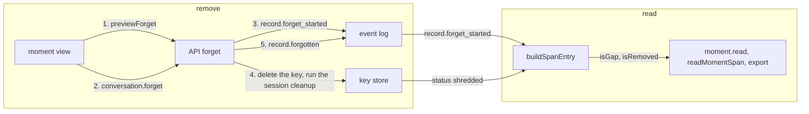

# Redaction of one record of a moment's span

- **Status:** draft. The owner chose every part and its scope.

You remove one whole record of a span, such as a tool result that holds a pasted secret. nixie
deletes the record's key, so its text is gone from the thread and from every moment that holds it.
Each memory item whose evidence quotes the record keeps its text and loses the quote.

The removal is the built `conversation.forget` action, widened in 5 parts that ship apart:

1. The forget takes every record with its own text, tool calls and tool results among them:
   [redaction-tool-records](https://linear.app/zgeoff/issue/GEO-2553).
2. A span record carries a mark, so the moment view tells a removed record from any other gap:
   [removal-mark](https://linear.app/zgeoff/issue/GEO-2554).
3. The moment view offers the removal behind a preview:
   [removal-control](https://linear.app/zgeoff/issue/GEO-2560).
4. nixie removes a record through a tool, under your policy rules:
   [forget-tool](https://linear.app/zgeoff/issue/GEO-2604).
5. The removal purges the quote from each memory item that quotes the record:
   [evidence-purge](https://linear.app/zgeoff/issue/GEO-2605).

A gap is a span record whose text nixie cannot read: a forget deleted its key, a session cleanup
deleted a summary's key, or its key fails to decrypt. A removed record is a gap that a forget made.
Other terms are in the [glossary](../../glossary.md).

## Shape



## Contracts

### Part 1: the forget takes every record with its own text

```ts
conversation.forget({
  clientActionID: '0b9d3c4e-7a21-4f0e-8c55-1e6f2a9d4c03',
  thread: 'conversation',
  sequence: 4190, // a tool_result record that holds a pasted key
});
// → ok
//   or RECORD_NOT_FOUND, as built, for a record outside forgettableKinds: the forget looks the
//   record up among the removable kinds only
//   or ACTION_NOT_FINISHED for a queued action that has not run: cancel it, or wait for it to run
```

```ts
// API contract: conversation.forget's output grows the backup state memory.forget already returns
.output(z.object({ forgottenAt: z.date(), backup: forgetBackupSchema }))
// → { forgottenAt, backup: { state: 'pending' } } until a published backup set drops the old key
```

```ts
// API contract package: the one list of removable kinds. The API forget, the web client's
// record item, and the moment view's control all import it, and no module keeps a copy.
export const forgettableKinds = [
  'owner_message',
  'model.reply',
  'tool_called',
  'tool_result',
] as const satisfies readonly RecordKind[];
```

### Part 2: the removal mark

```ts
moment.read({ momentID: 'm4k9', records: 'conversation' });
// → among its records:
//   { eventID: '4190', kind: 'tool_result', text: null, isGap: true, isRemoved: true }
//   { eventID: '4201', kind: 'model.reply', text: null, isGap: true, isRemoved: false } // key fails to decrypt
```

```ts
// memory module: MomentSpanEntry. The API contract's span record (read by readMomentSpan)
// and the memory export's spanRecordSchema carry the same 2 fields. The record that
// conversation.read and the live stream return carries isRemoved too, for the thread view.
interface MomentSpanEntry {
  // …existing fields
  readonly isGap: boolean; // as built: erasable status is 'shredded' or 'unreadable'

  // Status is 'shredded' and a record.forget_started holds this sequence. A session cleanup
  // also deletes summary keys, so a deleted key alone never proves a removal. The mark reads
  // record.forget_started, never record.forgotten: after a crash between the key's delete and
  // record.forgotten, only record.forget_started holds the sequence.
  readonly isRemoved: boolean;
}
```

```ts
// memory module: the export's span record
const spanRecordSchema = z.strictObject({
  // …existing fields
  isRemoved: z.boolean(), // required at the version that adds it; files of versions 5 and 6 read with false
});
```

### Part 3: the removal control and its preview

```ts
conversation.previewForget({ thread: 'conversation', sequence: 4190 });
// → { momentCount: 2,
//     memoryItems: [{ itemID: 'k3x9m2p7qa', text: 'The weather service key is sk-…' }] }
```

```ts
// API module: a read procedure beside conversation.forget, named after memory.previewForget
interface ForgetPreviewInput {
  thread: string;
  sequence: number;
}

interface ForgetPreviewOutput {
  momentCount: number; // the moments whose spans hold the record
  // the memory items whose evidence quotes the record, each with its current text, so you can
  // forget an item whose own text holds what you remove
  memoryItems: readonly { itemID: string; text: string }[];
}

// web client: the moment view's control label, word for word
const removalControlLabel = 'Remove this record';
```

### Part 4: the forget tool

```ts
// tools module: the model removes a record through a tool with the effect 'delete'
log.forget({ thread: 'conversation', record: '<the record as the session history names it>' });
// → policy decides first. The starter rule ask-permanent-deletes asks, and the approval shows the
//   record's kind, its text and the preview's counts. An allow rule you add for this tool lets
//   it run without asking.
// → once allowed: the same forget path as conversation.forget, with the same kinds and refusals
```

### Part 5: the evidence purge

```ts
// memory module: run inside the forget, once per item whose evidence quotes the record
purgeItemEvidence({ itemID, sequence: 4190 });
// 1. memory.evidence_purge_started { itemID, sequence }
// 2. make a new key, and seal the item's current text, with no evidence quote, under it: one new
//    version
// 3. in one key-store write, replace the old key with the new one under the item's UUID, so every
//    older version and its quote are gone
// 4. memory.evidence_purged { itemID, sequence }
```

## Constraints

### Every part

- When you remove a record, nixie deletes its key, so its text is gone from the thread and from
  every moment whose span holds it.
- A redaction removes a whole record. One record has one key, and no field has a key of its own.
- A redaction touches only the record you name. A reply that quotes the same secret stays readable.
- The forget writes `record.forget_started`, deletes the key, runs the session cleanup, and writes
  `record.forgotten` last, so a rebuilt session reads the record as a gap.
- Each step of a forget is safe to run twice, and the server's start finishes a forget that a crash
  cut short.
- `conversation.forget` never removes a record that holds a moment's title, note or reflection, and
  never removes a record of a memory item. You remove those by destroying the moment or forgetting
  the item.
- A redaction never reaches a model provider: a request sent before it keeps the text.
- A backup copied before the forget still holds the record's key. `conversation.forget` answers with
  the key backup state, read as
  [a forget's backup state](../../architecture/deployment/backups.md#a-forgets-backup-state)
  describes, and the web client shows it after the removal.

### Part 1

- A tool record on a task's thread is in that task's session, so this part lands only after
  [the forget reaches a task's session](https://linear.app/zgeoff/issue/GEO-2527).
- In the thread view, a removed tool record shows its tool name and outcome with no input or
  content, as the built thread view shows any tool record whose key is gone.
- `forgettableKinds` holds every record kind with an erasable field, except a kind that holds a
  moment's title, note or reflection and a memory item's own kinds. A test fails when a codec adds
  an erasable field to a kind that is in neither list.
- A forget refuses a queued action that has not run with `ACTION_NOT_FINISHED`, so an action never
  runs with its text gone. Once the action has run or you cancel it, the forget takes it.
- The release before this part returns `RECORD_NOT_FOUND` for the added kinds.
- When the web client hears `record.forget_started` or `record.forgotten`, it drops every text field
  of the record: the message, the tool call's input and the tool result's content. The built handler
  drops only the message.
- A web client loaded before this part keeps a removed tool record's text on screen until it
  reloads.

### Part 2

- The thread view reads the same `isRemoved` and words a removed record with "removed", such as
  "web_fetch — removed". A record whose key fails to decrypt keeps the built gap text.
- `isGap` stays true for every gap, a removed record included, so a client built against the
  contract without `isRemoved` still shows a gap.
- When a record's key fails to decrypt, `isGap` is true and `isRemoved` is false.
- The moment view words a removed record with the word "removed", in the form of the built gap
  sentence, and words any other gap with the built sentence:
  `Record {sequence}: this part is gone. It was forgotten, and the moment keeps its place.`
- The release before this part reads `isRemoved` on a tool result and on `readMomentSpan` and
  ignores it. It refuses an export file of the raised version, because its span record is a strict
  object.
- The API contract only grows, so the contract growth check passes.

### The export version, shared with the photos work

- Each of the photos work and the removal mark raises `memoryExportSchemaVersion` by one when it
  lands, and adds that version's test fixture and moves the web client's mock export to it.
- The export schema reads every version from 5 up. A file of a version before a field reads it with
  its default (`images` empty, `isRemoved` false) and is refused when it holds the field. A file of
  a version that has the field and lacks it is refused.

### Part 3

- The moment view shows the control on each span record of a kind in `forgettableKinds`.
- The thread view's built forget control reads the same preview before its confirm, so no web
  control removes a record without a preview.
- A click on the control reads the preview, and the view shows the 2 counts with a confirm. Only the
  confirm calls `conversation.forget`.
- When the preview read fails, the view shows an error in place of the confirm and hides the control
  on that record. It never removes without a preview. A client of this part on the release before
  gets the failure, because the procedure does not exist there.

### Part 4

- The tool's one effect is `delete`, so your policy rules decide it like any tool that removes data
  for good. The starter rules ask. A rule you add can allow the tool with no approval.
- The definition of `delete` covers removing nixie's own records for good, as well as data in an
  outside service.
- The approval shows the record's kind, its text and the preview's counts, read before the approval
  is asked.
- The tool takes only the kinds in `forgettableKinds`, and refuses as `conversation.forget` refuses.
- The model names the record by an ID the session history shows. When the history shows no stable ID
  for a record, the tool's work item adds one under the
  [short ID rule](../../architecture/core/database.md#short-ids).
- An allow rule for this tool lets a page or file the model reads lead it to remove records with no
  approval. Each removal the tool makes posts a notice under nixie's reply, as a job change does, so
  you see it afterwards.

### Part 5

- A forget purges the evidence of every memory item that quotes the record, before it writes
  `record.forgotten`. The item keeps its ID, its current text and its state, and loses its older
  versions and every evidence quote.
- The new key stays under the item's UUID, the key ID it already has, so every reader finds it as it
  finds the old one.
- Each step is safe to run twice. The server's start finishes a purge from
  `memory.evidence_purge_started`. A crash before step 3 leaves the old key in place, and the
  version sealed under a key that never landed reads as a gap. A crash never leaves an item with no
  readable key.
- The forget's backup state covers each item's old key as well as the record's key.
- The release before this part skips the 2 new record kinds, as it skips any kind it does not know.
  It reads the item through the key under its UUID, so it reads the new version and shows each older
  version as a gap.
- The purge never forgets an item. When an item's own text holds what you remove, you forget the
  item with the memory forget, from the preview's list.

## Decisions

- **A redaction is the forget of a record.** A moment refers to the log's records and copies none,
  so one forget path covers the thread and every moment.
  [Moments](../../architecture/memory/moments.md)
- **Every removal sits behind a preview.** [The memory view](../../architecture/memory/view.md)
- **A moment shows a "removed" mark in place of a removed record.** The owner chose this on 30 Oct,
  with one key per record, so part 2 gets built.
- **Parts 1 to 3 get built.** The owner chose tool records and the moment view's control on 13 Nov.
- **A redaction takes every record with its own text.** The owner chose this on 13 Nov, so a secret
  copied into a drafted action or a task brief can be removed too.
- **nixie can remove a record through a tool, governed by your policy rules.** The owner chose this
  on 13 Nov, with the condition that a rule of the owner's can allow it with no approval.
- **A removal purges the quote from each memory item that quotes the record.** The owner chose this
  on 13 Nov. The item stays; the preview lists its text, so you can forget it apart.
- **The names are `conversation.previewForget` and `log.forget`.** The owner chose them on 13 Nov.
  The preview follows the API's `memory.previewForget`, and the tool follows the model's `log.read`.
- **The thread view marks a removed record too.** The owner chose this on 13 Nov, so the thread and
  the moment say the same thing about one record.
- **One list of removable kinds, in the API contract package.** The built code holds 5 separate kind
  sets, and copies drift.

## Builder decides

- The full sentence for a removed record, within the rule above.
- Where the preview's counts and confirm sit in the moment view.
- The layout of the tests.
- Internal names, and the wording of each error.

## Out of scope

- A key per field, and a removal of part of a record.
- A second forget action for moments.
- What a redaction does to a request in the turn-input log. That log's design owns it.
- A forget control on a task's records in the web client.

## Open questions

None.
