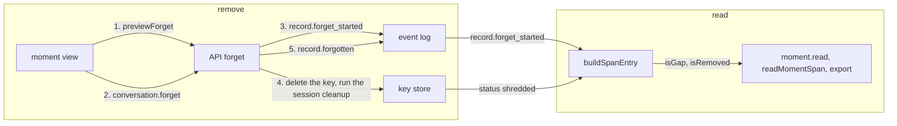

# Redaction of one record of a moment's span

- **Status:** draft. Nothing is built until the owner settles the [open questions](#open-questions),
  which part gets built first among them.
- **Decision records:** [0037](../../decisions/0037-moments.md),
  [0031](../../decisions/0031-memory-capture-context-and-removal.md)

You remove one whole record of a span, such as a tool result that holds a pasted secret. nixie
deletes the record's key, so its text is gone from the thread and from every moment that holds it. A
memory item that quotes the record stays readable until the owner settles that open question.

The removal is the built `conversation.forget` action, widened in 3 parts that ship apart:

1. The forget takes tool calls and tool results:
   [redaction-tool-records](https://linear.app/zgeoff/issue/GEO-2553).
2. A span record carries a mark, so the moment view tells a removed record from any other gap:
   [removal-mark](https://linear.app/zgeoff/issue/GEO-2554).
3. The moment view offers the removal behind a preview:
   [removal-control](https://linear.app/zgeoff/issue/GEO-2560).

A gap is a span record whose text nixie cannot read: a forget deleted its key, a session cleanup
deleted a summary's key, or its key fails to decrypt. A removed record is a gap that a forget made.
Other terms are in the [glossary](../../glossary.md).

## Shape



## Contracts

### Part 1: the forget takes tool records

```ts
conversation.forget({
  clientActionID: '0b9d3c4e-7a21-4f0e-8c55-1e6f2a9d4c03',
  thread: 'conversation',
  sequence: 4190, // a tool_result record that holds a pasted key
});
// → ok
//   or RECORD_NOT_FOUND, as built, for a record outside forgettableKinds: the forget looks the
//   record up among the removable kinds only
```

```ts
// API contract package: the one list of removable kinds. The API forget, the web client's
// record item, and the moment view's control all import it, and no module keeps a copy.
export const forgettableKinds = [
  'owner_message',
  'model.reply',
  'tool_called',
  'tool_result',
] as const satisfies readonly RecordKind[];
```

### Part 2: the removal mark

```ts
moment.read({ momentID: 'm4k9', records: 'conversation' });
// → among its records:
//   { eventID: '4190', kind: 'tool_result', text: null, isGap: true, isRemoved: true }
//   { eventID: '4201', kind: 'model.reply', text: null, isGap: true, isRemoved: false } // key fails to decrypt
```

```ts
// memory module: MomentSpanEntry. The API contract's span record (read by readMomentSpan)
// and the memory export's spanRecordSchema carry the same 2 fields.
interface MomentSpanEntry {
  // …existing fields
  readonly isGap: boolean; // as built: erasable status is 'shredded' or 'unreadable'

  // Status is 'shredded' and a record.forget_started holds this sequence. A session cleanup
  // also deletes summary keys, so a deleted key alone never proves a removal. The mark reads
  // record.forget_started, never record.forgotten: after a crash between the key's delete and
  // record.forgotten, only record.forget_started holds the sequence.
  readonly isRemoved: boolean;
}
```

```ts
// memory module: the export's span record
const spanRecordSchema = z.strictObject({
  // …existing fields
  isRemoved: z.boolean(), // required at the version that adds it; files of versions 5 and 6 read with false
});
```

### Part 3: the removal control and its preview

```ts
conversation.previewForget({ thread: 'conversation', sequence: 4190 });
// → { momentCount: 2, memoryItemCount: 1 }
```

```ts
// API module: a read procedure beside conversation.forget, named after memory.previewForget
interface ForgetPreviewInput {
  thread: string;
  sequence: number;
}

interface ForgetPreviewOutput {
  momentCount: number; // the moments whose spans hold the record
  memoryItemCount: number; // the memory items whose evidence quotes the record
}

// web client: the moment view's control label, word for word
const removalControlLabel = 'Remove this record';
```

## Constraints

### Every part

- When you remove a record, nixie deletes its key, so its text is gone from the thread and from
  every moment whose span holds it.
- A redaction removes a whole record. One record has one key, and no field has a key of its own.
- A redaction touches only the record you name. A reply that quotes the same secret stays readable.
- The forget writes `record.forget_started`, deletes the key, runs the session cleanup, and writes
  `record.forgotten` last, so a rebuilt session reads the record as a gap.
- Each step of a forget is safe to run twice, and the server's start finishes a forget that a crash
  cut short.
- `conversation.forget` never removes a record that holds a moment's title, note or reflection, and
  never removes a record of a memory item. You remove those by destroying the moment or forgetting
  the item.
- A redaction never reaches a model provider: a request sent before it keeps the text.

### Part 1

- A tool record on a task's thread is in that task's session, so this part lands only after
  [the forget reaches a task's session](https://linear.app/zgeoff/issue/GEO-2527).
- In the thread view, a removed tool record shows its tool name and outcome with no input or
  content, as the built thread view shows any tool record whose key is gone. It carries no removal
  mark.
- The release before this part returns `RECORD_NOT_FOUND` for the added kinds.

### Part 2

- `isGap` stays true for every gap, a removed record included, so a client built against the
  contract without `isRemoved` still shows a gap.
- When a record's key fails to decrypt, `isGap` is true and `isRemoved` is false.
- The moment view words a removed record with the word "removed", in the form of the built gap
  sentence, and words any other gap with the built sentence:
  `Record {sequence}: this part is gone. It was forgotten, and the moment keeps its place.`
- The release before this part reads `isRemoved` on a tool result and on `readMomentSpan` and
  ignores it. It refuses an export file of the raised version, because its span record is a strict
  object.
- The API contract only grows, so the contract growth check passes.

### The export version, shared with the photos work

- Each of the photos work and the removal mark raises `memoryExportSchemaVersion` by one when it
  lands, and adds that version's test fixture and moves the web client's mock export to it.
- The export schema reads every version from 5 up. A file of a version before a field reads it with
  its default (`images` empty, `isRemoved` false) and is refused when it holds the field. A file of
  a version that has the field and lacks it is refused.

### Part 3

- The moment view shows the control on each span record of a kind in `forgettableKinds`.
- A click on the control reads the preview, and the view shows the 2 counts with a confirm. Only the
  confirm calls `conversation.forget`.
- When the preview read fails, the view shows an error in place of the confirm and hides the control
  on that record. It never removes without a preview. A client of this part on the release before
  gets the failure, because the procedure does not exist there.

## Decisions

- **A redaction is the forget of a record.** A moment refers to the log's records and copies none,
  so one forget path covers the thread and every moment. [0037](../../decisions/0037-moments.md)
- **Every removal sits behind a preview.**
  [0031](../../decisions/0031-memory-capture-context-and-removal.md)
- **One list of removable kinds, in the API contract package.** The built code holds 5 separate kind
  sets, and copies drift.

## Builder decides

- The full sentence for a removed record, within the rule above.
- Where the preview's counts and confirm sit in the moment view.
- The layout of the tests.
- Internal names, and the wording of each error.

## Out of scope

- A key per field, and a removal of part of a record.
- A second forget action for moments.
- What a redaction does to a request in the turn-input log. That log's design owns it.
- A forget control on a task's records in the web client.

## Open questions

- **Which parts get built?** The owner settles it. Each part is its own work item, and an item the
  owner does not choose closes as not planned. Until then, nothing is built. The parts in order of
  worth: tool records, the mark, the control.
- **Which record kinds does a redaction take?** The owner settles it: messages and replies only, as
  built; every record of a thread that has a key, except a moment's or a memory item's own records;
  or that set only for a record inside a kept span. Until then, part 1 adds `tool_called` and
  `tool_result` only.
- **Does the agent also redact, through a tool?** The owner settles it. Until then, no tool removes
  a record.
- **Does a redaction forget the memory items whose evidence is the record?** The owner settles it:
  the preview lists each item for you to forget apart, or the redaction forgets each one too. Until
  then, it forgets none.
- **What is the preview procedure called?** The owner settles it, because the API contract package
  is published. `memory.previewForget` already exists for memory items, and the memory store's own
  read is `readForgetPreview`. Until then, the sketches use `conversation.previewForget`.
- **Does the thread view mark a removed record as removed?** The owner settles it. Until then, the
  thread view shows a removed record as it shows any record whose key is gone.
