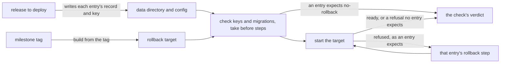

# The rollback check

- **Status:** draft
- **Work items:** [the rollback check](https://linear.app/zgeoff/issue/GEO-2529),
  [a previous release's server in the e2e lane](https://linear.app/zgeoff/issue/GEO-2569)

A deployment takes nixie's releases in milestones, and a rollback returns to the last release it
ran, which can be several releases back
([deploy in milestones](../../runbooks/releasing.md#deploy-in-milestones)). The rule "Rollbacks in a
design" in [AGENTS.md](../../../AGENTS.md#working-here) makes each design state what that release
does with each record kind, migration and config key the design adds. The rollback check tests those
statements. It starts the older release on a data directory and a config that the newer release
wrote, and compares what the older release does with what each statement says it does.

Terms:

- **Rollback target:** the older release, the one a rollback of the next milestone deploy returns
  to.
- **Release to deploy:** the newer release, the build under check. The check runs as an e2e test,
  where this is the checked-out commit, or as a fallback CI job, where it is the release image.
  [Where it runs](#where-it-runs) says which.
- **Expectation:** one design's statement about one record kind, migration or config key, written as
  an entry of one list in test code, so the check can run it. An entry's `expected` field holds the
  statement.
- **An entry applies** when its ID is missing from the copy of the list at the rollback target's
  tag. An entry that applies describes a change the rollback target is older than.
- **Before step:** a rollback step that an entry holds in its `before` field, which the check takes
  before the target's first start.

## Shape



## Contracts

### The check

```ts
// e2e test-utils: the rollback check
const result = await runRollbackCheck({ target, toDeploy, expectations });
// → {
//     verdict: 'pass',
//     target: { tag: 'v0.70.1', milestone: 'milestone-1' },
//     starts: 2,
//     entries: [
//       { id: 'push-notice/channels', expected: 'refuses', observed: 'not-in-schema', pass: true },
//       { id: 'pause/migration', expected: 'refuses', observed: 'refused', pass: true },
//       { id: 'push-notice/channels.paired', expected: 'never-meets', observed: 'ready', pass: true },
//       // a record on no thread, which no reader of the target meets
//     ],
//   }

type RollbackCheckResult =
  | { verdict: 'pass'; target: TargetName; starts: number; entries: readonly EntryResult[] }
  | {
      verdict: 'fail';
      target: TargetName;
      starts: number; // every start of the target, the refused ones included
      entries: readonly EntryResult[]; // one per applying entry, in list order
      reason: FailReason;
      detail: string; // the key path, the schema version, the record kind or the refusal output
    }
  | {
      verdict: 'no-rollback'; // the check started no target
      target: TargetName;
      entryID: string; // the entry that expects no-rollback
      entries: readonly EntryResult[]; // each observed 'not-started'
    }
  | { verdict: 'skipped'; reason: 'no-milestone-tag' | 'target-without-list' };

// The check finds the milestone tag, then reads the v* tag on the same commit.
type TargetName = { tag: string; milestone: string }; // such as v0.70.1, tagged milestone-1 too

type FailReason =
  | 'missing-record' // the release to deploy wrote no record of an entry's kind
  | 'unstated-config-key' // the target's schema lacks a key, and no applying entry holds it
  | 'unstated-migration' // a migration since the target has no applying entry
  | 'unexpected-refusal' // the target refused, and no entry's `error` is in the output
  | 'expected-refusal-missing' // an entry other than a config key expects a refusal, and the target reached ready
  | 'config-key-in-schema' // an entry expects a key's refusal, and the target's schema names it
  | 'no-ready'; // the target neither exited nor reached ready within 10 s

interface EntryResult {
  id: string;
  expected: Expected['outcome'];
  observed: 'ready' | 'refused' | 'not-in-schema' | 'in-schema' | 'not-started';
  // not-started: the check started no target, on a no-rollback verdict or a failure before the
  // first start
  pass: boolean;
}
```

### An expectation

```ts
// e2e test-utils: the rollback check. The list holds one entry per record kind, migration or
// config key that a design adds. The design's own PR adds its entries.
interface RollbackExpectation {
  id: string; // '<design file name>/<item>', such as 'push-notice/channels'; never reused
  adds: Added;
  expected: Expected;
  before?: RollbackStep; // a step the rollback takes before the target's first start
}

type Added =
  | { kind: 'record'; recordKind: string; write: (toDeploy: ReleaseToDeploy) => Promise<void> }
  // write: drives the release to deploy until its log holds one record of the kind, through a
  // scripted turn, a procedure call or a host command
  | { kind: 'migration'; schemaVersion: number } // the release to deploy runs it at its first start
  | { kind: 'config-key'; path: string; yaml: string } // yaml: the key and a value, as in config.yaml
  | { kind: 'removal'; path: string };
// removal: a config section that the release to deploy deletes and refuses, such as
// `memory_writer`. The deletion is a change after the target, so its ID is missing from the
// target's list and the entry applies. The target still reads the section, so the rollback puts
// it back: the entry holds a `before` step that sets it, and expects 'reads'.

type Expected =
  | { outcome: 'reads' }
  | { outcome: 'skips' }
  | { outcome: 'never-meets' }
  | { outcome: 'refuses'; error?: string; step?: RollbackStep }
  // error, step: required for every kind but 'config-key'. error is text in the target's output
  // when it refuses, such as 'SchemaTooNewError'; step is the design's rollback step.
  // A config-key entry holds neither: step 1 of Starts and steps removes the key.
  | { outcome: 'no-rollback' }; // a migration that no rollback crosses; the way back is a restore

type RollbackStep =
  | { kind: 'config'; remove?: readonly string[]; set?: string } // set: YAML merged into the config
  | { kind: 'command'; argv: readonly string[] } // a host command of the release to deploy
  | { kind: 'start-to-deploy' };
// start-to-deploy: starts the release to deploy once, to ready, and stops it, for a design whose
// start cleans up what the target refuses, such as the restore marker in the pause design's rollback
```

The check proves only what shows when the target starts on the data directory and the config. A
design's rollback section can list more, and the check leaves each such statement to the design's
reviewer. Examples are a procedure that the target answers with `NOT_FOUND`, a rules file that the
target's seed refuses
([the rule format rename](task-definition-format.md#a-rollback-of-the-rule-format-rename)), a proxy
with its own release, and anything the target does after ready. A design that wants the check to
prove such a statement, or that needs another kind of step, adds the kind to the check in its own
PR.

### The 2 releases

```ts
// e2e test-utils: the rollback check. Adapters: a server bundle built from the target's tag, which
// the e2e harness startSpawnedNixie already starts through its `release` option; and the release
// image by digest, for the CI job.
interface RollbackTarget {
  name: TargetName;
  readConfigSchema(): Promise<JSONSchema>; // config.schema.json at the target's tag
  readExpectationIDs(): Promise<readonly string[] | null>; // the list's IDs at the target's tag; null before the list exists
  start(input: { dataDir: string; configPath: string }): Promise<TargetStart>;
}

type TargetStart =
  | { result: 'ready' }
  | { result: 'refused'; output: string } // exited before ready; output: its stderr and log lines
  | { result: 'no-ready' }; // neither within 10 s

// Adapters: the checked-out build, through startSpawnedNixie; and the release image by digest.
interface ReleaseToDeploy {
  dataDir: string;
  configPath: string;
  model: ScriptedModel; // startSpawnedNixie's scripted model; never a real provider
  request: SpawnedNixieProcess['request'];
  runCommand(argv: readonly string[]): Promise<{ exitCode: number; output: string }>;
  stop(): Promise<void>;
}
```

## Constraints

### Inputs

- The check starts the rollback target, and never a release between it and the release to deploy.
- The rollback target is the release at the newest `milestone-<n>` tag reachable from the release to
  deploy. Whoever deploys a milestone puts that tag on the commit of its release once the deploy
  succeeds.
- With no milestone tag, the check skips and prints `no milestone tag: no rollback target`. A
  milestone deploy needs a passing check, and a skipped check counts as no pass.
- The check reads the target's `config.schema.json` and its copy of the list from the commit that
  carries both the milestone tag and the target's `v*` tag.
- Each entry in the target's copy of the list describes a change that the target's own release
  already holds, so the check skips it.
- The check runs only against a target whose tag carries the list. Against an older target it skips
  with `target-without-list`, because a missing ID there tells nothing.
- The release to deploy writes the data directory and the config. Its config holds the `yaml` of
  each applying `config-key` entry.
- The release to deploy starts, runs the `write` of each applying `record` entry in list order, and
  stops. The check then reads its log, and fails with `missing-record` when an entry's record kind
  is absent.
- The milestone that deletes the 2 built-in memory tasks has 2 `removal` entries, for
  `memory_writer` and `memory_consolidation`. Each holds the `before` step
  `{ kind: 'config', set: builtInMemoryTasksOffConfig }`, the off config that
  [the rollback of that delete](no-built-in-memory-tasks.md#a-rollback) sets.

### Starts and steps

1. The check removes each config key that the target's `config.schema.json` does not name, as a
   rollback's first step does. It fails with `unstated-config-key` when a removed key is missing
   from every applying entry, before any start.
2. The check passes each applying `config-key` entry that expects a refusal when the target's schema
   lacks the key, because that schema refuses every key it does not name. It fails with
   `config-key-in-schema` when the schema names the key.
3. The check fails with `unstated-migration` when
   [the migration check](../../architecture/deployment/release-pipeline.md) lists a migration
   between the target and the release to deploy, and every applying entry lacks it.
4. The check takes the `before` step of each applying entry, in list order.
5. The check starts the target. After a refused start, it finds the applying entry whose `error` the
   output holds, takes that entry's step, and starts the target again. It takes each entry's step
   once at most.
6. The check passes when the target reaches ready and each applying entry that expects a refusal has
   met it: a `config-key` entry in step 2, and every other entry at a start.

- The check sees `reads`, `skips` and `never-meets` as the same start to ready. It tells each of
  them apart from a refusal, and never from each other.
- The target starts at most once more than the number of applying entries, other than `config-key`
  entries, that expect a refusal.
- When an applying entry expects `no-rollback`, the check reports `no-rollback` before it starts the
  target. [The memory index](memory-index.md#where-the-block-sits) states that a rollback never
  crosses the migration that drops the sensitive flag's column, so the check never starts a target
  on a database that migration changed.

### Where it runs

- The check runs as an e2e test, on a server bundle built from the target's tag. When the work item
  on [a previous release's server](https://linear.app/zgeoff/issue/GEO-2569) measures that this
  build does not fit the e2e lane's time, the check runs as a CI job on the 2 release images
  instead. It never runs by hand.
- The e2e lane runs inside the required `pr / checks`, so a failed check stops the merge of the PR
  that fails it. A statement can also turn false on main, such as when a new milestone tag gives the
  check a new target. The statement then stays false until a PR fixes it, and every PR before that
  fix fails the same required check, so no release goes out.
- The check uses the test doubles of `startSpawnedNixie`: a scripted model and a temporary data
  directory. It never sends a message to the agent of a production deployment.
- The check prints its result as a table, one row per applying entry. The table is the evidence for
  a milestone deploy.

### A rollback

The check lives in test code and the milestone tags in git, so nixie gains no record kind, migration
or config key from this design, and a rollback finds nothing of it.

## Decisions

- **The check is an e2e test, and falls back to a CI job on the 2 release images.** An agent's call
  on 13 Nov 2026: the e2e lane already starts a spawned nixie on a data directory and holds no
  production data, and an automated check runs the same way for every milestone.
- **The check removes the unknown config keys before the first start, and proves a config key's
  refusal from the target's schema.** An agent's call on 13 Nov 2026: a rollback removes those keys
  first, and the target's strict schema refuses each key it does not name, so a start adds no proof.
- **An entry applies when the list at the target's tag lacks it.** An agent's call on 13 Nov 2026:
  one rule then serves a target one release back and one several releases back, and an entry needs
  no version number.
- **The check fails on an unstated config key or migration.** An agent's call on 13 Nov 2026: the
  target's config schema and the migration check already list both, so the PR of a design that
  leaves out its statement fails.
- **The release to deploy writes each record through its own code, on a scripted model.** The
  interim for the open question on the data directory. A committed fixture goes stale with each
  release, and the spawned nixie already runs in the e2e lane.
- **The rollback target is the newest milestone tag.** The interim for the open question on the
  target. Milestones skip releases, so the newest `v*` tag is the last release a deployment ran only
  when the milestone holds one release. A deployment's own repo records the release it runs, but
  that repo is private, and the public repo's CI cannot read it.
- **A pass is a target that reaches ready after the refusals its entries expect.** The interim for
  the open question on the pass rule.
- **The expectations live in one list in the repo, and each design's PR extends it.** The interim
  for the open question on where they live. For a design already merged, the builder of the check
  writes its entries from the rollback constraint of that design's work item.

## Builder decides

- The file of the list, the internal names, and how the check matches an entry's `error` against the
  output.
- How each `write` drives the release to deploy.
- The layout of the printed table and of the tests.
- Where the target's bundle builds, inside the time that the work item on
  [a previous release's server](https://linear.app/zgeoff/issue/GEO-2569) measures.

## Out of scope

- The `nixie rollback` command of a later stage, which
  [upgrades](../platform/deployment/upgrades.md#rolling-back) describes.
- The removal of config keys on a deployment, which the deployment's own repo makes.
- The backup before the deploy that drops the sensitive flag's column.
- A start of a release further back than the target, for a deployment that skipped a milestone.
- A read of each record back through the target's API.

## Open questions

[The rollback check](https://linear.app/zgeoff/issue/GEO-2529) holds each question, with its
recommendation.

- **How does the check learn the rollback target?** The owner settles it. Until then, the newest
  `milestone-<n>` tag.
- **How is the data directory made?** The owner settles it. Until then, a spawned nixie on a
  scripted model.
- **What counts as a pass?** The owner settles it. Until then, the target reaches ready.
- **Where do the expectations live?** The owner settles it. Until then, one list in the repo.
- **Does a failed check block the release, or only the milestone deploy?** The owner settles it.
  Until then, the deploy waits for a pass, and a failed check also stops merges, as
  [Where it runs](#where-it-runs) says.
- **Does the check also start a release further back?** The owner settles it. Until then, it starts
  the target only.
- **A design states what the release directly before it does. Does that statement also hold for a
  target 2 or more releases back?** The check settles it once it exists.
