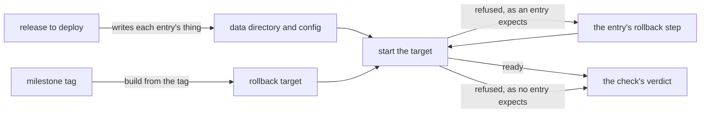

# The rollback check

- **Status:** draft
- **Work items:** [the rollback check](https://linear.app/zgeoff/issue/GEO-2529),
  [a previous release's server in the e2e lane](https://linear.app/zgeoff/issue/GEO-2569)

A deployment takes releases in milestones, and a rollback returns to the last release it ran, which
can be several releases back
([deploy in milestones](../../runbooks/releasing.md#deploy-in-milestones)). Each design states what
that release does with each record kind, migration and config key the design adds, as the rule
"Rollbacks in a design" in [AGENTS.md](../../../AGENTS.md#working-here) says. The rollback check
proves those statements before a milestone deploy. The release to deploy writes a data directory and
a config, the check starts the rollback target on them, and it compares each start with the
statements. A refusal that a statement expects is a pass once the statement's rollback step lets the
target start.

Terms:

- **Rollback target:** the release that a rollback of the milestone deploy returns to.
- **Release to deploy:** the build under check: the checked-out commit in the e2e lane, or the
  release image in the fallback.
- **Expectation:** one design's statement about one thing it adds, in a form the check runs.

## Shape



## Contracts

### The check

```ts
// e2e test-utils: the rollback check
const result = await runRollbackCheck({ target, toDeploy, expectations });
// → {
//     verdict: 'pass',
//     target: { tag: 'v0.70.1', milestone: 'milestone-1' },
//     starts: 2,
//     entries: [
//       { id: 'push-notice/channels', expected: 'refuses', observed: 'refused', stepTaken: true, pass: true },
//       { id: 'push-notice/migration', expected: 'never-meets', observed: 'ready', stepTaken: false, pass: true },
//     ],
//   }
//   or { verdict: 'fail', reason: 'unstated-config-key', path: 'channels.telegram', entries: [...] }
//   or { verdict: 'fail', reason: 'unexpected-refusal', output: '…', entries: [...] }
//   or { verdict: 'no-rollback', entryID: 'memory-index/sensitive-flag-drop' } // started no target

interface RollbackCheckResult {
  verdict: 'pass' | 'fail' | 'no-rollback';
  target: { tag: string; milestone: string };
  starts: number; // the starts of the target, the refused ones included
  entries: readonly EntryResult[]; // one per entry that applies, in list order
  reason?: FailReason; // only on 'fail'
}

type FailReason =
  | 'missing-record' // the release to deploy never wrote an entry's record kind
  | 'unstated-config-key' // the target's schema lacks a key, and no entry holds it
  | 'unstated-migration' // a migration since the target has no entry
  | 'unexpected-refusal' // a refusal that no entry's `error` matches
  | 'expected-refusal-missing' // an entry expects a refusal, and the target reached ready
  | 'no-ready'; // the target neither refused nor reached ready within 10 s
```

### An expectation

```ts
// e2e test-utils: the rollback check. One entry per record kind, migration or config key that a
// design adds. The design's own PR adds its entries to the one list.
interface RollbackExpectation {
  id: string; // '<design file name>/<thing>', such as 'push-notice/channels'; never reused
  adds: Added;
  target: 'reads' | 'skips' | 'never-meets' | Refuses | NoRollback;
}

type Added =
  | { kind: 'record'; recordKind: string; write: (nixie: ReleaseToDeploy) => Promise<void> }
  // write: drives the release to deploy until the log holds one record of the kind, such as a
  // scripted turn, a procedure call or a host command
  | { kind: 'migration'; schemaVersion: number } // the release to deploy runs it at its first start
  | { kind: 'config-key'; path: string; yaml: string }; // yaml: the key with a value, in config.yaml

interface Refuses {
  outcome: 'refuses';
  error: string; // text the target prints when it refuses, such as 'SchemaTooNewError'
  step: RollbackStep; // the design's rollback step
}

interface NoRollback {
  outcome: 'no-rollback'; // a migration that no rollback crosses; the way back is a restore
}

type RollbackStep =
  | { kind: 'config'; remove?: readonly string[]; set?: string } // set: YAML merged into the config
  | { kind: 'command'; argv: readonly string[] } // a host command of the release to deploy
  | { kind: 'start-to-deploy' }; // start the release to deploy once, to ready, and stop it
```

A rollback step of any other kind, such as an edit of the definitions repo, has no form here. The
design that needs it adds the step kind to the check in its own PR.

### The 2 releases

```ts
// e2e test-utils: the rollback check. Adapters: a server bundle built from the target's tag, started
// through startSpawnedNixie's `release` option; and the release image by digest, in the fallback
// job.
interface RollbackTarget {
  tag: string; // such as 'v0.70.1'
  readConfigSchema(): Promise<JSONSchema>; // config.schema.json from the target's tag
  readExpectationIDs(): Promise<readonly string[]>; // the IDs of the list at the target's tag; [] before it exists
  start(input: StartInput): Promise<TargetStart>;
}

interface StartInput {
  dataDir: string;
  configPath: string;
}

type TargetStart =
  | { result: 'ready' }
  | { result: 'refused'; output: string } // the process exited before ready; output: its stderr and log lines
  | { result: 'no-ready' }; // neither within 10 s

// Adapters: the checked-out build, through startSpawnedNixie; and the release image by digest.
interface ReleaseToDeploy {
  dataDir: string;
  configPath: string;
  model: ScriptedModel; // the scripted model of startSpawnedNixie; never a real provider
  request: SpawnedNixieProcess['request'];
  runCommand(argv: readonly string[]): Promise<{ exitCode: number; output: string }>;
  stop(): Promise<void>;
}
```

## Constraints

### Inputs

- The check starts the rollback target, never a release between it and the release to deploy.
- The rollback target is the release at the newest `milestone-<n>` tag reachable from the release to
  deploy. That tag sits on the commit of the release that the last milestone deployed.
- With no milestone tag, the check skips and prints `no milestone tag: no rollback target`. A
  skipped check is no pass for a deploy.
- The release to deploy writes the data directory and the config. Its config holds the `yaml` of
  every `config-key` entry that applies.
- An entry applies when the target tag's list lacks the entry's ID. Each entry in the target's list
  holds a thing the target knows.
- The release to deploy starts, runs each applying `record` entry's `write` in list order, and
  stops. Then the check reads the log, and fails with `missing-record` when an entry's record kind
  is absent.
- The check's config for the milestone that deletes the 2 built-in memory tasks is
  `builtInMemoryTasksOffConfig`, as
  [the rollback of that delete](no-built-in-memory-tasks.md#a-rollback) says. The entry for that
  delete carries the constant as a `config` step with `set`.

### Starts and steps

- The first start of the target uses the config as the release to deploy left it, so a config key
  whose entry expects a refusal shows its refusal.
- After a refused start, the check finds the entry whose `error` the output holds, takes that
  entry's step, and starts the target again. One entry's step runs once.
- After the last refusal, the check removes each config key that the target's `config.schema.json`
  does not name, as a rollback's first step does.
- The check fails with `unstated-config-key` when it removes a key that no applying entry holds.
- The check fails with `unstated-migration` when the
  [migration check](../../architecture/deployment/release-pipeline.md) lists a migration between the
  target and the release to deploy that no applying entry holds.
- The check passes when the target reaches ready and every applying entry that expects a refusal met
  its refusal. `reads`, `skips` and `never-meets` all reach ready, so the check tells them apart
  from a refusal and not from each other.
- The target's starts number at most the applying `refuses` entries plus one.
- When an applying entry holds `no-rollback`, the check starts no target and reports `no-rollback`.
  [The memory index](memory-index.md#where-the-block-sits) states that no rollback crosses the
  migration that drops the sensitive flag's column, so the check never starts a target on a database
  that migration changed.

### Where it runs

- The check runs as an e2e test, on a server bundle built from the target's tag. When
  [a previous release's server](https://linear.app/zgeoff/issue/GEO-2569) finds that the build does
  not fit the e2e lane's time, the check runs as a CI job on the 2 release images instead. It never
  runs by hand.
- The e2e lane runs inside the required `pr / checks`, so a failed check blocks the merge of the PR
  that breaks a statement, and every release after it.
- The check uses the doubles of `startSpawnedNixie`: a scripted model and a temporary data
  directory. It never sends a message to the agent of a production deployment.
- The check prints its result as a table, one row per applying entry, which is the evidence for a
  milestone deploy.

### A rollback

This design adds no record kind, migration or config key to nixie, so a rollback meets nothing of
it. The milestone tags and the list live in the repo and in test code only.

## Decisions

- **The check is an e2e test, and falls back to a CI job on the 2 release images.** An agent's call
  on 13 Nov 2026: the e2e lane already starts a spawned nixie on a data directory and holds no
  production data, and an automated check runs the same way for every milestone.
- **The first start uses the config as written, and the key removal comes after the refusals.** An
  agent's call on 13 Nov 2026: a removal before the first start would hide every refusal that a
  config key's statement expects, and the removal still comes before the start that must reach
  ready.
- **An entry applies when the target's own list lacks it.** An agent's call on 13 Nov 2026: one rule
  then serves a target one release back and one several releases back, with no version number in an
  entry.
- **The check fails on an unstated config key or migration.** An agent's call on 13 Nov 2026: the
  target's config schema and the migration check already name both, so a design that forgets its
  statement fails at its own PR.
- **The release to deploy writes each record through its own code, on a scripted model.** The
  interim for the open question on the data directory. A fixture goes stale with each release, and
  the spawned nixie already runs in the e2e lane.
- **The rollback target is the newest milestone tag.** The interim for the open question on the
  target. Milestones skip releases, so the newest `v*` tag is often not the last release a
  deployment ran, and the public repo holds no deployment's details.
- **A pass is a target that reaches ready after the expected refusals.** The interim for the open
  question on the pass rule.
- **The expectations live in one list in the repo, and each design's PR extends it.** The interim
  for the open question on where they live. Until a design's PR adds its entries, the builder of the
  check writes them from that work item's rollback constraint.

## Builder decides

- The file of the list, the internal names, and the matching of an entry's `error` against the
  output.
- How a `write` drives the release to deploy for each record kind.
- The layout of the printed table, and of the tests.
- Where the target's bundle builds, inside the limits that
  [a previous release's server](https://linear.app/zgeoff/issue/GEO-2569) measures.

## Out of scope

- `nixie rollback`, and the recovery holds it would place.
- The removal of config keys on a deployment, which the deployment's own repo makes.
- The backup before the deploy that drops the sensitive flag's column.
- A start of a release further back than the target, for a deployment that skipped a milestone.
- A read of each record back through the target's API.

## Open questions

Each one lives in [the rollback check](https://linear.app/zgeoff/issue/GEO-2529), with its
recommendation. The deploy of milestone 1 waits for the owner's answers.

- **How does the check learn the rollback target?** The owner settles it. Until then, the newest
  `milestone-<n>` tag.
- **How is the data directory made?** The owner settles it. Until then, a spawned nixie on a
  scripted model.
- **What counts as a pass?** The owner settles it. Until then, the target reaches ready.
- **Where do the expectations live?** The owner settles it. Until then, one list in the repo.
- **Does a failed check block the release, or only the milestone deploy?** The owner settles it.
  Until then, the deploy waits for a pass, and the e2e lane also blocks the PR that fails it.
- **Does the check also start a release further back?** The owner settles it. Until then, the target
  only.
- **Does a statement written about the release directly before hold for a target 2 or more releases
  back?** The check settles it once it exists.
