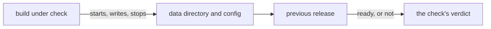

# The rollback check

- **Status:** draft
- **Work items:** [the rollback check](https://linear.app/zgeoff/issue/GEO-2529),
  [a previous release's server in the e2e lane](https://linear.app/zgeoff/issue/GEO-2569)

A rollback returns a deployment to an earlier release, which then starts on the data directory and
the config that the newer release wrote. The rollback check is one cheap CI test of that start: CI
starts the build under check on a fresh data directory, stops it, and starts the previous release on
that data directory and the same `config.yaml`. The previous release must reach ready, as the
constraints below define.

Terms:

- **Build under check:** the checked-out commit of the PR or of main.
- **Previous release:** the newest release before the build under check.

## Shape



## Contracts

```ts
// e2e test-utils: the rollback check
const result = await runRollbackCheck({ previous, build });
// → { verdict: 'pass', previous: 'v0.70.1' }

type RollbackCheckResult =
  | { verdict: 'pass'; previous: string } // previous: the release's v* tag
  | { verdict: 'declared'; previous: string; oldestReader: number; previousWrites: number }
  | { verdict: 'fail'; previous: string; output: string }; // output: its stderr and log lines
```

## Constraints

- The build under check starts once on a fresh data directory, reaches ready, and stops. The check
  then starts the previous release on that data directory and the `config.yaml` the build under
  check used.
- A release ignores a config key it does not know, and logs a warning that names the key at start. A
  newer release's config keys then never stop an older release from starting. The cost: a mistyped
  key is no longer refused, only warned about.
- A task definition fails closed. When a definition holds a field the release does not know, the
  seed skips that definition whole: it never runs, and its triggers never fire. The release logs a
  warning that names the definition and the field. An unknown tool name in a definition's `tools` is
  dropped with a warning, because the task then gets less, never more.
- A rules file fails closed. When a rule holds a field the release does not know, the seed skips an
  allow rule whole, so it matches nothing. For a deny or an ask rule, the seed drops only that
  field, so the rule matches more. Either way it logs a warning that names the rule and the field.
- A previous release built before this rule refuses an unknown config key or an unknown field in a
  definition or rules file. The check passes against it only while the test's config, definitions
  and rules hold nothing that release lacks.
- A migration may drop a column in the release that stops using it, because one release per change
  is the standing rule. A migration that makes the previous release unable to read the data raises
  `oldestReader`, which declares the break, and the migration check already forces that declaration.
  The previous release then refuses the data directory by design.
- The check runs on a data directory that nixie left unpaused. A release without the pause refuses a
  data directory that nixie left paused, as [the pause](pause.md) designs.
- Ready means that the previous release logs `http.listening` and that its `/health/ready` report
  shows the `database` part ready. The `definitions` part, which reports that no seed has applied
  yet, and the parts that need impd may stay unready. The build under check must meet the same rule
  on its start.
- The check passes, with the verdict `pass`, when the previous release reaches ready. It fails, with
  its output, when the previous release exits first, does not reach ready in time, or listens with
  its database part unready.
- The verdict is `declared`, and the check accepts it, when the previous release exits before it
  listens with the schema refusal
  `database schema S needs a build that writes schema R or later, and this build writes schema W`,
  where R equals the `oldestReader` of the build under check and W is lower than R. A refusal that
  looks declared while the build's `oldestReader` does not exceed W is a `fail`. While the verdict
  is `declared`, the check cannot see config or rules faults. That blind spot ends when the next
  release becomes the previous release.
- The check takes no step between the 2 starts. It never edits the config or the data directory.
- The check uses the test doubles of `startSpawnedNixie`: a scripted model and a temporary data
  directory. It never sends a message to the agent of a production deployment.
- The check runs in the e2e lane, inside the required `pr / checks`, so a failed check stops the
  merge of the PR that fails it.

## Builder decides

- How CI finds the previous release, such as the newest `v*` tag reachable from the build under
  check.
- Where the previous release's bundle builds, inside the time that the work item on
  [a previous release's server](https://linear.app/zgeoff/issue/GEO-2569) measures, and whether the
  check falls back to a CI job on the release images when that time does not fit the e2e lane.
- What the build under check writes before it stops, beyond its own first start.
- How long the check waits for ready.
- The internal names and the layout of the tests.

## Out of scope

- The `nixie rollback` command of a later stage, which
  [upgrades](../platform/deployment/upgrades.md#rolling-back) describes.
- A start of a release further back than the previous release.
- A read of each record back through the previous release's API.
