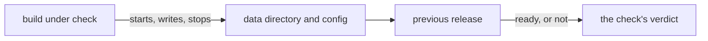

# The rollback check

- **Status:** draft
- **Work items:** [the rollback check](https://linear.app/zgeoff/issue/GEO-2529),
  [a previous release's server in the e2e lane](https://linear.app/zgeoff/issue/GEO-2569)

A rollback returns a deployment to an earlier release, which then starts on the data directory and
the config that the newer release wrote. The rollback check is one cheap CI test of that start: CI
starts the build under check on a fresh data directory, stops it, and starts the previous release on
that data directory and the same `config.yaml`. The previous release must reach ready.

Terms:

- **Build under check:** the checked-out commit of the PR or of main.
- **Previous release:** the newest release before the build under check.

## Shape



## Contracts

```ts
// e2e test-utils: the rollback check
const result = await runRollbackCheck({ previous, build });
// → { verdict: 'pass', previous: 'v0.70.1' }

type RollbackCheckResult =
  | { verdict: 'pass'; previous: string } // previous: the release's v* tag
  | { verdict: 'fail'; previous: string; output: string }; // output: its stderr and log lines
```

## Constraints

- The build under check starts once on a fresh data directory, reaches ready, and stops. The check
  then starts the previous release on that data directory and the `config.yaml` the build under
  check used.
- A release ignores a config key it does not know, and logs a warning that names the key at start. A
  seed of definition files and rules files does the same with a field it does not know, and keeps
  the rest of the seed. A newer release's keys then never stop an older release from starting. The
  cost: a mistyped key or field is no longer refused, only warned about.
- A previous release built before this rule refuses an unknown key, so the check passes against it
  only while the test's config holds no key that release lacks.
- A migration never drops a column in the release that stops using it: one release stops reading the
  column, and the next release drops it, so the previous release always starts on the new data.
- The check runs on a data directory that nixie left unpaused. A release without the pause refuses a
  data directory that nixie left paused, as [the pause](pause.md) designs.
- The check passes when the previous release reaches ready. It fails when the previous release exits
  first or does not reach ready in time, and prints the release's output.
- The check takes no step between the 2 starts. It never edits the config or the data directory.
- The check uses the test doubles of `startSpawnedNixie`: a scripted model and a temporary data
  directory. It never sends a message to the agent of a production deployment.
- The check runs in the e2e lane, inside the required `pr / checks`, so a failed check stops the
  merge of the PR that fails it.

## Builder decides

- How CI finds the previous release, such as the newest `v*` tag reachable from the build under
  check.
- Where the previous release's bundle builds, inside the time that the work item on
  [a previous release's server](https://linear.app/zgeoff/issue/GEO-2569) measures, and whether the
  check falls back to a CI job on the release images when that time does not fit the e2e lane.
- What the build under check writes before it stops, beyond its own first start.
- How long the check waits for ready.
- The internal names and the layout of the tests.

## Out of scope

- The `nixie rollback` command of a later stage, which
  [upgrades](../platform/deployment/upgrades.md#rolling-back) describes.
- A start of a release further back than the previous release.
- A read of each record back through the previous release's API.
