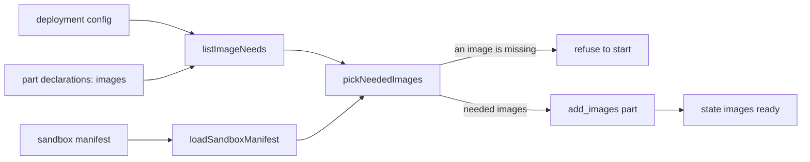

# The sandbox image set

- **Status:** draft
- **Work items:** [the image set](https://linear.app/zgeoff/issue/GEO-2582)

One tuple of image keys in the sandbox module drives every image schema and both image workflows, so
a new sandbox image is one key and no hand-written schema. At start, nixie adds and waits for only
the images that its configured profiles and its parts need, and refuses to start when the release
lacks one. A configured profile is the profile each model role resolves to, falling back to the
conversation's profile as `resolveRoleProfile` does, and each profile a `models.selectable` entry
names.

## Shape



## Contracts

### The keys and the start

```ts
// Server start, before any part starts:
const images = await loadSandboxManifest(manifestPath); // --manifest, default /app/sandbox-manifest.json
const needed = pickNeededImages(images, listImageNeeds(config, serverPartDeclarations));
// → { conversation: { name: 'nixie-conversation-0f3a9c21d4e7', ref: 'ghcr.io/…@sha256:…' },
//     fetch: { name: 'nixie-fetch-7b1e02c955aa', ref: 'ghcr.io/…@sha256:…' } }
// or throws, before any part starts:
//   'nixie refuses to start: the web_fetch part needs the fetch image, and the sandbox manifest
//    holds conversation'
```

```ts
// sandbox module. A key identifies an image. It never identifies a sandbox kind (6 kinds run on 2
// images) or a size row.
export const sandboxImageKeys = ['conversation', 'fetch'] as const;
export type SandboxImageKey = (typeof sandboxImageKeys)[number];

// sandbox module. One record per key.
export interface SandboxImageRecord {
  readonly repository: string; // the registry package, such as nixie-fetch
  readonly dockerfile: string; // from the repository root
}
export declare const sandboxImageRecords: Readonly<Record<SandboxImageKey, SandboxImageRecord>>;

// sandbox module, built.
export interface SandboxImage {
  readonly name: string; // nixie-<key>-<first 12 hex of the digest>
  readonly ref: string; // <registry>/<repository>@sha256:<digest>
}

export interface ImageNeed {
  readonly key: SandboxImageKey;
  // a profile: "the profile chat-main on the agent-sdk harness"; a part: "the web_fetch part"
  readonly neededBy: string;
}

// models module, built field, retyped by this work.
interface HarnessDescriptor {
  // …existing fields
  readonly imageKey: SandboxImageKey; // was string
}

// server, built type. Only a part that picks an image itself declares `images`. A part whose image
// comes from a harness record declares none: its profile's need covers it.
interface PartDeclaration<Values, Name extends keyof Values> {
  // …existing fields
  readonly images?: (config: DeploymentConfig) => readonly SandboxImageKey[];
}
// The web_fetch part: images: () => ['fetch']. The config has no switch that turns web fetch off,
// so every deployment needs the fetch image.
```

```ts
// server. One need per configured profile, from its harness record; then one per key that a
// declaration's `images(config)` returns. Takes the declarations so a test can pass its own.
export declare function listImageNeeds(
  config: DeploymentConfig,
  declarations: readonly AnyPartDeclaration<ServerPartValues>[],
): readonly ImageNeed[];

// server. Built as (path); now each key is optional, so a manifest that lacks one still loads.
export declare function loadSandboxManifest(
  path: string,
): Promise<Partial<Record<SandboxImageKey, SandboxImage>>>;

// server. Returns the needed images only, or throws the refusal for every missing need. The
// result stays Partial: which keys are needed depends on the config at runtime, so no type can
// prove a key present. A part looks its key up through a lookup that throws an invariant naming
// the key.
export declare function pickNeededImages(
  images: Partial<Record<SandboxImageKey, SandboxImage>>,
  needs: readonly ImageNeed[],
): Partial<Record<SandboxImageKey, SandboxImage>>;

// server. The body of `nixie sandbox-manifest`. `needs` is null without --needed.
export declare function printSandboxManifest(
  images: Partial<Record<SandboxImageKey, SandboxImage>>,
  needs: readonly ImageNeed[] | null,
): string;
```

```bash
nixie sandbox-manifest [--manifest <path>]                            # every image; reads no config
nixie sandbox-manifest [--manifest <path>] --needed --config <path>   # only the images the server adds
# {"conversation":{"name":"nixie-conversation-0f3a9c21d4e7","ref":"…"},"fetch":{…}}
```

### The 3 outputs

| Output                                        | Keys     | Each value                                          |
| --------------------------------------------- | -------- | --------------------------------------------------- |
| the sandbox manifest, in the nixie image      | optional | `<registry>/<repository>@sha256:<digest>`           |
| `nixie sandbox-manifest`                      | optional | `{ name, ref }`, a `SandboxImage`, no other field   |
| `sandboxImages` in `release.json`, `format` 1 | required | `<registry>/<repository>:<version>@sha256:<digest>` |

```ts
// server. Builds the zod schema of one output from a tuple of keys. The test seam: a test passes
// a tuple of its own, such as ['conversation', 'fetch', 'extra']; every product caller passes
// sandboxImageKeys. The schema is strict, so it refuses a key the tuple lacks.
export declare function buildImageShape<Key extends string, Value extends z.ZodType>(
  keys: readonly Key[],
  value: Value, // the ref string schema, or the { name, ref } schema
  presence: 'optional' | 'required',
): z.ZodObject<Record<Key, Value | z.ZodOptional<Value>>>;
```

### The release

```ts
// release scripts. Throws on a key of the tuple with no ref and on a ref with no key; the error
// holds the key. Returns the manifest as JSON.
export declare function buildSandboxManifest(refs: Readonly<Record<string, string>>): string;
```

| Where                       | Gives `buildSandboxManifest`                                                                           | Then reads the manifest                                                        |
| --------------------------- | ------------------------------------------------------------------------------------------------------ | ------------------------------------------------------------------------------ |
| release: `sandbox-manifest` | `toJSON(needs)`, keeping each entry whose name is a key, as `{ key: outputs.ref }`                     | `nixie` build, `notes`, `check-pulls`, `tag`, `assets`                         |
| Images: the manifest step   | `toJSON(steps)`, keeping each step whose `id` is a key, as `{ key: <registry>/<repository>@<digest> }` | the nixie build, the public-pull check, the tag rehearsal, the asset rehearsal |

## Constraints

The keys and the start:

- The tuple holds a key only when a harness record or a part declaration uses it. Each key costs a
  build, a public registry package and a pull check in every release.
- The code never writes a key out in a schema.
- An output never holds a sandbox's memory, CPU or disk limit.
- nixie refuses to start when the config or the manifest fails its schema. It exits and never
  retries the start.
- The `add_images` part, `toImageNames` and the adapter's add before a create read only the needed
  images. `registerSandboxImages` adds them one after another, and the state `images` is ready after
  the last one.
- When a config change needs an image the runtime does not hold, the start pulls it, and readiness
  waits for that pull.
- Each release's nixie image holds its own manifest, so each release adds its own images. The
  runtime holds another release's images until it evicts them.
- Each part that creates a sandbox has a start test that starts it with only the images that
  `pickNeededImages(images, listImageNeeds(config, declarations))` returns. A part that picks an
  image itself and forgets `images` fails that test.

The command:

- `--manifest` keeps its built default, `/app/sandbox-manifest.json`.
- `--needed` is false by default, and reads `--config` as `nixie health` does.
- With `--needed`, when the manifest lacks a needed image, the command exits non-zero and prints the
  start's refusal.
- A release never removes an entry's field or renames a key of the printed output. A new key is an
  added field.

The release:

- Each sandbox image has its own job in the release workflow, named by its key. The job pushes by
  digest, and gives its `ref` through the reusable image workflow's `on.workflow_call.outputs`.
- Each sandbox image has an Images workflow build step whose `id` is its key.
- A release pushes each image by digest, writes the manifest, and tags last. A commit never holds a
  sandbox image's digest.
- Each sandbox image's registry package is public, because the runtime pulls with no credentials.
  The public-pull check fails on a private one.
- No step or job names a sandbox key. `check-public-pulls.sh` and `tag-images.sh` take each ref of
  the manifest JSON plus the non-sandbox refs (server, web, backup).
- The `release.json` builder takes `--sandbox-manifest <path>` in place of the `CONVERSATION` and
  `FETCH` inputs. The server, web and backup inputs stay.
- The asset rehearsal is the only reader of `sandboxImages` in this repo, and it parses the
  `release.json` of its own release, so its schema stays strict.
- When the release workflow lacks a key's job, the release fails at the `sandbox-manifest` job,
  ahead of the nixie image build.
- A unit test reads both workflows, and fails when a key has no release job, a key has no Images
  build step, or a job's `image` or `dockerfile` differs from the image record.
- A pull request that adds an image holds its Dockerfile, its key and record, its release job (in
  the `needs` of the `sandbox-manifest` job) and its Images step, the harness record or part
  declaration that uses it, and a size row when its role has none.

## Decisions

- **The outputs are objects keyed by image key.** A new key is an added field, which the
  `release.json` compatibility rule allows. A list would make a script written for another release
  misread the output.
- **nixie adds only the images its configured profiles and parts need.** A deployment pulls no image
  that none of them uses.
- **A configured profile that is never used still needs its harness's image.** Each rollout pulls
  that image, and in return a selectable profile never fails on its first use.

## Builder decides

- The wording of the `buildSandboxManifest` errors, as long as one holds a key with no ref and the
  other a ref with no key.
- The refusal's text for 2 or more missing images, as long as it holds each image and what needs it.
- Test names and layout.

## Out of scope

- Another image. [The code tool](code-tool.md) adds the `code` key. A `codex`, `worker` or browser
  image each arrives in its own pull request, with its own design.
- What each image holds and builds from.
  [The bundled conversation guest](https://linear.app/zgeoff/issue/GEO-2491),
  [the image session](https://linear.app/zgeoff/issue/GEO-2248) and
  [the fetch image's base](https://linear.app/zgeoff/issue/GEO-2578) own that.
- A config key for a size, a committed catalog of the images, a workflow matrix, or the size table
  in `release.json`.
- An interface for the image build.
- A deployment's own script that adds the images before a roll, and its parse of another release's
  `release.json`. nixie guarantees only the printed output, the `--needed` flag and the added-field
  rule above.
