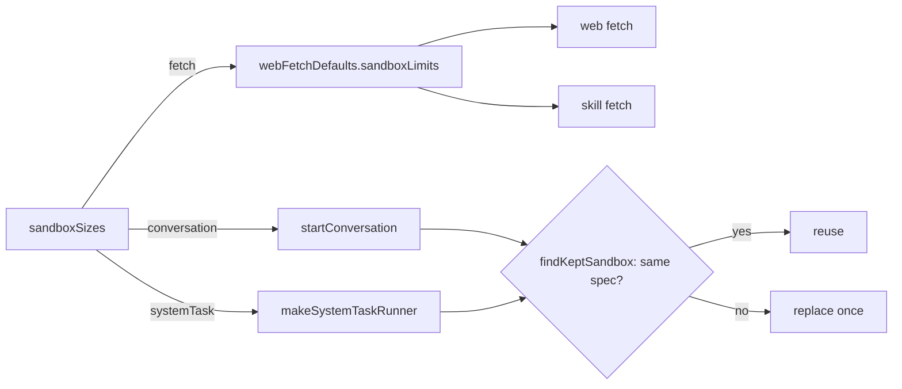

# The sandbox sizes

- **Status:** draft
- **Decision records:** [0054](../../decisions/0054-the-sandbox-sizes-ship-first.md)
- **Work items:** [the size table](https://linear.app/zgeoff/issue/GEO-2417),
  [the day's check of the sizes](https://linear.app/zgeoff/issue/GEO-2583)

nixie asks the sandbox runtime for less memory, because a host refuses to create or wake a sandbox
when its memory is short. The conversation gets 512 MiB in place of 2048, each system task 384 MiB
in place of 1024, and each fetch 192 MiB in place of 512. One table in the sandbox module holds the
figures, so a busy deployment of 1 conversation, 2 system tasks and 4 fetches asks for 2048 MiB in
place of 6144. [The memory-kill signal](memory-kill-signal.md) shows when a guest outgrows its size,
and the sizes are accepted on a day with no memory kill.

## Shape



## Contracts

```ts
// sandbox module, exported from @heynixie/sandbox. In product code, the only place that holds a
// sandbox's memory figure. A row is a role.
export const sandboxSizes = {
  conversation: { vcpus: 2, memoryMiB: 512, diskMiB: 4096 },
  systemTask: { vcpus: 1, memoryMiB: 384, diskMiB: 4096 },
  fetch: { vcpus: 1, memoryMiB: 192, diskMiB: 4096 },
} as const satisfies Readonly<Record<string, SandboxLimits>>; // SandboxLimits: sandbox module, built
```

```ts
// Each reader takes its row in place of its own literal:
// startConversation (server)
limits: sandboxSizes.conversation,
// makeSystemTaskRunner (sessions module): the checker, each started task, the memory writer and
// the memory consolidator
limits: sandboxSizes.systemTask,
// webFetchDefaults (connectors module): startWebFetch passes it to both the web fetch sandbox and
// the skill fetch sandbox
sandboxLimits: sandboxSizes.fetch,
```

## Constraints

- A row belongs to a role. A sandbox kind never picks a row: the worker kind and the checker kind
  both take `systemTask`. An image never picks a row: the conversation image runs at 512 MiB for the
  conversation and at 384 MiB for a system task.
- Each `memoryMiB` is even and 128 or more, and a unit test of the table fails otherwise. The
  runtime's smallest sandbox is 128 MiB. The runtime places an odd size outside the host's pool of
  reserved large memory pages, so a host that keeps all its memory in that pool refuses it.
- When a row's sandbox is killed for memory, the row rises in 64 MiB steps to the first figure at
  which the memory spike's probe (`research/sandbox-memory/probe.sh`) passes, such as `fetch` from
  192 to 256 MiB. A release carries the new figure.
- Every size is fixed. nixie asks for one amount of memory and for no room above it.
- A size is a constant, and no config key sets one.
- The vCPUs and the disk of every sandbox stay as they are.
- Each `sandbox.created` record holds its spec's limits as plain numbers, as it does today, so each
  release reads the spec another release stored.
- A sandbox whose stored size differs from its row is replaced by the built `findKeptSandbox` rule,
  once, the first time nixie uses it after a start. The conversation copies its session into the new
  sandbox. A worker sandbox, which a started task and each system task use, is destroyed and created
  again with no copy. A fetch creates its own sandbox each time. This design adds no replacement
  code.
- The replacement holds for an upgrade and for a rollback between 2 releases with different tables.
- A pull request that adds an image for a role with no row adds the role's row, sized by the probe
  on that image, with the probe's output in its description.

## Decisions

- **The sizes ship before the runtime's reserved-memory work.** They only lower what nixie asks for.
  [0054](../../decisions/0054-the-sandbox-sizes-ship-first.md)
- **A row belongs to a role.** Several kinds run one role, and one image runs at several sizes.
- **A size is a constant with no config key.** A wrong size is a bug that a release fixes.

## Builder decides

- Test names and layout.

## Out of scope

- A config key for a size, and a change to any sandbox's vCPUs or disk.
- One imp shared by several pieces of work.
- A second sandbox adapter. Its author measures its overhead and adds its own set of rows.
- The Codex harness's row and its probe, and a harness record that names its own rows. The Codex
  image's work owns them.
- A row for a worker image or a browser fetch. Each arrives with its image.
- Each step on a host: the reserved-page pool, the developer imps and the read of the runtime's log.
