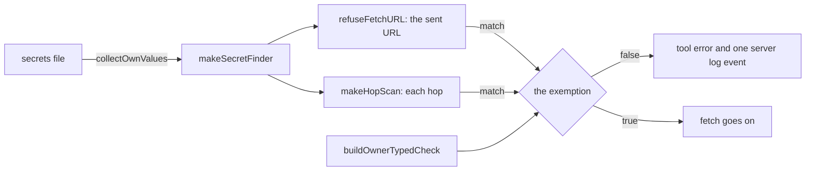

# The refusal of a URL that carries a secret

- **Status:** draft
- **Work items:** [the secret scan lib](https://linear.app/zgeoff/issue/GEO-2591),
  [the secret refusal in the fetch tool](https://linear.app/zgeoff/issue/GEO-2246)

nixie refuses a web fetch of a URL that holds an API key or a token, so a model that copies a token
into a URL never sends it to a site. nixie scans the sent URL and every redirect hop against a
pinned public rule set and against the exact values of its own secrets file. A URL that you typed
yourself runs, whatever it holds, and nixie never shows a prompt about a refusal.

The scan runs at step 3 and inside step 6 of [the flow of a page fetch](page-fetch-flow.md), which
defines the named URL, the sent URL, the hop and the 2 passes. [The hop gate](hop-gate.md) carries
each hop to the server.

Terms: a public rule is a rule of the pinned public rule set, such as `github-pat`. An own value is
one string of nixie's secrets file that the scan matches exactly, and a match reports the rule
`nixie-secret`. A typed URL is a named URL that sits in a typed span of one of your messages. The
exemption is the function that decides whether a matched URL runs anyway.

## Shape



## Contracts

### The secret scan lib

```ts
findSecret('https://api.example.com/v1/items?token=<a GitHub token>'); // → { rule: 'github-pat' }
makeSecretFinder(['<a deployment key>'])('https://x.example/?k=<that key>'); // → { rule: 'nixie-secret' }
```

```ts
// @heynixie/secret-scan, tagged server-only. Plain functions; the rule set is data.

// The public rules alone. null when no rule matches.
export function findSecret(url: string): { rule: string } | null;

// Each own value first, then the public rules.
export function makeSecretFinder(ownValues: readonly string[]): SecretFinder;

export type SecretFinder = (url: string) => { rule: string } | null;

export const ownValueRule = 'nixie-secret';
```

### The config keys

```ts
// connectors module: 3 more keys of the web_fetch section, a strict object
interface WebFetchSecretKeys {
  secret_typed_url_covers: 'named_url' | 'redirects'; // default 'redirects'
  secret_own_values: readonly SecretsEntryName[]; // default: every name but 'settings'; [] matches the public rules alone
  secret_own_value_min_chars: number; // whole, 1 or more; default 8
}

// The 6 entries of the secrets file, as built.
type SecretsEntryName =
  | 'deployment_key'
  | 'impd_token'
  | 'definitions_export_token'
  | 'model_credentials'
  | 'connector_credentials'
  | 'settings';
```

### What the server wires

```ts
// apps/server, where tool-part-declarations calls startWebFetch
startWebFetch({
  // …existing options; config carries the 3 keys
  findSecret: makeSecretFinder(
    collectOwnValues(secrets, {
      entries: config.secretOwnValues,
      minChars: config.secretOwnValueMinChars,
    }),
  ),
  isOwnerTyped: buildOwnerTypedCheck(log),
  logger,
});
```

```ts
// apps/server. Shared with the turn-input log's own-value search. Reads each string of the listed
// entries, the values of a map entry included and its keys left out, and leaves out a value shorter than minChars.
// Without settings, it uses the keys' defaults.
function collectOwnValues(
  secrets: z.infer<typeof secretsSchema>,
  settings?: { entries: readonly SecretsEntryName[]; minChars: number },
): readonly string[];

// memory module, built on readOwnerMessages and collectTypedSegments; the thread is run.thread.
// true when a typed span of one of the thread's newest 50 messages holds the whole URL. A pasted
// span does not count, and neither does a message that a forget erased.
function buildOwnerTypedCheck(log: Pick<Log, 'deploymentKey' | 'writer'>): IsOwnerTyped;

type IsOwnerTyped = (run: ToolRun, url: string) => Promise<boolean>;
```

### The exemption and the refusal

```ts
// connectors module. Asked only after a match, with the hop's number. true lets the URL through,
// and nixie logs nothing.
type IsExempt = (hop: number) => Promise<boolean>;

// The scan of a sent URL: the refusal sentence, or null when the URL holds no secret or is exempt.
function refuseFetchURL(url: string, scan: SecretScan): Promise<string | null>;

// The scan of a hop, for the hop gate.
function makeHopScan(scan: SecretScan): HopScan;

interface SecretScan {
  findSecret: SecretFinder;
  isExempt: IsExempt;
  logger: Logger; // the server log, not the event log
}
```

```ts
// The texts a model reads.
const secretRefusal = 'the URL holds a secret (rule {rule}), so it was not fetched';
const hopRefusal =
  '{host} redirected to a URL that holds a secret (rule {rule}), so it was not fetched';

// The server log event of each refusal holds these fields and nothing else.
logger('web_fetch.secret_refused', { rule: 'github-pat', hop: 1 });
```

## Constraints

### The scan

- The public rules are the Betterleaks rules at tag v1.9.0, commit `81aff7a`, under the MIT licence,
  from its `config/betterleaks.toml`.
- A rule that backtracks in more than linear time on hostile input runs on `re2js`, an entry of the
  root catalog.
- The lib holds the builder script, the generated rule file with its source and licence notice, and
  a check that fails when the file and the pinned commit disagree. The rule file is committed, so a
  build reads no other repo.
- Both functions read the URL as given and percent-decoded. The finder matches each own value as it
  is and percent-encoded.
- The lib gives each rule no file path, so a rule that matches on a file path alone never fires.
- The own values come from the 5 credential entries by default. `settings` holds your name and
  pronouns, and a scan for them would refuse an ordinary URL that holds your name.
- `collectOwnValues` leaves out a value shorter than `secret_own_value_min_chars`. A short value
  matches an ordinary URL by chance, and a site that redirects to a URL with its guess of an own
  value learns one yes or no per fetch.
- For a URL that holds an own value and a key that a public rule matches, the finder returns
  `nixie-secret`.
- A test builds each synthetic key at run time, and `.gitleaks.toml` allows the generated rule file
  by path and by rule.
- A compile-time check in `apps/server` fails the build when the names that `secret_own_values`
  accepts differ from the keys of `secretsSchema`.

### The exemption

`runPageFetch` builds one exemption per call, and the scan of the sent URL and of each hop in both
passes use it. The exemption gives the same answer for every rule, `nixie-secret` included:

1. Hop 0: whether `isOwnerTyped` holds for the named URL, the URL before any rewrite.
2. A later hop: the same answer under `redirects`, and false under `named_url`.

- Typed text is the typed spans of the thread's newest readable messages, as in the memory
  [content gate](../../architecture/memory/writes.md#the-content-gate). A pasted span never counts,
  because a paste can hold text someone else wrote.
- The second pass numbers its hops from 0 again, with the named URL as hop 0.
- `isOwnerTyped` is read at most once per call, across both passes, and only after a match, so a
  fetch with no match reads none of your messages.

### The refusal

- nixie returns a refusal as a tool error. A refusal at step 3, in either pass, ends the call: nixie
  starts no sandbox and stores no page.
- A refused hop ends the call with the hop's refusal and never sets off the second pass.
- The hop's sentence names the host that sent the redirect. When the finder matches that host name
  itself, the sentence names no host.
- The tool error and the log event never repeat the URL or the secret. The log event holds no host
  name, because a forget does not reach the server log.
- The call record holds the refused URL as the model wrote it, as every tool's call record holds its
  input.
- For the scan, nixie never sends a value of the secrets file or a rule to a sandbox, in any form, a
  hash included.
- A release before the 3 keys refuses a config that holds any of them, so a rollback takes them out
  first. Each key has a default, so a config without them loads on every release.

## Decisions

- **No prompt about a refusal.** nixie's target is 0 approval prompts, so a public rule that matches
  an ordinary URL refuses that page on every call, and the log event is how you find such a rule.
  [Prompt causes](../platform/policy/decision-point.md#prompt-causes)
- **The finder tries own values first.** The tool error and the log event then name `nixie-secret`
  for a URL with an own value, so a reader of the log can tell a leak of nixie's own credential from
  a public rule's match.
- **A URL that you typed runs, whatever it holds, one of nixie's own values included.** The owner
  chose this on 3 Nov.
- **Under `redirects`, a typed URL's exemption covers every hop, whatever rule matches, an own value
  included.** An agent's call on 13 Nov, open to the owner's veto: a site that redirects a typed URL
  with its token to its `www` host would fail under `named_url`, and the exemption that
  `runPageFetch` builds is the one place to change when the approval rules land.
- **The call record holds a refused URL as the model wrote it.** An agent's call on 13 Nov, open to
  the owner's veto: it is the built rule for every tool's input, the secret sits in the session the
  model read it from, and a typed URL that runs puts the same value in the record anyway.
- **nixie never scans the skill file reader's fetches.** An agent's call on 13 Nov, open to the
  owner's veto: the reader builds each URL itself from a skill source's repository and its commit
  and tree hashes, so the model never writes a URL into it, and adding a scan later is one wrapper
  around the skills module's `ReadPage`.

## Builder decides

- The sentence for a hop whose sending host matches the finder, within the rule above.
- The signature of `makeTypedExemption` and other internal names.
- How the builder script fetches the pinned rule file.

## Out of scope

- A scan of page content or tool results, and the outbound URL check of every tool.
- A scan of the skill file reader's fetches.
- A change to what a turn-input log stores of a refused URL.
- The rules inside the fetcher, a sandbox per hop, and a hash or filter of the own values in a
  sandbox. Each sends a secret or a rule toward a sandbox.

## Open questions

None.
