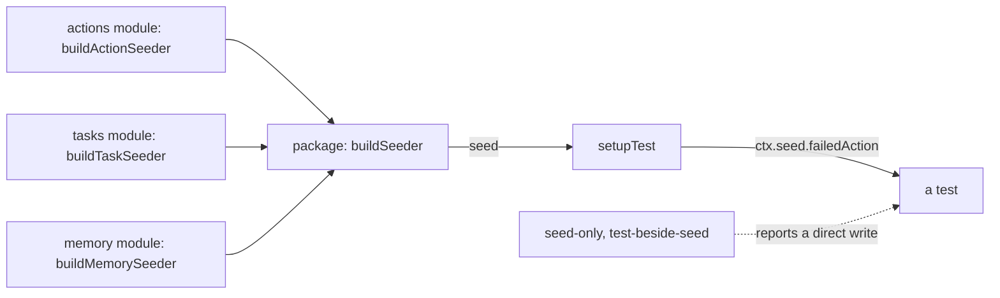

# Test seeders and the seed lint rules

- **Status:** draft
- **Work items:** [the lint config bump](https://linear.app/zgeoff/issue/GEO-2563),
  [the actions seeder](https://linear.app/zgeoff/issue/GEO-2081),
  [every other seeder](https://linear.app/zgeoff/issue/GEO-2565),
  [the seed rules as errors](https://linear.app/zgeoff/issue/GEO-2573)

A test outside a module gets stored state, such as a failed action or a paused task, from a test
seed that the module publishes, and never writes the module's tables itself. A test then fails only
when the module's write code changes, never because a hand-written row drifts from what the code
writes. Two lint rules enforce it: `zgeoff/seed-only` reports a direct write in a test, and
`zgeoff/test-beside-seed` reports a test seed with no test beside it. The testing skill's seeding
reference holds the rule that every repo with these lint rules follows.

Terms:

- A **test seed** is a function in a module's test utils that puts one record into one state through
  the module's own write functions. It is not the definitions seed of the glossary.
- A **seeder** is an object whose members are test seeds, bound to a test's dependencies.
- `ctx` is what a test's `setupTest()` returns, and `ctx.seed` is its seeder.

## Shape



## Contracts

```ts
const ctx = await setupTest();
const action = await ctx.seed.failedAction({ taskID: task.id }); // task: one the test made
// → the failed action, as the actions module's own reads return it
```

```ts
// Each module that owns tables: one builder in its test utils, named after the module's main
// record. Each test seed is one file with a test beside it, and takes the shape of the built
// seeds: (context, input) => Promise<the seeded record>, bound here to the test's dependencies.
// actions module
// ActionRow and ActionStatus: actions module, built
declare function buildActionSeeder(deps: ActionSeederDeps): {
  action: (input: { taskID: string }) => Promise<ActionRow>; // pending
  doneAction: (input: { taskID: string }) => Promise<ActionRow>;
  failedAction: (input: { taskID: string }) => Promise<ActionRow>;
  unknownAction: (input: { taskID: string }) => Promise<ActionRow>;
}; // one test seed for each ActionStatus: 'pending' | 'done' | 'failed' | 'unknown'

// The other builders, each with its members named by the rule in Constraints:
// buildTaskSeeder (tasks), buildMemorySeeder (memory), buildConnectorSeeder (connectors),
// buildBackupSeeder (backup), and buildIdentitySeeder (API module, the one writer of identities).
```

```ts
// Each package whose tests seed another module's records: the API module, the sessions module,
// the server app, integration and e2e. It merges the builders it needs into one seeder.
declare function buildSeeder(
  deps: TestDeps,
): ReturnType<typeof buildActionSeeder> & ReturnType<typeof buildTaskSeeder>; // & each other builder the package needs

async function setupTest() {
  const deps = await startTestAPI();

  return { ...deps, seed: buildSeeder(deps) }; // setupTest() creates no data
}
```

```jsonc
// each module's package.json: one export for its test utils, and no export for a single file
{ "exports": { "./test-utils": "./src/test-utils/index.ts" } }
```

```jsonc
// .oxlintrc.json, under "rules", once every seeder exists
{ "zgeoff/seed-only": "error", "zgeoff/test-beside-seed": "error" }
```

## Constraints

- A test seed's member name is its state, then its record, as in `failedAction`, and the record
  alone for the state that the create function gives, as in `action`. No 2 builders share a member
  name, so `buildSeeder` merges them with no clash.
- The tasks seeder has one test seed for each `TaskState` that the module's create function cannot
  give. The built `seedConversationStep`, `seedHeldTask` and `seedStartedTask` become its members.
- The memory seeder has one test seed for each value of each state type of items and of proposals.
- The connectors seeder holds the built `seedWebFetchLinks`, and the backup seeder holds the built
  `seedFailedBackupNotice`. The server app's built `seedHeldTasks` and `seedRuleConflict` become
  members of its own `buildSeeder`.
- The API module publishes the identity seeds, because `claimEnrolmentCode` is the one product code
  that inserts into `identities`.
- A test writes a table directly only in these places:
  - in a module's own tests, for that module's tables;
  - in the db lib's migration tests;
  - in tests of the code that stores rows, such as a repository function;
  - inside a test seed for a state that no code in the repo makes, such as a row that an earlier
    release wrote before a column was required. The seed's author states the exact state in a `//`
    comment.
- Every other test seeds stored state through `ctx.seed`. An e2e test never writes with raw SQL.
- A test seed calls the module's own write functions, never branches on a state, and never bundles
  several records. When it needs a write that the module does not export, the module exports that
  write function.
- A test seed has no port: it is test code that calls the module's write functions.
- `zgeoff/function-verb` stays an error, with a clause for the verb `seed`.
- `bun run lint:full`, the type-aware pass, reports both seed rules. The pull request's CI run is
  its evidence, because the pass needs more memory than a builder's host may have.

## Decisions

- **The lint is the gate, not a grep.** A grep of `insertInto('actions')` in the API module misses
  every other direct write, and the lint reports each one.

## Builder decides

- The input of each test seed, and which records it returns.
- The `deps` each builder takes.
- The file names under each module's test utils, within the rules of `zgeoff/test-beside-seed`.

## Out of scope

- That a test reads stored state back through the module. It is built.
- Assertions on log lines.
- Any change to product behaviour beyond an export that a test seed needs.
