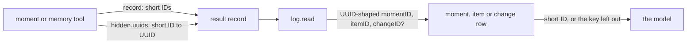

# Short IDs in tool records

- **Status:** draft
- **Work items:**
  [short IDs in the moment and recall records](https://linear.app/zgeoff/issue/GEO-2528),
  [the short ID of a proposal](https://linear.app/zgeoff/issue/GEO-2589)

The model reads and passes the short ID of a moment, a memory item or a proposal, never its UUID, as
[short IDs](../../architecture/core/database.md#short-ids) says. 12 moment and memory tools break
the rule: each stores a UUID in its `record`, and `log.read` prints the stored record to the model.
The 4 write tools also show a proposal's UUID in their result. Each tool stores the short ID instead
and keeps the UUID under `hidden.uuids`, and `log.read` swaps a UUID that an older record holds for
its short ID. [The `hidden` field](tool-hidden-field.md) owns `hidden` and the rule for what
`log.read` prints.

## Shape



## Contracts

```ts
// moment.edit
return {
  status: 'ok',
  result: { momentID: 'k3v9t2m7qa', version: 4 },
  record: { momentID: 'k3v9t2m7qa', version: 4 },
  hidden: { uuids: { k3v9t2m7qa: '5b1f0c1e-2a57-4a0b-9c37-0f6d3f6f2b11' } },
};
```

```ts
// memory module: the hidden object of each tool in the table below
interface HiddenUUIDs {
  uuids: Record<string, string>; // { <short ID>: <UUID> }, one entry per short ID the record shows
}
```

```text
The keys that hold a short ID in each tool's record:
  moment.find     momentID of each entry of `moments`
  moment.read     momentID
  moment.keep     momentID
  moment.edit     momentID
  moment.retire   momentID
  moment.link     momentID, itemID
  memory.recall   itemID of each item
  memory.pending  proposalID of each entry of `proposals`
  memory.remember, memory.edit, memory.retire, memory.pin
                  proposalID, when the status is `proposed`
```

```text
A stored moment.edit record from a release before:
  { "result": { "momentID": "5b1f0c1e-2a57-4a0b-9c37-0f6d3f6f2b11", "version": 4 } }
What log.read prints for it:
  the moment's row exists     {"result":{"momentID":"k3v9t2m7qa","version":4}}
  the moment is destroyed     {"result":{"version":4}}
```

```ts
// memory module: the keys whose UUID-shaped value log.read swaps, at any depth of `result`.
// The proposal item adds 'proposalID'.
const swappedKeys = ['momentID', 'itemID', 'changeID'] as const;
```

## Constraints

- The input schema and the output schema of each tool are unchanged, and so is each result except
  for a proposal's ID. A moment tool's `momentID` input still takes a UUID or a short ID.
- As built, the result of each tool but `memory.pending` already shows the short ID of a moment or
  an item, and only the `record` holds the UUID. The result of `memory.pending` and the `proposed`
  result of a write tool show the proposal's UUID. A tool entry shows the model the same content as
  on main, with each UUID replaced by its short ID.
- `hidden` holds the UUIDs alone.
- No server code reads a UUID out of a stored `result` on main: the decoders of the `tool_result`
  payload outside `readLogPage` read the payload only, and the API passes the erasable fields to the
  web client whole. Code that later needs a stored UUID reads `hidden.uuids`.
- The web client shows the whole result record, the UUIDs included.
- A value is UUID-shaped when it matches the 8-4-4-4-12 hex form, in any case and any version. The
  swap walks objects and arrays at any depth of `result`.
- `log.read` reads the short ID through the built short ID reads of the moment, item and change
  stores, for every result record, whatever tool wrote it. The item read already derives a short ID
  with `buildShortIDFromUUID` when the row has none.
- When the row holds no short ID or does not exist, `log.read` leaves the key out. A destroyed
  moment has no row, so its `momentID` is left out: the model never reads a UUID, even when no short
  ID exists.
- When the read of a short ID fails, such as on a closed database, the `log.read` call fails as any
  read error does. It never prints the UUID.
- A stored `result` that holds only short IDs has no UUID-shaped value, so `log.read` reads no row
  for it.
- A stored `memory.diff` record prints the short ID of each change while the change's row exists,
  and no `changeID` when it does not. So the outcome of the memory gate's check that the change rows
  survive the consolidator's delete needs no change here.
- The 7 moment and recall tools, every tool of the table but the 5 that show a `proposalID`, cover
  every UUID in their records as the records stand on main when the work is built. When
  memory-index-1 lands first, that includes `leftOut.itemIDs` of `memory.recall`. When it lands
  after, memory-index-1 records `leftOut` by this rule.
- A proposal's short ID is the one `buildShortIDFromUUID` gives for its UUID, as a memory
  consolidation change's is in [short IDs](../../architecture/core/database.md#short-ids). Every
  reader derives it from the UUID on each read, and the proposal row gains no column, so the
  proposal item adds no migration and a rollback needs no step. The `memory.proposed` record keeps
  the shape that the release before reads, so it never carries a short ID.
- `memory.pending` and the 4 write tools show the same derived short ID as `proposalID`, so the
  model meets one ID for one proposal. `log.read` swaps a UUID-shaped `proposalID` by the same
  derivation, with no row read.
- The release before prints `hidden.uuids` as it prints any field, so after a rollback the model
  reads those UUIDs.

## Decisions

- **Each tool stores the short ID, and the UUID moves to `hidden`.** A rule in `log.read` alone
  would leave the UUID in the stored record that the next reader prints.
- **`log.read` prints the short ID from the row for a UUID in a stored record, and leaves the key
  out when the row gives none.** An agent's call on 13 Nov, which the owner accepted: the model can
  then name the moment or item in a later call, and older entries keep the link newer entries have.
- **A proposal's short ID is derived from its UUID on each read, with no column.** An agent's call
  on 13 Nov, which the owner accepted: the derivation gives the same value a column would hold, so a
  column adds a migration and a rollback check for nothing.

## Builder decides

- How `log.read` batches the row reads of one page.
- Test layout and internal names.

## Out of scope

- A `record` with short IDs for `memory.diff`, a tool of the built-in consolidator that the memory
  work removes.
- The `record` of any other tool.

## Open questions

None.
