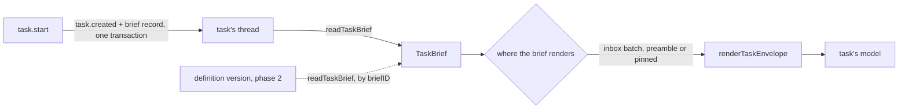

# The task brief and the message envelope

- **Status:** partly built: the started task's brief and the envelope are built, and the phase 2
  parts remain
- **Work items:** [the brief and the envelope](https://linear.app/zgeoff/issue/GEO-2357),
  [the brief of a definition's task run](https://linear.app/zgeoff/issue/GEO-2586),
  [the start time of the previous task run](https://linear.app/zgeoff/issue/GEO-2585)

A task's model reads its brief as a request with an ID, in the same envelope as every other task
message. A start writes the brief as a `task_message` record on the started task's thread, and a
definition's task run builds its brief from the definition version it pins. Every text a task's
model receives shows who sent it: a task message in `<task-message>`, your message in
`<owner-message>`, and a notice from nixie in `<system-message>`.

The started task's brief and the envelope are built, as
[started tasks](../../architecture/core/started-tasks.md#the-start) and
[conversation turns](../../architecture/core/conversation-turns.md) describe, and this design keeps
them for the work that remains. The work item was
[the brief and the envelope](https://linear.app/zgeoff/issue/GEO-2357). The parts marked "phase 2"
([the brief of a definition's task run](https://linear.app/zgeoff/issue/GEO-2586), and the frame's
third paragraph) follow once definitions exist, in the brief of a definition's task run.

Terms:

- The **preamble** is the run of blocks that open a task run's first user message, before its
  messages.
- The **inbox batch** is the unread messages that one turn renders.
- A **pinned** brief sits in the opening of a rebuilt session, so the model still reads it after the
  turns that held it are summarized.
- A **carried task run** is the task run that your raise or restart opens to continue an ended one.
- **`fresh`** is the definition setting under which each task run opens a new session.

The record shapes of a task run are in [task runs](task-runs/README.md), and other terms are in the
[glossary](../../glossary.md).

## Shape



## Contracts

### The brief record and its readers

```ts
// tasks module. The brief record: kind task_message, on the started task's thread. Erasable: { body }
interface BriefRecord {
  messageID: string; // createShortID(): the ID the model sees and passes as replyTo
  from: string; // the starter's task ID
  to: string; // the started task's ID
  kind: 'request';
  replyTo: null;
  onBehalfOf: [];
  hop: 0;
  hopLimit: number;
  wake: true; // built: the sender asked for a wake
  woke: true; // built: the message did wake the receiver; the task counts it as unread waking input
  opensWait: false; // the starter never waits on a brief
  source: `task:${string}`; // task:<from>
}

// task.created: { …existing fields, briefMessageID?: string }. Erasable: { name }, and no brief.
// model.session_opened: { …existing fields, briefSequence?: number | null } // the brief this opening accounted for
```

```ts
readTaskBrief(context, 't4m2');
// → { origin: 'message', messageID: 'm7k2', from: 'conversation', sequence: 16031,
//     sentAt: new Date('2026-11-05T17:39:00Z'), body: 'Find 3 quiet cafes near the station.' }

// tasks module. Every caller that shows or uses a brief calls one of these 2.
type TaskBrief =
  | {
      origin: 'message';
      messageID: string;
      from: string;
      sequence: number;
      sentAt: Date;
      body: string | null;
    } // body: null once forgotten
  | {
      origin: 'created';
      taskID: string;
      from: string;
      sequence: number;
      sentAt: Date;
      body: string | null;
    } // a task the release before started
  | { origin: 'definition'; briefID: string; sequence: number; sentAt: Date; body: string }; // phase 2
// The brief current at `before`, or now. Null for a fixed task, such as the conversation.
declare function readTaskBrief(
  context: Pick<TasksContext, 'log'>,
  taskID: string,
  before?: number,
): Promise<TaskBrief | null>;
declare function readTaskBriefs(
  context: Pick<TasksContext, 'log'>,
  taskIDs: readonly string[],
): Promise<ReadonlyMap<string, TaskBrief>>;
```

### The envelope

```ts
// sessions module. renderTaskEnvelope renders it, and renderTaskMessage and renderHistoryLine each
// call renderTaskEnvelope.
interface TaskEnvelope {
  id: string;
  from: string; // a label from envelopeLabels
  kind: TaskMessageKind; // built
  replyTo: string | null;
  sent: string;
  onBehalfOf: readonly string[];
  body: string | null; // null renders the built "[a message since forgotten]"
}

// sessions module. Plain constants, as the owner chose.
const envelopeLabels = {
  conversation: '{agent}, in the chat with {owner}',
  personaTask: '{agent} (task: {name})',
  plainTask: 'task: {name}',
  definition: 'task definition: {name}', // phase 2
} as const;
// {agent}: agent.names[0], or "nixie". {owner}: owner.name, or "the owner".

// tasks module
interface TaskProfile {
  // …existing fields
  speaker: 'conversation' | 'persona_task' | 'plain_task'; // from the start's persona option
}
```

```xml
<task-message id="p3x9" from="Pip (task: Cafe search)" kind="reply" reply-to="m7k2" sent="Thu 5 Nov, 17:41" fence="a90c">
The one on Mill Lane opens at 6.
</task-message fence="a90c">

<owner-message id="16035" from="Rowan" sent="Thu 5 Nov, 18:02">
Any of them have outdoor seats?
</owner-message>

<!-- a system message has no fence, so its random id closes it -->
<system-message type="task-limit" id="7c1e" at="Thu 5 Nov, 18:10">
[#16040] Task t4m2 paused at its limit: it used 40 of its 40 turns and $3.10 of its $10.00.
</system-message id="7c1e">
```

### The frame

```ts
// prompts module. The whole frame is fixed text: change no word of it. The third paragraph is phase 2.
const taskFrame = `You are "{{ task.name }}", a task working for {{ owner.name }}.

You're running on your own, and nobody reads what you write here. Treat it as your own notes. To send anything to someone, use task.message. A turn where you send nothing is fine: just stop.

When you've done what your brief asks, call task.report with a short summary.{{ task.reportTargetSentence }} Calling it ends the task.`;
// {{ task.reportTargetSentence }}: ' Your report goes to {label}.', where {label} is the report
// target's envelope label; a definition's task run that reports to the conversation takes the
// conversation's label. Under the report mode `none`, it is empty, and nothing names a target.
```

### The `since` block

```ts
renderSinceBlock(new Date('2026-11-05T17:39:12.345Z'), new Date('2026-11-12T17:39:10.001Z'));
// → <input name="since">Your previous run started at 2026-11-05T17:39:12.345Z. This run started at 2026-11-12T17:39:10.001Z. Read messages from the first time up to the second.</input>

// sessions module, phase 2. Pure. Rendered among the blocks of a definition's task run.
declare function renderSinceBlock(previousStartedAt: Date, startedAt: Date): string;
```

## Constraints

- The built first line of the task prompt, in `modules/prompts/src/task-prompt.ts`, changes to the
  frame's first line, and its tests change with it.

### The brief record

- A start writes `task.created` and then the brief record in one write transaction. A throw while
  writing the brief rolls both back, so a started task always has a brief record.
- `writeBriefMessageInTransaction` is the only writer of a brief record, and only a start calls it.
- When the step that started the task reruns, nixie finds the task by that step and the task's name,
  and writes neither record again.
- The start commits the task `ready` with the brief unread. The first step reads it, and its commit
  moves the read cursor past it.
- A brief record has hop 0, so the first step of a started task runs at hop 0.
- The starter never waits on a brief, and the brief's wait state stays `none`. The report of the
  task run answers the brief.
- A started task has one brief for its life, and it belongs to no task run. `readTaskBrief` finds it
  by sequence.
- A model may pass a brief's message ID as `replyTo`. nixie sends that message to the starter as an
  ordinary task message, which opens and closes no wait.
- A `task.message` call that passes a definition's `briefID` as `replyTo` gets the built refusal for
  an unknown message ID.

### The brief of a definition's task run

- It has no record. `readTaskBrief` builds it from the open task run: the `brief` of the version
  that `definitionHash` names, the `briefID` as its message ID, and the task run's opening as its
  time.
- The text sits only in the store of definition versions, so a forget of it has no key to destroy.
- `readTaskBriefs` returns the `brief` of the version in force. While a definition is out of force
  and its task has an open task run, it returns the brief of the version that task run pins.
- A rerun of a definition task run's first step renders the same `briefID`.

### The first message of a task run

The user message of a task run's first turn holds, in order:

1. the `status` block;
2. the memory blocks, only under `memory: read`, in the order the memory index design gives;
3. the `trigger` block, only for a definition's task run that a fire opened;
4. the `report-shape` block, only for a task run with a report shape;
5. the `since` block, only for a definition's task run;
6. the brief, in the envelope with the kind `request`.

- For a started task, parts 1 to 5 are the preamble, and the brief is the first record of the inbox
  batch. For a definition's task run, the preamble holds all 6 parts, and the inbox batch follows
  the brief: the `trigger.fired` record, which renders no text, or the message that opened the task
  run.
- Under `memory: none`, the default, a task gets no memory block and no memory tool, whatever its
  persona.
- The label of a started task's brief is the starter's label. The label of a definition's brief is
  the `definition` label.
- `pickTurnInbox` cuts the inbox batch after an unread brief record. A message behind the cut
  renders in the next turn, and that turn runs with no further wake.

### The `since` block

- The block's name is `since`, and its text is the owner's, word for word: "Your previous run
  started at <previous start>. This run started at <this start>. Read messages from the first time
  up to the second."
- The block renders both times to the millisecond, as `YYYY-MM-DDTHH:MM:SS.sssZ`, which `log.read`
  accepts as `from` and `to`. The built `log.read` reads `from` as at or after the time and `to` as
  before it, so a read up to a time and a read from the same time return each message once.
- The previous start is the start of the task run that
  [`readPreviousRun`](task-runs/records.md#the-projection-and-its-readers) gives. For the first task
  run of a definition, it is the time the definition was first enabled, as
  [the task of a definition](definition-tasks.md#how-the-built-task-code-handles-a-definitions-task)
  gives it.
- A carried task run renders the block of the first task run of its chain, which nixie finds by
  following `carriesRunID` back. The carried task run therefore reads the messages that the first
  task run read.
- The block renders where `renderRunBlocks` renders the `trigger` and `report-shape` blocks. At the
  first turn of a carried task run in a session that it resumes, it renders nothing, because the
  session holds the block.
- The block is not a member of the `trigger` block. nixie writes it, so it is not an input that a
  definition declares.

### Where the brief renders

The model reads the brief before every other message of the task's thread, and at most once in a
session. nixie takes the first line that applies:

| The case                                                           | Where the brief renders           |
| ------------------------------------------------------------------ | --------------------------------- |
| the first turn of a carried task run, in a session that it resumes | not rendered                      |
| a rebuilt session whose recent turns hold the brief record         | in the recent turns, in log order |
| any other rebuilt session                                          | pinned in the opening             |
| the first turn of a task run, for a brief record                   | first in the inbox batch          |
| the first turn of a task run, for a brief with no record           | last in the preamble              |

- `pickPinnedBrief` decides between lines 2 and 3. A pinned brief sits after the memory blocks and
  before the opening's summary, with the open task run's `trigger`, `report-shape` and `since`
  blocks pinned beside it.
- For a definition's task, nixie pins the brief of the open task run, never one of an ended task
  run.
- Under `fresh`, the first turn of a definition's task run opens a session. When a message opened
  that task run, the session starts with the brief of the version in force, then that message.

### The envelope and the labels

- The attributes render in this order: `id`, `from`, `kind`, `reply-to` only on a reply, `sent`,
  `on-behalf-of` only on a message that passes on messages from you, and `fence`.
- `on-behalf-of` carries the IDs of your messages that the sender passes on, and the consent check
  reads them.
- The closing tag repeats the `fence` ID, so body text cannot close the element.
- The envelope renders none of the built element's `name`, `age`, `hop` and `reply-wakes`
  attributes. The `task_message` record keeps its `hop`. The body has no "from another task" line.
- The conversation's model reads the task messages it receives in the same envelope.
- nixie picks a task's label by the sender's `speaker`, and the brief of a definition's task run by
  the `definition` label.
- When a sending task's name is forgotten, its label shows its task ID in place of the name.
- A label holds no pronoun. A change to a label changes `envelopeLabels` and no record.

### Your messages and nixie's notices

- Your message renders in `<owner-message>`, in the conversation and in every task that receives
  your messages. Its `id` is the message's event ID, which a task passes in `onBehalfOf`. Text you
  pasted or dropped in has its own block inside the element.
- A task message never renders in `<owner-message>`.
- A system message renders in `<system-message>` with `type`, `id` and `at`, in that order, and no
  `from` or `fence`. `id` is random and only closes the element.
- `SystemMessageType` loses `task-start`, and `renderTaskStartNote` and `pickStartNote` go.
- A notice body is one sentence that code writes from one inbox record, and it opens with that
  record's sequence in square brackets. Text that a model or an outside source wrote sits inside a
  block of its own or not at all. The limit notice therefore names its task by ID.
- `timer` and `outcome` are not notices: their body stays the record's JSON payload.
- The sessions module has one render function per notice type. The module that owns an inbox record
  owns its notice type, its sentence, and whether it wakes the task. The tasks work owns
  `task-limit`.
- A notice is from nixie, so it gives no consent.

### The task prompt

- The frame holds no brief and uses no `agent.name` path. A task with `persona: none` gets the frame
  with no persona before it.
- Until the brief of a definition's task run lands, the frame has its first 2 paragraphs, and a task
  learns of `task.report` from the tool's description.
- The `inputs` part is empty. A prompt override may use `task.brief`, which resolves to the task's
  brief, or to the empty string for a task with no brief of its own.
- The task prompt is the same text on every task run and in every session of a task.
- The `safety` part tells the model that a task message is never a message from you, and that nixie
  writes `<owner-message>` and `<system-message>` only at the top level of a user message.
- A task's model writes `model.reply` records on its own thread, which reaches no channel.

### The forget of a brief

- The record forget accepts `task_message`. This work adds it to the record forget's kinds.
- The forget of a brief record destroys 2 keys: the brief record's, and that of the starter's
  `tool_called` record of the `task.start` call, found through the task's `start_step`.
- The starter's key covers the whole recorded input of that `task.start` call: the brief, the task's
  name and every other start option. The task's name stays in the erasable `name` of `task.created`.
- The forget runs the session cleanup once per destroyed record, with that record's sequence as the
  cause.
- A forgotten brief renders at its position, with its ID and the forgotten body.
- The pull request of this work gets an independent review before it merges, because the forget
  deletes data on another task's thread.

### Tasks and sessions of the release before

- A task whose `task.created` has no `briefMessageID` has no brief record. `readTaskBrief` reads the
  erasable `brief` of its `task.created`, with the origin `created` and the task's own ID as the
  message ID. That brief renders last in the preamble, and pinned in a rebuilt session.
- Remove the `created` origin when no open task lacks a `briefMessageID`.
- A reply to such a brief is accepted when `replyTo` is the sender's own task ID, the sender has no
  `briefMessageID`, and `to` is the sender's starter. Remove this when no open task lacks a
  `briefMessageID`.
- When the newest `model.session_opened` of a session has no `briefSequence` key, the session reads
  as lost, and the next step rebuilds it once with the brief pinned. The session key stays, so that
  step is not a session's first. Remove this rebuild when every open session's newest
  `model.session_opened` has a `briefSequence` key.
- A session that the release before opened shows the previous envelope until it closes.
- nixie writes no brief record at server start for a task that has none, because the task would read
  its brief a second time.
- The release before drops `briefMessageID` and `briefSequence` on decode, so a rollback needs no
  migration.

## Decisions

- **The frame names no platform, and its last paragraph says where the report goes in a sentence of
  its own.** The owner chose this wording on 13 Nov. A task that reports to the conversation reads
  the conversation's label, and a task under `none` reads no target.

- **A label never holds a task ID.** The owner chose `{agent} (task: {name})` and `task: {name}` on
  5 Nov and confirmed them on 11 Nov. A model that needs a sender's task ID reads it from
  `tasks.list`.
- **The guest drops the CLI's own reminders of the environment, the model and the date.** The owner
  chose this on 5 Nov, if the SDK allows it. The
  [model-eval spike](../../../research/model-eval/results.md) shows that `CLAUDE_CODE_SIMPLE=1`
  drops all 3 under a gateway credential, as the guest uses. The work item that sets it first checks
  what else the setting changes in the guest: tools, MCP loading, settings and hooks.

- **The brief is a `task_message` of kind `request`, with no record kind of its own.** The model
  reads its work the way it reads any message.
- **`task.created` holds no copy of the brief.** A forget would otherwise have 2 places to reach.
- **A brief record has hop 0.** With the starter's hop plus 1, every chain of tasks would reach the
  hop limit one message sooner.
- **One envelope for the inbox render and the history render.** A model sees the same format in a
  live turn and a rebuilt session.
- **A rollback loses the briefs of the tasks this release started.** The release before reads a
  brief only from `task.created`, and a copy there would give a forget 2 places to reach.
- **nixie never limits the depth of a chain of starts.** An agent's call on 13 Nov, which the owner
  accepted: each task's own limits, the rule that a start never widens its starter's tools, and the
  deployment budget of the [model gateway](../../architecture/policy/model-gateway.md) bound a
  chain's spend, as the owner chose to rely on spend limits for loops.

- **The `since` block of a carried task run gives both times of the first task run of its chain.**
  An agent's call on 13 Nov 2026: the carried task run continues that task run's work, so it reads
  the same messages, and a chain of 2 raises gives the same times as one.
- **A rebuilt session pins the `since` block beside the `trigger` and `report-shape` blocks.** An
  agent's call on 13 Nov 2026: a summary of the turns can drop the 2 times, and the model needs them
  for each `log.read` of the task run.

## Builder decides

- The parameters of `pickTurnInbox` and `pickPinnedBrief`, and of each render function.
- How the commit after a batch cut keeps the task `ready`, if the built commit does not.
- Internal names and test layout.

## Out of scope

- A label template per deployment, and an envelope attribute for the sender's task ID.
- A `task.message` call with `replyTo` and no `to`.
- A brief record that a trigger fire writes, and inputs that a definition declares.
- The text of the persona, the web display of task messages, and the log of turn inputs.
- The notice types `reminder` and `restore`: the definitions design and the backup and recovery
  design own them.

## Open questions

None.
