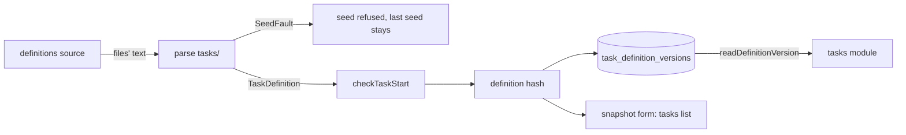

# The task definition format

- **Status:** draft
- **Work items:** [the format and the seed](https://linear.app/zgeoff/issue/GEO-1834),
  [the task of a definition](https://linear.app/zgeoff/issue/GEO-2531),
  [the runtime layer](https://linear.app/zgeoff/issue/GEO-2533),
  [the docs say "task definition"](https://linear.app/zgeoff/issue/GEO-2536),
  [the note-taking example](https://linear.app/zgeoff/issue/GEO-2532),
  [the consolidation example](https://linear.app/zgeoff/issue/GEO-2530),
  [the moment reflection example](https://linear.app/zgeoff/issue/GEO-1334)

A task definition is a folder `tasks/<id>/` in the definitions repo. Its `task.yaml` holds the input
of one `task.start` call and an optional trigger, so nixie can start the task without you, from
files you read and diff. A seed parses every folder with one strict schema, refuses the whole seed
on one fault, hashes each definition and stores each version under its hash. A definition that the
agent makes from chat follows the same schema and the same store.

Terms: the definitions repo is the git repo that the definitions source reads. The definition ID is
the folder name. A definition version is the content of one definition at one seed, and the
definition hash is its hash. A definition is in force when the last accepted seed holds it and it is
enabled. The glossary's "job" is a task definition.

## Shape



## Contracts

### The folder and `task.yaml`

```yaml
# tasks/water-the-tomatoes/task.yaml
name: Water the tomatoes
brief: Read what memory holds about the garden and say what needs water this week.
trigger:
  schedule:
    every: week
    on: fri
    at: '08:00'
tools:
  - memory.recall
report: wake

# tasks/dentist/task.yaml: a reminder, with no task
name: Dentist
brief: Call the dentist about the check-up.
target: conversation
trigger:
  at: '2027-03-09T14:00:00+11:00'
```

```ts
// definitions module. The schema is strict: a key outside both groups is a fault.
type TaskDefinition = TaskStartInput & DefinitionOnly;
// TaskStartInput: the output of parseTaskStartInput, tasks module, from the task runner port work
// (not built). It holds `name` and `brief` (both required), `model`, `persona`, `memory`, `tools`
// and `report`, and gains `log` and `reportShape` when the tasks work adds them to that schema.

interface DefinitionOnly {
  enabled: boolean; // default true
  trigger: Trigger | null; // default null
  target: 'task' | 'conversation'; // default 'task'. 'conversation': a fire shows a reminder
  context: 'fresh' | 'continuing'; // default 'fresh'. 'continuing' resumes the last task run's session
  wakeable: boolean; // default false. The task wake work owns its meaning.
  step: { file: string; api: 1 } | null; // default null. The seed hashes the file; no code runs it.
  // maxCalls: added by the task run limits work, with its own seed check and fault code
}

// contract lib, beside isTimeZone. The definitions schema, the triggers module, the chat tools and
// the API all read it, and the contract lib is the one place every one of them may import.
type Trigger = { schedule: Schedule } | { at: string }; // at: ISO 8601 with an offset or `Z`
// Schedule: its keys and rules are in the trigger core design: ./triggers.md#schedule
```

The folder:

```text
tasks/<id>/task.yaml        required
tasks/<id>/instructions.md  optional
tasks/<id>/<name>.ts        one step file, allowed only when step.file names it
```

### What a seed refuses

```ts
// definitions module. One fault in one file refuses the whole seed.
interface SeedFault {
  path: string; // the file, such as 'tasks/dentist/task.yaml'
  fault: SeedFaultCode;
  reasons: string[]; // the sentences of the schema or of checkTaskStart; empty for the others
}

type SeedFaultCode =
  | 'missing_task_yaml' // a tasks/<id>/ folder with no task.yaml
  | 'bad_id' // an ID outside [a-z0-9-], or longer than 64 characters
  | 'unknown_key' // includes role, inputs, reportFields, runner and skills
  | 'unnamed_step_file' // a .ts file that step.file does not name
  | 'reminder_key' // target: conversation with a key other than name, brief, target, trigger, enabled
  | 'reminder_without_trigger'
  | 'bad_slot' // a slot in instructions.md that the `task` prompt does not accept; trigger.* and inputs.* never are
  | 'poll_trigger' // the trigger holds `poll`
  | 'bad_schedule' // a Schedule key outside its rule
  | 'at_without_offset'
  | 'start_refused'; // checkTaskStart refuses the task.start input
```

```ts
// What the server app passes into the definitions module. It wraps planTaskStart, which the tasks
// module keeps unexported, with the starter and the bounds below.
type CheckTaskStart = (
  input: TaskStartInput,
  starter: 'file' | 'conversation', // 'conversation' for a definition from chat
) => { status: 'planned' } | { status: 'refused'; reasons: string[] };
// 'conversation': the starter and the TaskStartBounds that the conversation's task.start passes.
// 'file': the same until the owner answers the open question on a file definition's starter.
```

### The hash, the version store and the snapshot

```text
task_definition_versions, one appended migration. nixie never deletes a row.
  definition_hash  text, primary key
  definition_id    text
  form             text, the parsed TaskDefinition as canonical JSON, defaults filled
  files            text, a JSON object of path to exact text: task.yaml, instructions.md, a step file
```

```ts
// definitions module. Replaces `jobs: []` in the snapshot form. Sorted by id.
type SnapshotTasks = Array<
  | { id: string; hash: string; origin: 'definitions' }
  | { id: string; hash: string; origin: 'nixie'; changeID: string } // a runtime definition
>;
```

```ts
const version = await readDefinitionVersion('3f9c…');
// → { definitionID: 'water-the-tomatoes', name: 'Water the tomatoes', brief: 'Read what memory…',
//     instructions: '', model: null, profile: null, persona: 'default', memory: 'read', log: 'own',
//     tools: ['memory.recall'], context: 'fresh', wakeable: false }
//   or null: no row holds the hash

// definitions module. The server app passes it into TasksContext.
type ReadDefinitionVersion = (definitionHash: string) => Promise<DefinitionVersion | null>;

interface DefinitionVersion {
  definitionID: string;
  name: string;
  brief: string;
  instructions: string; // '' when the folder holds no instructions.md
  model: string | null; // null: the model profile of the model role `task`
  profile: string | null;
  persona: TaskPersona; // tasks module, built
  memory: TaskMemory; // tasks module, built
  log: 'own' | 'conversation'; // 'own' unless the definition sets the log grant
  tools: readonly string[];
  context: 'fresh' | 'continuing';
  wakeable: boolean;
}
```

## Constraints

### The folder and the keys

- Under `tasks/`, `isDefinitionsPath` accepts only `.yaml`, `.md` and `.ts` files.
- `definitionsLayout.folders` holds `tasks`, `prompts`, `rules` and `skills`. nixie reads no `jobs/`
  folder, and the seed record lists it among the skipped root entries.
- `definitionsFormats.tasks` is 4, and a release reads formats 3 and 4. At format 3, nixie loads no
  task definition, and the seed record lists each file under `tasks/` as not applied.
- When a definition omits `model`, its task runs use the model profile of the model role `task`.
- When a definition has `target: task` and no trigger, nixie loads it and binds its task, and never
  opens a task run from a trigger.

### The seed

- nixie checks each definition through `CheckTaskStart`, the one check of a start. The memory tools
  on a task work owns which memory tools a task may hold, and the seed applies that rule only
  through the check.
- When nixie refuses a seed, the definitions of the last accepted seed stay in force.
- A seed is one write transaction. In order: every refusal, the hook that binds each task
  ([the task of a definition](definition-tasks.md#the-seed-hook-and-the-binding)), the hook that
  arms each trigger ([the trigger core](triggers.md#the-arming-hook)), then the `unchanged` return.
  A refused seed calls neither hook, and an `unchanged` seed calls both.
- The parser takes the text of the files as input and never reads the definitions source, so a test
  checks a definition that lives in no repo.

### The hash and the store

- The definition hash covers the parsed `task.yaml` with defaults filled, as canonical JSON; the
  hash of `instructions.md` after `normalizeInstructions`, the persona's normalisation; and the hash
  of the step file.
- A comment in `task.yaml` leaves the hash unchanged. An edit of `instructions.md` changes it.
- When a task run's pinned hash has no row in `task_definition_versions`, the step fails, and after
  `maxStepErrors` failed steps nixie sets the task to `failed`.
- The definitions module imports the tasks module for `TaskStartInput`, and the tasks module imports
  nothing from the definitions module. Module-to-module imports pass the boundary tags, and no
  package the tasks module depends on reaches the definitions module.
- The format adds no port and no config key.

## Decisions

- **Each task run uses the version pinned when it opened.** A seed's edit reaches the next task run,
  never a task run in progress.
  [The trigger source](../platform/channels/trigger-source.md#schedules)
- **A file definition and a runtime definition follow one schema and one store.** Two schemas would
  let chat make a definition that a file cannot hold.
- **One fault refuses the whole seed.** A partial seed would put half an edit in force.
- **`Trigger` lives in the contract lib.** The definitions module imports the triggers module, so
  the triggers module cannot import the type from it.

## Builder decides

- The sentences of each fault. Each fault names its file and its code.
- Where in the seed's transaction nixie stores each version and lays the runtime layer over the
  repo, as long as both come after every refusal and before the 2 hooks.
- Internal names, and the layout of the parser's tests.

## Out of scope

- A `poll` trigger, and a trigger kind `log`. The poll sources own `PollFilter`.
- Code that runs a step file.
- A `skills` key: `task.start` takes no skills, so a task run has no way to use a pinned skill.
- The keys `inputs` and `reportFields`.
- A bypass of `slice1.read-only` for the tools that a definition lists.
- A way to start a definition that has no trigger.

## Open questions

- **Does a definition hold a `runner` key?** The owner settles it: a `runner` key that
  `readDefinitionVersion` returns, or the nixie runner for every definition. Until then, the seed
  refuses `runner` as an unknown key, every definition runs on the nixie runner, and a `step` key is
  always on that runner.
- **Which starter and bounds does the seed pass to `planTaskStart` for a file definition?** The
  owner settles it. A file definition may need a wider grant than the conversation holds, such as
  any registered tool or `log: conversation`. Until then, the seed passes the starter and the bounds
  that the conversation's `task.start` passes, so a file definition holds only what a task the
  conversation starts can hold.
- **Does the rule format rename `jobs` and `job`?** The owner settles it in
  [the rule format names](https://linear.app/zgeoff/issue/GEO-2535). Until then, the rule format
  keeps its `jobs` field and its `job` context as built.
