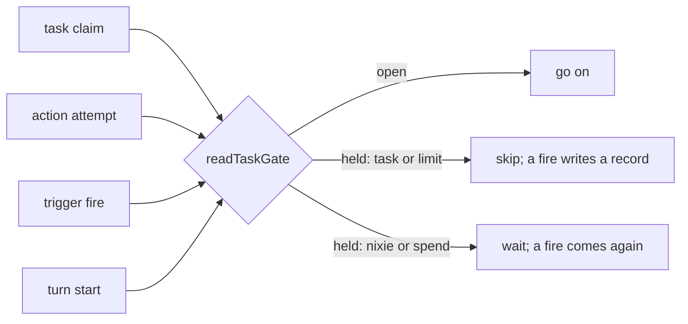

# One gate for every hold on a task

- **Status:** draft

A task can be held for four reasons: you paused it, you paused all of nixie, the spending stop
tripped, or the task reached one of its limits. Today each check reads its own subset. The claim
filter reads the task's state and the nixie pause, the attempt check reads another list of states,
the spending stop runs a check of its own before each turn, and a schedule reads only the task's own
pause and limit. So a schedule fires into a task's inbox while all of nixie is paused, which the
[pause design](pause.md) says never happens. After this design, one function answers whether a task
may go on and why not, and every claim, action attempt, turn and trigger fire asks it.

The word "recovery" also means two things: the restart sweep after a crash, and one restore. After
this design it means one.

Once the owner approves this design, build its work items from it and the built
[claim path](../../architecture/core/leases-and-recovery.md#the-claim-path) it extends.

## Shape



## Terms

- A task is **held** when the gate answers anything but open. Every other word for it, such as
  paused, barred or stopped, names a reason.
- An **exempt task** is one you resumed while nixie is paused, as in the [pause design](pause.md).

## Contracts

### The gate

```ts
const gate = await readTaskGate(tx, taskID);
// → { open: false, reason: 'nixie', since: 1796548800000 }
```

```ts
// tasks module. The one answer to "may this task go on", read inside the caller's transaction.
type TaskGate = { open: true } | { open: false; reason: TaskHoldReason; since: number }; // since: epoch ms of the hold's record

// In order of precedence: the first that holds is the reason.
type TaskHoldReason =
  | 'spend' // the spending stop stands; an exemption doesn't lift it
  | 'nixie' // nixie is paused, by you or by a restore, and the task isn't exempt
  | 'task' // the task's own state: paused, stopped, failed or closed
  | 'limit'; // the task reached a limit and nothing raised it
```

- The claim filter keeps its SQL form and builds it from the same predicate the gate uses, so the
  two can't disagree. A test runs the gate and the filter over every reason and checks they agree.
- `readTaskGate` replaces `probeTaskPaused`, the attempt check's list of states and the definition
  fire's held check.
- The spending check before each turn reads the gate. Its own job shrinks to tripping the stop when
  the turn count reaches the limit.

### What each caller does when held

| Caller         | `task` or `limit`                                      | `nixie` or `spend`                                            |
| -------------- | ------------------------------------------------------ | ------------------------------------------------------------- |
| task claim     | skips the task                                         | skips the task                                                |
| action attempt | barred; an attempt already started runs to its outcome | barred; the attempt stays pending and the lease is freed      |
| trigger fire   | writes `trigger.skipped` with `task_held`, as today    | writes nothing and takes no key; the source delivers it again |
| turn start     | –                                                      | the step waits, as a step under the spending stop does today  |

- A schedule fire that waited through a hold is late when the hold ends. The
  [catch-up rule](../../architecture/core/triggers.md#the-schedule-source) decides it, as for a fire
  missed while nixie was down: one catch-up within half the interval, otherwise a `too_late` skip.
- A trigger whose target is the conversation reads the gate of the conversation's task.
- Poll sources, such as mail, deliver while nixie is paused, and their events wait in the inbox.
- Timers, inbox records and action outcomes land while a task is held, as they do today.

### The two recoveries

```text
crash side, after this design   restore side, unchanged
the restart sweep               recovery: one restore under one recoveryID
start part restart_sweep        recoveries table, recovery.started, recovery.notice, recovery.read
runRestartSweep                 installRestorePause
fault points restart_sweep.*    fault points recovery.pause.*
```

The restore side keeps the word, because its names are stored and published: a table, two record
kinds and an API route. The crash side holds only code names and fault point IDs.

## Constraints

- Every claim, attempt start, turn start and trigger fire reads `readTaskGate` in the same
  transaction as the write it guards.
- A hold never drops a fire. A fire lands, waits for the next delivery, or is skipped with a record
  that gives the reason.
- The gate reads only the database.
- The lease guard keeps its test-build throw for a candidate that the gate holds, so a claim query
  that skips the filter fails in tests.

## Builder decides

- How the claim filter and the gate share the predicate.
- The fault point IDs' new prefix, once the old IDs are gone.
- Whether `since` comes from the record's sequence or its time.

## Out of scope

- What a resume does, and which tasks can be exempt. The [pause design](pause.md) holds them.
- The spending stop's limits and its watcher.

## Open questions

- **Which side gives up "recovery".** The owner chose to rename the restore side. Its names are
  stored and published, so that rename needs a migration, new record kinds with the old ones still
  read, and a new API route beside the old one for a minor release. Renaming the crash side touches
  code and fault point IDs only. Until the owner decides, the design renames the crash side.
