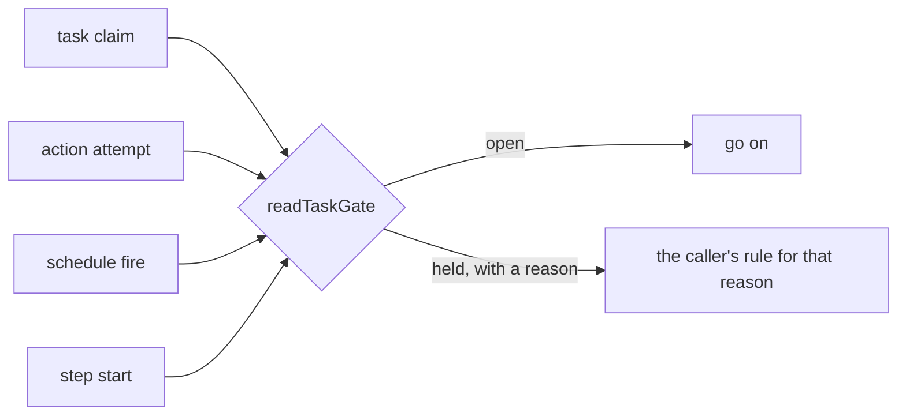

# One gate for every hold on a task

- **Status:** agreed

A task is held when you paused it, you paused all of nixie, the spending stop tripped, or the task
reached one of its limits. Today each check reads only some of these. The claim filter reads the
task's state and the nixie pause, the attempt check reads another list of states, the spending stop
runs a check of its own before each turn, and a schedule reads only the task's own pause and limit.
So a schedule fires into a task's inbox while all of nixie is paused, which the
[pause design](pause.md) says never happens. After this design, one function answers whether a task
may go on and why not, and every claim, action attempt, step and schedule fire asks it. A small
rename at the end gives "recovery" one meaning.

Once the owner approves this design, build its work items from it and the built
[claim path](../../architecture/core/leases-and-recovery.md#the-claim-path) it extends.

## Shape



## Terms

- A task is **held** when the gate answers anything but open. Every other word for it, such as
  paused, barred or stopped, names a reason.
- An **exempt task** is one you resumed while nixie is paused, as in
  [pausing nixie](../../architecture/core/pause.md).

## Contracts

### The gate

```ts
const gate = await readTaskGate(tx, taskID);
// → { open: false, reason: 'nixie', since: 1796548800000 }
```

```ts
// tasks module. The one answer to "may this task go on", read inside the caller's transaction.
// since: the recorded time, in epoch ms, of the record that put the task in its present hold:
// the record that set an ended state, the stop row's or the pause row's own record,
// task.limit_reached or task.paused. A later pause or trip that replaces the row moves it.
type TaskGate = { open: true } | { open: false; reason: TaskHoldReason; since: number };

// In order of precedence: the first that holds is the reason. An ended task comes first, because
// it never runs again, so a caller never waits on it.
type TaskHoldReason =
  | 'ended' // the task is done, stopped, failed or closed
  | 'spend' // the spending stop's row stands; an exemption doesn't lift it
  | 'nixie' // nixie is paused, by you or by a restore, and the task isn't exempt
  | 'limit' // the task reached a limit and nothing raised it, whether or not it is paused too
  | 'task'; // the task is paused; a pause you asked for counts once task.paused is written
```

- Put the spending stop's projection in the log module, beside the pause tables, and export its
  write the way `pauseNixieInTransaction` is exported. The spend module keeps the record kinds and
  calls that write. The table keeps its name, and a rebuild fills it. The tasks module can't import
  the spend module without a cycle, so the gate reads the log module's table in one read.
- The spending stop holds a task through its own row, whatever the nixie pause's cause. A trip still
  pauses nixie, and nixie can't resume while the stop stands, as today.
- One predicate builder takes the caller, and each claim filter is built from it in SQL. A test per
  caller runs the gate and the filter over every reason and checks they agree.
- The task claim's filter leaves out `limit`. A task at a limit is claimed once, and the step start
  writes `task.paused`, as today. Its reason stays `limit`, with `since` at `task.limit_reached`,
  because `limit` comes before `task`.
- `readTaskGate` replaces `probeTaskPaused`, the attempt check's list of states and the definition
  fire's held check.
- No caller shows `since` yet. A later work item can show it in the task list.

### What each caller does when held

| Caller         | `ended`                            | `task` or `limit`                                   | `nixie` or `spend`                                                        |
| -------------- | ---------------------------------- | --------------------------------------------------- | ------------------------------------------------------------------------- |
| task claim     | skips the task                     | skips a paused task; claims a task at a limit once  | skips the task                                                            |
| action claim   | as today, by the task's state      | skips an unstarted attempt                          | skips every attempt                                                       |
| action attempt | as today, by the task's state      | barred and stays pending; its lease is freed        | barred and stays pending; its lease is freed                              |
| schedule fire  | `trigger.skipped` with `task_held` | `trigger.skipped` with `task_held`, as today        | writes nothing and claims no trigger key; the next tick delivers it again |
| step start     | the claim already skipped it       | at a limit, writes `task.paused` and ends, as today | `spend` ends the step; `nixie` lets it run to its commit                  |

- In the table, "as today, by the task's state" means a stop cancels the task's actions, a closed
  task's unstarted attempt is barred, and a done or failed task's action runs.
- An attempt already started runs to its outcome, except under `nixie` or `spend`, or when a stop
  cancels it.
- An unstarted action of a task at a limit waits until the limit is raised.
- A schedule fire held for `nixie` or `spend` claims no trigger key, the key that stops a fire
  landing twice, so the source's next tick delivers it again. When the hold ends, the fire is late,
  and the [catch-up rule](../../architecture/core/triggers.md#the-schedule-source) applies, as for a
  fire missed while nixie was down: one catch-up within half the interval, otherwise a `too_late`
  skip.
- A one-shot schedule that waits retires only when it fires or is skipped.
- Poll sources, such as mail, never read the gate. They keep their cursor, and while nixie is paused
  their events land in the inbox and wait there.
- A trigger whose target is the conversation reads the gate of the conversation's task, and heeds
  only `nixie` and `spend`. It fires into a conversation you paused yourself, as today, so a
  reminder still lands.
- A step already under way when its task is paused finishes, as a pause request does today.
- Timers, inbox records and action outcomes land while a task is held, as they do today.

### The step start

The claim filter already skips a task that is held at claim time. The step start catches a spending
stop that trips after the claim.

- Once per step, before its turn, the step trips the stop if the turn count reached its limit, then
  reads the gate in a read transaction. Both run where today's spending check runs.
- A step held for `spend` ends at once and commits nothing. The claim filter holds the next claim.
  The two-second wait of today's spending check goes.
- A step under way when nixie pauses runs to its commit, as
  [pausing nixie](../../architecture/core/pause.md#what-a-pause-stops) says.
- A worker run reads the gate of the task whose step started it: for a conversation step, the
  conversation's task. Held for `spend`, it returns today's "spending is stopped" sentence.
- When the stop trips during a turn, that turn finishes. The stop's limit has room for one turn past
  it.

### The two recoveries

The rename shares no code with the gate and ships as its own work item.

| Name             | Crash side today  | Crash side after the rename | Restore side, unchanged                                                    |
| ---------------- | ----------------- | --------------------------- | -------------------------------------------------------------------------- |
| what it is       | crash recovery    | the restart sweep           | recovery: one restore under one `recoveryID`                               |
| start part       | `recovery`        | `restart_sweep`             | –                                                                          |
| entry point      | `runRecovery`     | `runRestartSweep`           | `installRestorePause`                                                      |
| stored or public | –                 | –                           | `recoveries` table, `recovery.started`, `recovery.notice`, `recovery.read` |
| fault points     | `recovery.step.*` | `restart_sweep.*`           | `recovery.pause.*`                                                         |

Call the crash side the restart sweep. Keep "recovery" for the restore side, because its names are
stored and published: renaming them would need a migration, new record kinds while the old ones are
still read, and a new API route beside the old one. The crash side holds only code names and fault
point IDs.

## Constraints

- Every attempt start and schedule fire reads `readTaskGate` in the same transaction as the write it
  guards. Every claim applies the filter built from the gate's predicate, in its claim transaction.
  A step start reads the gate in a read transaction of its own, after the trip check, which may
  write.
- A hold never drops a fire. A fire lands, waits for the next delivery, or is skipped with a record
  that gives the reason.
- The gate reads only the database.
- The lease guard keeps its test-build throw for a candidate the claim should have filtered out, so
  a claim query that skips the filter fails in tests. It applies each caller's rule from the table:
  a started attempt of a task held for `task` or `limit` passes.

## Builder decides

- How the claim filter and the gate share the predicate.
- The fault point IDs' new prefix, once the old IDs are gone.

## Out of scope

- What a resume does, and which tasks can be exempt.
  [Pausing nixie](../../architecture/core/pause.md) holds them.
- The spending stop's limits and its watcher.
