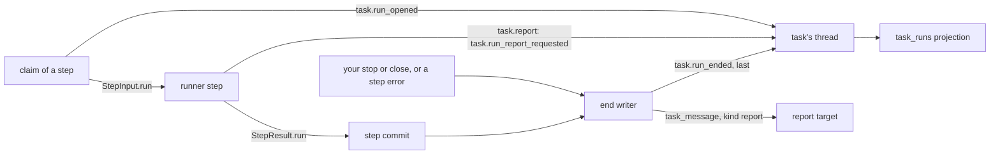

# Task runs and their reports

- **Status:** draft
- **Decision records:** [0055](../../../decisions/0055-the-report-shape-of-a-task.md)
- **Work items:** [task run records and `task.report`](https://linear.app/zgeoff/issue/GEO-2113),
  the brief of a definition's task run, [the wake rule](https://linear.app/zgeoff/issue/GEO-1865),
  the previous task run's start, the runner port, the worker tool

A task run is one stretch of a task's work that ends in exactly one report. Three records on the
task's thread mark each task run, so nixie counts turns, dollars and tool calls per task run, and
the task that asked for the work always learns how it ended. A task ends its task run with
`task.report`, and nixie checks the report's fields against the report shape that the start or the
definition declared.

Terms:

- The **report target** is the task that receives the report: the starter for a started task, and
  the conversation for a definition's task run.
- A **carried task run** is the task run that your raise or restart opens to continue an ended task
  run. A **piece of work** is an ended task run with every carried task run after it.
- A **quiet turn** sends no message and calls no `task.report`.
- A **wakeable** task starts a task run when a message reaches it while it waits.
- The **limit hold** is the built `task.limit_reached` record that keeps a task paused until you
  raise its limit.
- The **hop limit** is the built count of task messages in one exchange past which a message no
  longer wakes its receiver.

Other terms are in the [glossary](../../../glossary.md).

## Shape

## Parts

| Doc                   | What it holds                                                                                                                                                                              |
| --------------------- | ------------------------------------------------------------------------------------------------------------------------------------------------------------------------------------------ |
| [records](records.md) | the 3 records, the `task_runs` projection and its readers, what a runner, a tool call and a meter see, opening and ending a task run, delivering the report, limits, a raise and call caps |
| [reports](reports.md) | `task.report`, the report shape, the report body, the blocks of a task run, and the forget of a report                                                                                     |

The end writer in records writes the body that reports defines, and `task.run_opened` in records
pins the shape that reports checks.
