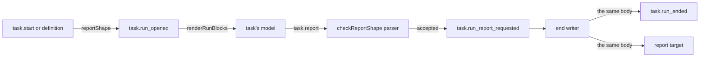

# Task runs: the report

- **Status:** draft
- **Work items:** [task run records and `task.report`](https://linear.app/zgeoff/issue/GEO-2113),
  [the brief of a definition's task run](https://linear.app/zgeoff/issue/GEO-2586)

A task ends its task run with `task.report`, and nixie checks the report's fields against the report
shape that the start or the definition declared. This part holds the tool, the shape, the report
body, the blocks a task run renders, and the forget of a report. The records and the end writer are
in [records](records.md).

## Shape



## Contracts

### `task.report`

```ts
task.report({
  summary: 'Read the 3 pages. The second one has the opening hours.',
  fields: { pagesRead: ['https://cafe-list.test/north'], confidence: 'medium' },
});
// → { reportID: 'r8d2' }
//   or the outcome `error` with a sentence of reportCallRefusals; an empty summary gets `invalid`

// tasks module. effects ['note'], execution 'direct', recordInput: () => ({}).
// input: { summary: string /* 1 to 8000 characters after a trim */, fields?: JSONObject }, no other key
const reportCallRefusals = {
  mismatch:
    "This report's fields do not match the shape this task declares, so nixie sent nothing and the run goes on. {faults} Call task.report again with a summary and with fields that match this schema: {schema}",
  noShape:
    'This task declares no report fields, so nixie sent nothing and the run goes on. Call task.report again with a summary only.',
  size: "This report's fields are {n} characters and the most is 16000, so nixie sent nothing and the run goes on. Call task.report again with shorter fields.",
  second: 'This run already sent its report as {reportID}.',
  // a step whose lease expired: the built `stale_step` sentence of task.message
};
// {faults}: each missing required field, a count of the fields the shape lacks, then each other
// fault's path and rule. {schema}: the pinned shape as one line of JSON.
```

### The report shape

```ts
task.start({
  name: 'Cafe hours',
  brief: 'Read the 3 cafe pages and report the opening hours.',
  report: 'next_turn',
  reportShape: {
    properties: {
      pagesRead: { type: 'array', items: { type: 'string' }, maxItems: 20 },
      confidence: { type: 'string', enum: ['low', 'medium', 'high'] },
    },
    required: ['pagesRead', 'confidence'],
  },
});
// A definition file takes the same `reportShape` key. task.define takes none.

// tasks module
type ReportShape = { properties: Record<string, FieldSchema>; required?: string[] };
type FieldSchema = {
  // the closed table of keywords
  type: 'string' | 'number' | 'integer' | 'boolean' | 'array' | 'object';
  description?: string; // at most 200 characters
  enum?: (string | number)[]; // 1 to 50 values
  items?: FieldSchema; // with type array
  properties?: Record<string, FieldSchema>; // with type object
  required?: string[]; // with type object; each name is one of its properties
  maxLength?: number;
  maxItems?: number;
  minimum?: number;
  maximum?: number;
};
type ShapeFault =
  | { fault: 'keyword'; path: string; keyword: string }
  | { fault: 'value'; path: string; keyword: string }
  | { fault: 'required'; path: string; name: string }
  | { fault: 'size'; size: number; max: number };

// tasks module, pure. planTaskStart calls it, and the seed calls it through planTaskStart.
declare function checkReportShape(
  shape: unknown,
): { status: 'accepted'; shape: ReportShape } | { status: 'refused'; fault: ShapeFault };
// tools module: the parser the registry builds for each tool, moved out as one export
declare function buildSchemaParser(schema: JsonSchema): (value: unknown) => SchemaCheck; // SchemaCheck: built

const shapeFaultSentences = {
  keyword:
    'the report shape uses {keyword} at {path}, which nixie cannot enforce, so nixie started nothing. A report shape takes only {the keywords of the table}.',
  value:
    'the report shape has a {keyword} at {path} that nixie cannot read, so nixie started nothing',
  required:
    'the report shape requires {name} at {path}, which its properties lack, so no report could match, and nixie started nothing',
  size: 'the report shape is {n} characters and the most is 4000, so nixie started nothing',
};
// TaskStartChoiceRefusal (built) takes { reason: 'report_shape', fault: ShapeFault }.
```

### The report body, the blocks and the forget

```yaml
# the erasable body of task.run_ended and of the delivered task_message: this YAML, stored as one
# string, the same text in both, rendered once by the end writer
report:
  summary: 'Read the 3 pages. The second one has the opening hours.'
  fields: # only with a shape and an accepted report
    pagesRead: ['https://cafe-list.test/north']
    confidence: medium
  # with a shape and no report: summary is a codeMadeSummaries sentence, and
  # missing: [pagesRead, confidence], each top-level declared name
```

```ts
// tasks module: the summary when a task run ends with no task.report call
const codeMadeSummaries = {
  limit: 'The run stopped at its {limit} limit before it wrote a summary.', // {limit}: the meter's render
  stopped: 'The run was stopped before it wrote a summary.',
  closed: 'The task was closed before it wrote a summary.',
  failed: 'The run failed after {count} errors before it wrote a summary.',
  no_work: 'The run had nothing to do, so it ran no model turn.',
  no_report: 'The run ended before it wrote a summary.',
};

// sessions module: the trigger block, then the report-shape block, each only when it applies
declare function renderRunBlocks(run: TaskRun): string;
//   <report-shape fence="k3f9">   fence: the first 4 hex digits of the runID, so a rerun and a rebuild render the same block
//   End this run with task.report. Beside summary, pass fields that match this schema:
//   {"type":"object","properties":{…},"required":["pagesRead","confidence"],"additionalProperties":false}
//   </report-shape fence="k3f9">

// memory module, log.read: one entry of the role `task` for each task_message on the thread it reads
//   { role: 'task', text: 'report r8d2 from task t4m2\n<body>' } // text null once forgotten

// tasks module: the sequences of a report's records, from any one of them, through task_runs.reportID
declare function listReportRecords(
  tx: Transaction<unknown>,
  record: LogRecord,
): Promise<readonly number[]>;

// tools module: a call past its cap is a tool_result with the outcome `denied` and no decision
const callCapRefusal = 'This run has used its {n} calls to {tool}.';
```

## Constraints

### The `task.report` call

- Every task on the nixie runner has `task.report`, even when its start or definition omits it. The
  conversation never has it. The base tools of a task are `tasks.list`, `task.message`,
  `turn.end_silently` and `task.report`.
- The tool has one input schema for every task, with no report shape in it, because the registry
  holds one definition per tool name.
- nixie records an empty input for every call, so a `tool_called` record holds neither the summary
  nor the fields.
- The check of the fields runs first and reads only the call and the pinned shape. Fields left out
  count as an empty object, so a shape with no required field accepts a summary alone.
- nixie refuses with the outcome `error`, and writes and ends nothing, when the task declares no
  shape and the call has fields, when the fields fail the shape, or when the fields pass 16,000
  characters as JSON.
- A refusal never repeats a value or a key that the model sent, because a forget of the report never
  reaches the refused call's `tool_result`.
- After the check, one write transaction refuses a step whose lease expired through the built
  `readLeasedStepHop`, refuses a second request in the task run with the first `reportID`, and
  otherwise writes `task.run_report_requested`. Of 2 calls in one turn, only the first writes.
- A refused call counts toward no call cap. Only the turn and dollar limits bound the tries, and a
  task run that never matches ends at one of them with a code-made summary.
- nixie checks that the fields match the shape, never that they are true.

### The report shape

- A field name matches `^[A-Za-z][A-Za-z0-9_]{0,39}$`, and every `required` name is a key of the
  `properties` beside it.
- A shape is at most 4,000 characters as JSON, because nixie copies it into every `task.run_opened`,
  every first message and every refusal.
- `checkReportShape` checks the keywords, the values, each `required` name and the size, then
  compiles the shape once with `buildSchemaParser`, so a shape the validator cannot compile is
  refused.
- nixie adds `type: object` and `additionalProperties: false` to the shape and to every object
  inside it, and stores it with sorted keys, so one shape gives one definition hash.
- The type `FieldSchema` is the one list of keywords. The `task.start` description and the `keyword`
  sentence are built from it.
- The start writes the shape to `options.reportShape` of `task.created`. The claim copies it into
  `task.run_opened`, and a carried task run copies it from the task run it continues.
- A shape is payload, so a forget never destroys a field name, a description or an `enum` value.
- When a forget destroys a report request's key before the task run ends, the end writer writes the
  code-made summary and `missing`.

### The blocks of a task run

- The `fence` value is the first 4 hex digits of the task run's `runID`. The model never sees the
  `runID`, so it cannot close the block early.

- `renderRunBlocks` renders the `trigger` block first, then the `report-shape` block, and nixie
  stores neither. A task run with no shape gets no `report-shape` block.
- The trigger details sit in a block, not in the task prompt, because a prompt that changes at each
  fire would break the session of a `continuing` task.
- At the first turn of a carried task run, `renderRunBlocks` renders nothing, because the resumed
  session holds both blocks. In a rebuilt session of a carried task run, it renders both, and
  follows `carriesRunID` back to the first task run of the chain for the fire.

### The forget of a report

- A report's words sit in up to 3 records: `task.run_report_requested`, `task.run_ended`, and the
  delivered message on the report target's thread.
- The record forget accepts `task_message` and destroys the key of each record that
  `listReportRecords` returns.
- The forget runs the session cleanup once per destroyed record, with that record's sequence as the
  cause, so the cleanup reaches the task's thread and the report target's thread.
- You cannot forget a kept report on its own. Forgetting its task's thread destroys it.

## Decisions

- **A report shape is a closed subset of JSON Schema, checked at the seed and the start, and pinned
  on the task run.**
- **When a harness drops or changes an object argument, `fields` becomes a JSON string on every
  harness.** An agent's call on 13 Nov, open to the owner's veto: `task.report` has one input schema
  for every task, so one harness cannot take a different type.
- **The task run records work lands before the definitions work.** An agent's call on 13 Nov, open
  to the owner's veto: the definitions work fills the `frame` of the `task` prompt that the task run
  records work builds, so the task run records work passes with started tasks only, and the
  definitions work calls its exports.

## Builder decides

- Whether the `mismatch` refusal uses the validator's text or builds each fault from its path and
  keyword, within the rule that it never repeats a value or a key.
- Test layout.

## Out of scope

- A key on `task.run_ended` for whether the model filled the fields, and a second copy of the fields
  as JSON on it.
- Report fields that code fills from queries, a `reportShape` key on `task.define`, and an input
  schema per task run for `task.report`.

## Open questions

- **Does each harness pass a free-form object argument unchanged?** A probe per harness settles it,
  for `agent-sdk` and `codex`: a model call of `task.report` with an object `fields`, checked at the
  tool. Until it runs, `fields` is an object.
