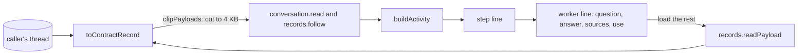

# Worker runs and large payloads on a task's page

- **Status:** draft
- **Work items:** [the view routes](https://linear.app/zgeoff/issue/GEO-1837),
  [the worker tool](https://linear.app/zgeoff/issue/GEO-1793)

A task's page shows its thread in the conversation view, where each step folds into one line that
opens to its tool calls. Two kinds of content do not fit that view yet. A worker run writes 3 record
kinds and its own tool calls on the caller's thread, and the view would list those calls as the
caller's own. A fetched page or a worker's model text can run to many kilobytes on every record of a
page read. This design shows each worker run as one line inside the step that called it, and lets
the client ask for payloads cut to 4 KB, with the whole value loaded on demand. The
[live view baseline](../platform/channels/live-view.md#a-task-as-a-conversation) gives the purpose,
and the [client architecture](../../architecture/channels/client.md#the-conversation-view) describes
the built view.

Terms: a **worker run** and its 3 records, `worker.run_started`, `worker.turn_ended` and
`worker.run_ended`, are as [the worker tool](https://linear.app/zgeoff/issue/GEO-1793) defines them.
A **payload** is a value of a record's erasable fields that the contract record carries: a tool
call's input, a tool result's content, and a worker turn's text or a worker run's failure detail.

## Shape



## Contracts

```ts
const page = await api.conversation.read({ thread: 't4k2', clipPayloads: true });
// → { records: [{ sequence: 8812, kind: 'tool_result',
//     toolCall: { callID: 'c7', runID: 'b51e…', tool: 'web.fetch', outcome: 'result',
//       content: { result: { url: 'https://cafe-list.test/north', text: '<the first 4096 bytes>' } } },
//     clipped: [{ field: 'toolCall.content', path: ['result', 'text'], bytes: 48211 }] }, …], … }
const whole = await api.records.readPayload({ thread: 't4k2', sequence: 8812 });
// → { status: 'readable', toolCall: { content: { result: { url: '…', text: '<all 48211 bytes>' } } } }
//   or { status: 'forgotten' } or { status: 'unreadable' }
```

```ts
// contract lib
const payloadClipBytes = 4096; // a constant: the cut size of a clipped string

// conversation.read and records.follow: { …existing input, clipPayloads?: boolean }
// Absent or false: every payload arrives whole, as built.

// recordSchema: { …existing fields, plus: }
interface RecordAdded {
  clipped?: ClippedPayload[]; // absent: every payload on the record is whole
  worker?: WorkerView; // set for the 3 worker record kinds
}
// recordSchema.toolCall: { …existing fields, runID?: string } // the tool run ID of the record

interface ClippedPayload {
  field: 'toolCall.input' | 'toolCall.content' | 'worker.text' | 'worker.detail';
  path: (string | number)[]; // the cut string inside the field; [] when the whole field is left out
  bytes: number; // the UTF-8 size of the whole value at `path`
}

type WorkerView =
  | {
      phase: 'started';
      workerRunID: string;
      shortID: string;
      callID: string; // the callID of the worker.run call that started it
      model: string;
      tools: string[];
      limits: { minutes: number; turns: number; tokens: number; dollars: number };
      isTaskLimit: boolean;
    }
  | {
      phase: 'turn';
      workerRunID: string;
      callID: string;
      turn: number;
      tokens: number; // input, output, cache read and cache write
      dollars: number;
      text?: string; // absent once a forget erased it
    }
  | {
      phase: 'ended';
      workerRunID: string;
      callID: string;
      outcome: string; // read as WorkerOutcome, the worker tool's closed union
      limit?: string; // read as WorkerLimit
      used: { minutes: number; turns: number; tokens: number; dollars: number };
      detail?: string; // a failure's detail, while readable
    };
```

```ts
// contract lib: records.readPayload, a signedIn read
interface ReadPayloadInput {
  thread: string;
  sequence: number;
}
type ReadPayloadOutput =
  | {
      status: 'readable';
      toolCall?: { input?: Record<string, unknown>; content?: Record<string, unknown> };
      worker?: { text?: string; detail?: string };
    }
  | { status: 'forgotten' | 'unreadable' };
// errors: RECORD_NOT_FOUND, 404, when no record has that sequence on that thread
```

## Constraints

### A worker run on the page

- `buildActivity` joins a worker run to the `worker.run` call whose `callID` its records carry. That
  call shows as one worker line in its step's tools section.
- A tool call or result whose `toolCall.runID` is a worker run's `workerRunID` belongs to that
  worker line. It never joins the step's own calls, its tool count or the step line's tool fact.
- The worker line shows the worker's short ID, the question's start, the outcome and the use: the
  `used` of `worker.run_ended`, or, before that record lands, `running` with the turns and dollars
  that its `worker.turn_ended` records add up to.
- Opening the worker line shows the question, from the input of the `worker.run` call; the answer,
  from its result's content; each of the worker's tool calls as a source, with the target the step
  line gives a call, such as the host and path of a fetched page; and each turn with its tokens,
  dollars and text.
- An outcome other than `answered` shows its limit or its detail, as `worker.run_ended` holds them.
- The answer and each turn's text are untrusted, so the page shows them as plain text, never as
  Markdown or HTML.
- A worker record with no matching `worker.run` call on the page, such as one before the page's
  first record, shows as its own line by its kind, as an unknown kind shows today.
- A forgotten question, answer or turn text shows as forgotten, and the worker line keeps its use
  and outcome.

### Clipping

- The web client passes `clipPayloads` on every page read and every follow, on a task's page and in
  the conversation, because both use the one conversation view.
- With `clipPayloads` set, the server cuts each string inside a payload whose UTF-8 size passes
  `payloadClipBytes` to its first `payloadClipBytes` bytes, on a code point boundary, and lists it
  in `clipped`.
- When a payload's JSON still passes 64 KiB after the cut, the server leaves the whole field out and
  lists it with the path `[]`.
- A message's text, a task's brief and every field outside the 4 payload fields always arrive whole.
- The server never clips a record that the page read returns as `lastStepEnd`.
- Every reader of a clipped value shows it as cut, with a control that loads the rest. This covers
  the step view's tool calls, the worker line, and the sent message block that `collectSentMessages`
  builds from a `task.message` call's input.
- The control calls `records.readPayload` and shows the whole value in place of the cut one.

### The on-demand read

- `records.readPayload` reads the record's erasable fields at the call, through the same mapping as
  the page read, with no cut. A record whose key a forget or a reset destroyed returns `forgotten`.
- It returns `RECORD_NOT_FOUND` when the sequence is on another thread, so a caller never reads a
  record through a thread it did not name.
- The client keeps a loaded payload only in the view's memory, never in local storage. It drops the
  payload when a forget record that names the record arrives, or a `log_reset` arrives, as it drops
  a forgotten message's text.
- When `records.readPayload` fails for any reason, the control shows the failure with a retry, and
  the cut value stays in place.

### A rollback

- This design adds no record kind, no migration and no config key. The worker tool work adds the 3
  worker kinds, and its design says what the release before does with them.
- The server of the release before strips `clipPayloads` and sends every payload whole with no
  `clipped`, so a newer client shows each value whole. A page that loaded clipped records before the
  rollback keeps its cut values, and its load control fails as the on-demand read says, until a
  reload reads the page whole.
- A newer server sends `clipped`, `worker` and `toolCall.runID` only as optional fields. A client of
  the release before passes no `clipPayloads`, so it gets whole payloads, and it shows a worker
  record by its kind.

## Decisions

- **Clipping is opt-in per read.** An agent's call on 13 Nov: a client that predates it, or a server
  rolled back under a newer client, still shows whole values, and no reader mistakes a cut value for
  a whole one.
- **The cut keeps the start of each long string in place.** An agent's call on 13 Nov: the step line
  reads short fields, such as a fetch's URL, beside a long page text, and the built view already
  shows a long value's start.
- **The on-demand read takes one record and returns all of its payloads.** An agent's call on 13
  Nov: one record rarely holds more than one long value, and a field-by-field read adds an input
  that no view needs.
- **The cut size is a contract constant.** An agent's call on 13 Nov: it sizes a wire format between
  client and server, and a config key would add a rollback step for no setting you need.
- **A task's page offers no control that shows a record in raw form.** An agent's call on 13 Nov,
  pending the owner's answer: the task route has no such control to reuse, as
  [the views](definition-views.md#out-of-scope) say, and a record with no renderer still shows by
  its kind.

## Builder decides

- The wording of the worker line, its outcome texts and the load control.
- How `buildActivity` stores a worker run, and the components that render it.
- Where the 64 KiB check sits in the mapping.
- The layout of the tests.

## Out of scope

- The worker tool and its records, which [the worker tool](https://linear.app/zgeoff/issue/GEO-1793)
  builds.
- A cut of a message's text.

## Open questions

- **Does each line on a task's page offer its raw record?** The owner settles it in
  [the view routes](https://linear.app/zgeoff/issue/GEO-1837). Until then, no line offers it.
