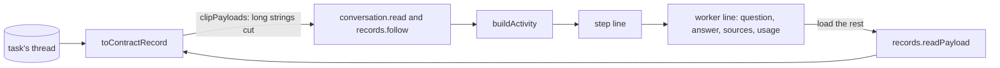

# Worker runs and large payloads on a task's page

- **Status:** draft
- **Work items:** [the view routes](https://linear.app/zgeoff/issue/GEO-1837),
  [the worker tool](https://linear.app/zgeoff/issue/GEO-1793)

A task's page shows the task's thread in the conversation view, which the
[client architecture](../../architecture/channels/client.md#the-conversation-view) describes. Each
step, one model turn of the task with its records, folds into one line that opens to its tool calls.
This design adds 2 things to that view:

- **A worker line.** The model calls `worker.run` to run a worker, which writes 3 record kinds and
  its own tool calls on the thread of the task that called it. The view shows each worker run as one
  line inside the step that called it, apart from the step's own tool calls.
- **Clipping.** A fetched page's text or a worker's model text can run past 40 KB on one record. A
  client can ask for each long string cut to its first 4,096 bytes, and load the whole value when
  you open it.

The [live view baseline](../platform/channels/live-view.md#a-task-as-a-conversation) gives the
purpose of both.

The terms this design uses:

| Term          | Meaning                                                                                                                                                                                   |
| ------------- | ----------------------------------------------------------------------------------------------------------------------------------------------------------------------------------------- |
| worker run    | one execution of a worker, with its records `worker.run_started`, `worker.turn_ended` and `worker.run_ended`, as [the worker tool](https://linear.app/zgeoff/issue/GEO-1793) defines them |
| tool run ID   | the `runID` that every `tool_called` and `tool_result` record holds. A worker's own tool calls take the worker run's `workerRunID` as theirs                                              |
| payload field | one of 4 fields of the contract record that carry erasable text: `toolCall.input`, `toolCall.content`, `worker.text` and `worker.detail`                                                  |
| page read     | one call of `conversation.read`, which returns a page of a thread's records                                                                                                               |

[Erasable fields](../../architecture/core/erasable-fields.md) describes the text that a forget
destroys with its record's key.

## Shape



## Contracts

```ts
const page = await api.conversation.read({ thread: 't4k2', clipPayloads: true });
// → { records: [{ sequence: 8812, kind: 'tool_result',
//     toolCall: { callID: 'c7', runID: 'b51e…', tool: 'web.fetch', outcome: 'result',
//       content: { result: { url: 'https://cafe-list.test/north', text: '<the first 4096 bytes>' } } },
//     clipped: [{ field: 'toolCall.content', path: ['result', 'text'], bytes: 48211 }] }, …], … }
const whole = await api.records.readPayload({ thread: 't4k2', sequence: 8812 });
// → { status: 'readable', toolCall: { content: { result: { url: '…', text: '<all 48211 bytes>' } } } }
//   or { status: 'forgotten' } or { status: 'unreadable' }
```

```ts
// contract lib
const payloadClipBytes = 4096; // the size, in UTF-8 bytes, that a clipped string is cut to

// conversation.read and records.follow: { …existing input, clipPayloads?: boolean }
// Absent or false: every payload field arrives whole, as on main.

// recordSchema: { …existing fields, plus: }
interface RecordAdded {
  clipped?: ClippedPayload[]; // absent: every payload field of the record is whole
  worker?: WorkerView; // set on the 3 worker record kinds
}
// recordSchema.toolCall: { …existing fields, runID?: string } // the record's tool run ID

interface ClippedPayload {
  field: 'toolCall.input' | 'toolCall.content' | 'worker.text' | 'worker.detail';
  path: (string | number)[]; // where the cut string sits inside the field; [] when the field is left out
  bytes: number; // the UTF-8 size of the whole value at `path`
}

type WorkerView =
  | {
      phase: 'started';
      workerRunID: string;
      shortID: string;
      callID: string; // the callID of the worker.run call that started the worker run
      model: string;
      tools: string[];
      limits: { minutes: number; turns: number; tokens: number; dollars: number };
      isTaskLimit: boolean;
    }
  | {
      phase: 'turn';
      workerRunID: string;
      callID: string;
      turn: number;
      tokens: number; // input, output, cache read and cache write
      dollars: number;
      text?: string; // absent once a forget erased it
    }
  | {
      phase: 'ended';
      workerRunID: string;
      callID: string;
      outcome: string; // read as WorkerOutcome, the worker tool's closed union
      limit?: string; // read as WorkerLimit
      used: { minutes: number; turns: number; tokens: number; dollars: number };
      detail?: string; // a failure's detail, while readable
    };
```

```ts
// contract lib: records.readPayload, a signedIn read
interface ReadPayloadInput {
  thread: string;
  sequence: number;
}
type ReadPayloadOutput =
  | {
      status: 'readable';
      toolCall?: { input?: Record<string, unknown>; content?: Record<string, unknown> };
      worker?: { text?: string; detail?: string };
    }
  | { status: 'forgotten' } // a forget or a reset destroyed the record's key
  | { status: 'unreadable' }; // the key exists and fails to decrypt the fields
// errors: RECORD_NOT_FOUND, 404, when the thread holds no record at that sequence
```

## Constraints

### A worker run on the page

- `buildActivity` gives each `worker.run` call that has worker records a worker line. The records
  join the call by their `callID`, and the line sits in the tools section of the call's step.
- A tool call or result whose `toolCall.runID` equals a worker run's `workerRunID` belongs to that
  worker line. The step leaves it out of its own calls, its count of tools and the list of tools on
  its collapsed line.
- The collapsed worker line shows the worker run's short ID, the start of the question, the outcome,
  and the minutes, turns, tokens and dollars from the `used` of `worker.run_ended`.
- Before `worker.run_ended` lands, the line shows `running`, with the turns and dollars that its
  `worker.turn_ended` records add up to.
- The open worker line shows 4 parts:
  - the question, from the input of the `worker.run` call;
  - the answer, from the content of the call's result;
  - each tool call of the worker as a source, with the target that the step line shows for a call,
    such as the host and path of a fetched page;
  - each turn, with its tokens, dollars and text.
- An outcome other than `answered` shows its limit or its detail, as `worker.run_ended` holds them.
- The answer and each turn's text come from untrusted content, so the view shows them as plain text,
  never as Markdown or HTML.
- When the page holds a worker record but not its `worker.run` call, such as a call before the first
  record of the page read, the view shows the record as its own line by its kind, as it shows any
  kind it has no renderer for.
- A question, answer or turn text that a forget erased shows as forgotten. The worker line keeps its
  usage and outcome.

### Clipping

- The web client sets `clipPayloads` on every page read and every follow. A task's page and the
  conversation page share the conversation view, so both clip.
- With `clipPayloads` set, the server walks each payload field. Each string in it that passes
  `payloadClipBytes` in UTF-8 is cut to its first `payloadClipBytes` bytes, on a code point
  boundary, and listed in `clipped`.
- When a payload field's JSON still passes 64 KiB after those cuts, the server leaves the whole
  field out and lists it with the path `[]`.
- Every field outside the 4 payload fields arrives whole, such as a message's text and a task's
  brief.
- The step that a page read returns as `lastStepEnd` arrives whole, because the failure notice reads
  its error from it.
- Each component that shows a clipped value shows it as cut, with a control that loads the rest: the
  tool calls of a step, the worker line, and the sent message block that `collectSentMessages`
  builds from the input of a `task.message` call.

### The on-demand read

- The control calls `records.readPayload` and shows the whole value in place of the cut one.
- `records.readPayload` reads the record's erasable fields when it is called, through the same
  mapping as a page read, with no cut.
- `records.readPayload` returns `RECORD_NOT_FOUND` when the sequence is on another thread, so a
  caller reads a record only through the thread that holds it.
- The client keeps a loaded value only in the view's memory, never in local storage.
- The client drops a loaded value when a forget of its record or a `log_reset` arrives on the
  stream, as it drops a forgotten message's text.
- When `records.readPayload` fails for any reason, the control shows the failure with a retry, and
  the cut value stays.

### A rollback

- This design adds no record kind, no migration and no config key. The worker tool adds the 3 worker
  kinds, and its design says what the release a rollback returns to does with them.
- The server of that release strips `clipPayloads` and sends every payload field whole with no
  `clipped`, so a newer client shows each value whole.
- A page that holds clipped records from before the rollback keeps its cut values. Its load control
  fails, as the on-demand read says, until a reload reads the page whole.
- A newer server sends `clipped`, `worker` and `toolCall.runID` only as optional fields. A client of
  that release passes no `clipPayloads`, so it gets every payload field whole, and it shows a worker
  record by its kind.

## Decisions

- **A client asks for clipping on each read.** An agent's call on 13 Nov: a client from before
  clipping, or a newer client under a rolled-back server, still gets whole values, and every cut
  value arrives with its entry in `clipped`.
- **A cut keeps the start of each long string in place.** An agent's call on 13 Nov: the step line
  takes a short field, such as a fetch's URL, from beside a long page text, and the view on main
  already shows the start of a long value.
- **The on-demand read takes one record and returns all of its payload fields.** An agent's call on
  13 Nov: no view on main needs one field of a record without the others, so the input stays at a
  thread and a sequence.
- **The cut size is a contract constant.** An agent's call on 13 Nov: it sizes a wire format between
  client and server, and a config key would add a rollback step and serve no setting.

## Builder decides

- The wording of the worker line, its outcome texts and the load control.
- How `buildActivity` stores a worker run, and the components that render it.
- Where the 64 KiB check sits in the mapping.
- The layout of the tests.

## Out of scope

- The worker tool and its records, which [the worker tool](https://linear.app/zgeoff/issue/GEO-1793)
  builds.
- A cut of a message's text.

## Open questions

- **Does each line on a task's page offer its raw record?** The owner settles it in
  [the view routes](https://linear.app/zgeoff/issue/GEO-1837). Until then, no line offers it, and a
  record with no renderer shows by its kind. The
  [views of definitions and ended task runs](definition-views.md#out-of-scope) leave the control out
  too, because the task route has none to reuse.
