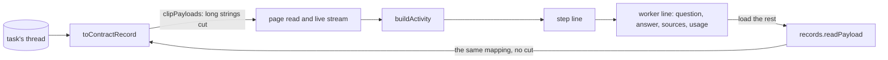

# Worker runs and large payloads on a task's page

- **Status:** draft
- **Work items:** [the view routes](https://linear.app/zgeoff/issue/GEO-1837),
  [the worker tool](https://linear.app/zgeoff/issue/GEO-1793)

A task's page shows the task's thread, its records in order, in the conversation view that the
[client architecture](../../architecture/channels/client.md#the-conversation-view) describes. Each
step, one model turn of the task with its records, folds into one collapsed line. Opening the line
shows its sections, and the tools section lists the step's tool calls. This design adds 2 things to
that view:

- **A worker line.** When a task's model calls `worker.run`, nixie runs a worker. The worker writes
  3 record kinds and its own tool calls on the calling task's thread. The view shows each worker run
  as one line in the tools section of the step that called `worker.run`, apart from the step's own
  tool calls.
- **Clipping.** A record that holds a fetched page's text or a worker's model text can hold one
  string far past 4 KB, such as a 48 KB page. The client asks the server to cut each long string to
  its first 4,096 bytes. When you open a cut value, the client loads the whole value.

The [live view baseline](../platform/channels/live-view.md#a-task-as-a-conversation) gives the
purpose of both.

The design uses these terms:

| Term          | Meaning                                                                                                                                                                                                              |
| ------------- | -------------------------------------------------------------------------------------------------------------------------------------------------------------------------------------------------------------------- |
| worker run    | one execution of a worker, from the `worker.run` call to its result, with its records `worker.run_started`, `worker.turn_ended` and `worker.run_ended` ([the worker tool](https://linear.app/zgeoff/issue/GEO-1793)) |
| tool run ID   | the `runID` of every `tool_called` and `tool_result` record. A worker's own tool calls carry the worker run's `workerRunID` as their tool run ID                                                                     |
| API record    | a record as the API sends it to a client: `recordSchema` in the contract lib, built from a log record by `toContractRecord` in the API module                                                                        |
| payload field | 1 of the 4 fields of an API record that hold [erasable](../../architecture/core/erasable-fields.md) text: `toolCall.input`, `toolCall.content`, `worker.text` and `worker.detail`                                    |
| page read     | one call of `conversation.read`, which returns a page of a thread's records                                                                                                                                          |
| live stream   | `records.follow`, which sends each new record of the log to the client as it commits                                                                                                                                 |
| forget        | `conversation.forget`, which destroys a record's key, so the record's erasable text can never be read again                                                                                                          |

## Shape



## Contracts

```ts
const page = await api.conversation.read({ thread: 't4k2', clipPayloads: true });
// → { records: [{ sequence: 8812, kind: 'tool_result',
//     toolCall: { callID: 'c7', runID: 'b51e…', tool: 'web.fetch', outcome: 'result',
//       content: { result: { url: 'https://cafe-list.test/north', text: '<the first 4096 bytes>' } } },
//     clipped: [{ field: 'toolCall.content', path: ['result', 'text'], bytes: 48211 }] }, …], … }
const whole = await api.records.readPayload({ thread: 't4k2', sequence: 8812 });
// → { status: 'readable', toolCall: { content: { result: { url: '…', text: '<all 48211 bytes>' } } } }
//   or { status: 'forgotten' } or { status: 'unreadable' }
```

```ts
// contract lib
const payloadClipBytes = 4096; // the size, in UTF-8 bytes, that a clipped string is cut to

// conversation.read and records.follow: { …existing input, clipPayloads?: boolean }
// Absent or false: every payload field arrives whole.

// recordSchema: { …existing fields, plus: }
interface RecordAdded {
  clipped?: ClippedPayload[]; // absent: every payload field of the record is whole
  worker?: WorkerView; // set on the 3 worker record kinds
}
// recordSchema.toolCall: { …existing fields, runID?: string } // the record's tool run ID

interface ClippedPayload {
  field: 'toolCall.input' | 'toolCall.content' | 'worker.text' | 'worker.detail';
  path: (string | number)[]; // where the cut string sits inside the field; [] when the field is left out
  bytes: number; // the UTF-8 size of the whole value at `path`
}

type WorkerView =
  | {
      phase: 'started';
      workerRunID: string;
      shortID: string;
      callID: string; // the callID of the worker.run call that started the worker run
      model: string;
      tools: string[];
      limits: { minutes: number; turns: number; tokens: number; dollars: number };
      isTaskLimit: boolean;
    }
  | {
      phase: 'turn';
      workerRunID: string;
      callID: string;
      turn: number;
      tokens: number; // input, output, cache read and cache write
      dollars: number;
      text?: string; // absent once a forget erased it
    }
  | {
      phase: 'ended';
      workerRunID: string;
      callID: string;
      outcome: string; // read as WorkerOutcome, the worker tool's closed union
      limit?: string; // read as WorkerLimit
      used: { minutes: number; turns: number; tokens: number; dollars: number };
      detail?: string; // a failure's detail, while readable
    };
```

```ts
// contract lib: records.readPayload, a signedIn read
interface ReadPayloadInput {
  thread: string;
  sequence: number; // the record's log sequence, unique across the whole log
}
type ReadPayloadOutput =
  | {
      status: 'readable';
      toolCall?: { input?: Record<string, unknown>; content?: Record<string, unknown> };
      worker?: { text?: string; detail?: string };
    }
  | { status: 'forgotten' } // a forget or a reset of the log destroyed the record's key
  | { status: 'unreadable' }; // the key exists and fails to decrypt the fields
// errors: RECORD_NOT_FOUND, 404, when the thread holds no record at that sequence
```

## Constraints

### A worker run on the page

- `buildActivity` gives each `worker.run` call with worker records one worker line. A worker record
  joins the call whose `callID` it carries, and the line sits in that call's step.
- A tool call or result belongs to the worker line when its `toolCall.runID` equals the worker run's
  `workerRunID`. The step leaves such a call out of its own tool calls, its tool count and the tools
  it names on its collapsed line.
- The collapsed worker line shows the worker run's short ID, the start of the question, the outcome,
  and the minutes, turns, tokens and dollars from the `used` of `worker.run_ended`.
- Until `worker.run_ended` lands, the worker line shows `running`, with the sum of the turns and
  dollars of its `worker.turn_ended` records.
- The open worker line shows 4 parts:
  - the question, from the input of the `worker.run` call;
  - the answer, from the content of the call's result;
  - each tool call of the worker as a source, with the target that the step line shows for a call,
    such as the host and path of a fetched page;
  - each turn, with its tokens, dollars and text.
- An outcome other than `answered` shows its limit or its detail from `worker.run_ended`.
- The answer and each turn's text come from untrusted content, so the view shows them as plain text,
  never as Markdown or HTML.
- A page read can start after a step's `worker.run` call and still hold its worker records. The view
  then shows each such record on its own line by its kind, as it shows every kind it has no renderer
  for.
- When a forget erased a question, an answer or a turn's text, that part shows as forgotten, and the
  worker line keeps its usage and outcome.

### Clipping

- The web client sets `clipPayloads` on every page read and on the live stream. A task's page and
  the conversation's page share the conversation view, so both clip.
- With `clipPayloads` set, the server walks each payload field. It cuts each string in the field
  whose UTF-8 size passes `payloadClipBytes` to its first `payloadClipBytes` bytes, on a code point
  boundary, and lists the string in `clipped`.
- When a payload field's JSON still passes 64 KiB after those cuts, the server leaves the field out
  and lists it with the path `[]`. A field of many short strings can pass that size, and no string
  in it is long enough to cut.
- Every field outside the 4 payload fields arrives whole, such as a message's text and a task's
  brief.
- A page read also returns the thread's newest step end as `lastStepEnd`, outside its page of
  records. The server never clips it, because the notice that nixie is failing to answer reads its
  error from that record.
- Each component that shows a clipped value shows it as cut, with a control that loads the rest: the
  tool calls of a step, the worker line, and the sent message block that `collectSentMessages`
  builds from the input of a `task.message` call.

### The on-demand read

- The load control calls `records.readPayload` and shows the whole value in place of the cut one.
- `records.readPayload` reads the record's erasable fields at the time of the call, through
  `toContractRecord` with no cut.
- `records.readPayload` returns `RECORD_NOT_FOUND` when the sequence belongs to a record on another
  thread. A caller therefore reads a record only through the thread that holds it.
- The client keeps a loaded value only in the view's memory, never in local storage.
- The client drops a loaded value when the live stream brings a forget of its record or a
  `log_reset`, the record a reset of the log writes. It drops a forgotten message's text the same
  way today.
- When `records.readPayload` fails for any reason, the control shows the failure with a retry, and
  the cut value stays.

### A rollback

- This design adds no record kind, no migration and no config key. The 3 worker kinds come from the
  worker tool, whose design states what the release before it does with them.
- After a rollback to the release before this design, the server strips `clipPayloads` and sends
  every payload field whole with no `clipped`. A newer client shows each value whole.
- A page that loaded clipped records before the rollback keeps its cut values. Its load control
  shows a failure, as [the on-demand read](#the-on-demand-read) sets out, until you reload the page.
- An older client under a newer server passes no `clipPayloads`, so it gets every payload field
  whole. It ignores `clipped`, `worker` and `toolCall.runID`, and shows a worker record by its kind.

## Decisions

- **A client asks for clipping on each read.** An agent's call on 13 Nov 2026: a client from before
  clipping, or a newer client under a rolled-back server, then gets whole values, and every cut
  value arrives with its entry in `clipped`.
- **A cut keeps the start of each long string, in place in its field.** An agent's call on 13 Nov
  2026: moving long strings out of the field would also hide the short strings beside them, such as
  a fetch's URL that the step line shows, and the view today already shows the start of a long
  value.
- **The on-demand read takes one record and returns all of its payload fields.** An agent's call on
  13 Nov 2026: no view needs one field of a record without the others, so the input stays at a
  thread and a sequence.
- **The cut size is a contract constant.** An agent's call on 13 Nov 2026: it sizes a wire format
  between client and server, and a config key would serve no setting.
- **No line on a task's page offers its raw record, the record as the log holds it.** The owner's
  call on 14 Nov 2026: a record kind with no renderer shows by its kind's name.

## Builder decides

- The wording of the worker line, its outcome texts and the load control.
- How `buildActivity` stores a worker run, and the components that render it.
- Where the 64 KiB check sits in the mapping.
- The layout of the tests.

## Out of scope

- The worker tool and its records, which [the worker tool](https://linear.app/zgeoff/issue/GEO-1793)
  builds.
- A cut of a message's text.
