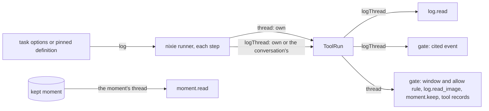

# Thread reads

- **Status:** draft
- **Work items:** [the log grant](https://linear.app/zgeoff/issue/GEO-2525),
  [the gate reads a granted task's cited event](https://linear.app/zgeoff/issue/GEO-2552),
  [the photos in a kept moment](https://linear.app/zgeoff/issue/GEO-1913)

Every tool that returns records of the event log reads one thread, and code picks that thread, never
the model. A model reads its own thread. One grant, `log: conversation`, lets a task read the
conversation's thread through 2 readers: `log.read`, and the write gate's read of a cited event. A
kept moment is memory, so `moment.read` reads the moment's own thread for any caller that holds the
tool.

A task's own thread is its task ID. The conversation's thread is `conversationTaskID`,
`'conversation'`.

## Shape



## Contracts

### The grant

```ts
task.start({
  name: 'Note taker',
  brief: 'Read the messages since the previous task run and save what is worth keeping.',
  memory: 'read',
  log: 'conversation',
  tools: ['log.read', 'memory.remember', 'memory.edit'],
});
// → planned, with options.log 'conversation'
//   or, from a starter without the grant, refused with logGrantRefusal
const logGrantRefusal =
  "You can give a task the conversation's log only when you hold it yourself, and you do not.";
```

```ts
// tasks module
type TaskLog = 'own' | 'conversation';

interface TaskStartChoice {
  // …existing fields
  readonly log?: TaskLog | undefined; // absent: 'own'
}

interface TaskRunOptions {
  // …existing fields
  readonly log: TaskLog; // a stored record with no `log` key decodes as 'own'
}

interface TaskStarter {
  // …existing fields
  readonly log: TaskLog; // the conversation passes 'conversation'; a task passes its own options.log
}

// TaskStartChoiceRefusal (built) gains { reason: 'wider_log' }, rendered as logGrantRefusal
```

A definition file takes the same `log` key, and its version holds it as `DefinitionVersion.log`, as
[the task definition format](task-definition-format.md#the-hash-the-version-store-and-the-snapshot)
shows.

### The thread on a tool run

```ts
// tools module. The runner sets both fields at the start of each step, from the task's options
// or the definition version the task run pins. No record, row or tool input holds logThread.
interface ToolRun {
  // …existing fields
  readonly thread: string; // as built: the caller's own thread
  readonly logThread: string; // the thread log.read and a cited event read
}

// memory module
interface WriteCaller {
  // …existing fields
  readonly thread: string; // as built: ToolRun.thread
  readonly logThread: string; // ToolRun.logThread
}
```

### Which thread each reader reads

| Reader                                  | Field of `ToolRun` | A task with `log: own` | A task with `log: conversation` | The conversation |
| --------------------------------------- | ------------------ | ---------------------- | ------------------------------- | ---------------- |
| `log.read`                              | `logThread`        | its own                | the conversation's              | its own          |
| the gate's read of a cited event        | `logThread`        | its own                | the conversation's              | its own          |
| the gate's window search, with no event | `thread`           | its own                | its own                         | its own          |
| the gate's allow rule lookup            | `thread`           | its own                | its own                         | its own          |
| `log.read_image`                        | `thread`           | its own                | its own                         | its own          |
| `moment.keep`                           | `thread`           | its own                | its own                         | its own          |
| `moment.read`                           | none               | the moment's           | the moment's                    | the moment's     |

For the conversation, `logThread` equals `thread`, so every row reads its own thread.

## Constraints

### The grant

- `log` sits beside `memory` and `persona` in the start input. With no `log` key, the task gets
  `own`.
- The start check accepts `log: conversation` only from a starter whose own `log` is `conversation`.
  A chain of starts passes the grant on, and a task without it never gives it.
- A definition file may set `log: conversation`. The `file` starter of
  [`CheckTaskStart`](task-definition-format.md#the-hash-the-version-store-and-the-snapshot) holds
  the grant.
- The start check accepts the grant beside a tool that sends data outside nixie.
- A stored `log` value other than `own` or `conversation` fails the decode of the task's options, as
  any invalid option does.
- `readTaskSetup` returns the stored value. Once
  [the runner port](https://linear.app/zgeoff/issue/GEO-2588) lands, `TaskSetup` carries it as
  `log`.
- [The worker tool](https://linear.app/zgeoff/issue/GEO-1793) gives a worker's tool run its caller's
  `logThread`.

### `log.read`

- `log.read` takes the same input with or without the grant, and reads only `logThread`.
- The `tool_called` and `tool_result` records of a granted task's `log.read` sit on the task's own
  thread. The conversation's thread never holds a record of a task's read.
- Each entry keeps its role, so your message reads as your message, and the role `task` entries of
  the [task reports](task-runs/reports.md#contracts) on the conversation's thread read as reports.
- A granted task's `log.read` returns the `<dropped-image>` markers of the conversation's thread.
  `log.read_image` returns `image unavailable` for each, and its description tells the model that it
  opens images of the caller's own thread only.

### The write gate

- A save that cites an `eventID` reads that record on `logThread`. A granted task's cited message
  then runs the quote check, the token check, the checker and the holds after a pass, as for the
  conversation.
- No record at the cited ID on `logThread` gives `no_quote`, which covers an event on any other
  thread. A cited record that is not your message gives `quote_not_typed`. A cited message that you
  forgot, or that backed an item you forgot, gives `forgotten_evidence`.
- A quote with no `eventID` searches the window of the caller's own thread, so a granted task's
  uncited quote waits with `no_quote`. Such a task must cite the event.
- The grant adds no review reason and no error sentence, and never holds a write on its own.

### Moments and images

- A moment keeps one span on one thread. `moment.keep` keeps a span of the caller's own thread only,
  as built.
- `moment.read` reads the span on the moment's own thread, for any caller that holds the tool. A
  task holds it only under `memory: read`, so the memory option gates a moment's records, and the
  log grant does not.
- `log.read_image` reads only the caller's own thread. For a moment on another thread, `moment.read`
  lists the images and `log.read_image` returns `image unavailable` for each, as
  [the photos issue](https://linear.app/zgeoff/issue/GEO-1913) states.

### Other paths to your messages

- Until [the similarity push cleanup](https://linear.app/zgeoff/issue/GEO-2550) lands, each turn of
  a task with `memory: read` places past messages of yours from every thread, as
  [what a turn brings](memory-turn-push.md#between-the-2-items) says. The grant ships after that
  cleanup, so the grant is then the only path from the conversation's log to a task.
- A memory item and a kept moment reach a task through `memory: read`, never through the grant.

### A forget

- A forget of a record on the conversation's thread cleans the session of each open task with
  `log: conversation`, as it cleans each open task that reads memory. Its session can hold the
  record's text from a `log.read`.
- A definition's task with `log: conversation` counts too. Where the pick reads `log` for it is the
  place [the task-session forget fix](https://linear.app/zgeoff/issue/GEO-2527) settles for
  `memory`.

### Rollback

| What this design adds                        | What the release before does with it                                                                           |
| -------------------------------------------- | -------------------------------------------------------------------------------------------------------------- |
| the `log` key in `task.created`'s options    | reads the record and drops the key, because the options schema is not strict; the task reads its own thread    |
| the `log` key in a definition file           | refuses the seed with `unknown_key`, because the definition schema is strict, and keeps the last accepted seed |
| `ToolRun.logThread`, `WriteCaller.logThread` | never meets them: nothing stores them                                                                          |
| a granted task's cited save                  | sends it to review with `no_quote`                                                                             |
| the `images` list of a span record           | as [the export version rules](redaction.md#the-export-version-shared-with-the-photos-work) say                 |

- The design adds no record kind, migration or config key. A rollback only narrows what a task
  reads. When a definition file sets `log`, remove the key before the release before seeds other
  changes.
- The log grant adds its keys to the newer-log test, or creates the test when it lands first, as
  [the brief and the envelope](https://linear.app/zgeoff/issue/GEO-2357) says.

## Decisions

- **Only `log.read` and the gate's cited event follow the grant.** An agent's call on 13 Nov: the 2
  readers a note-taking task needs, and the smallest widening of what a task reads.
- **The runner sets `logThread` per step, and nothing stores it.** An agent's call on 13 Nov: the
  model never picks a thread, and the release before never meets the field.
- **A granted read writes its records on the task's own thread.** An agent's call on 13 Nov: a
  forget of the task's thread then removes what the task read, and the conversation's thread holds
  only the conversation's work.
- **A kept moment stays under `memory: read`.** An agent's call on 13 Nov: a moment is memory you
  chose to keep, like an item that quotes your message, and the built `moment.read` reads it this
  way.
- **A forget on the conversation's thread cleans each granted task's session.** An agent's call on
  13 Nov: the forget fix cleans only tasks that read memory, and a granted task with `memory: none`
  would keep the forgotten text.

## Builder decides

- Where the runner computes `logThread`, and the name of the start check's refusal reason.
- The wording of `log.read_image`'s description, within the rule above.
- The layout of the tests.

## Out of scope

- A read of another task's thread.
- A window search on the conversation's thread for a granted task.
- Which thread `log.forget` removes a record from. [Redaction](redaction.md#part-4-the-forget-tool)
  owns that tool, and the grant widens reads only.
- A moment over several threads.

## Open questions

- **Does a grant that a task's setup loses in the middle of a step still count for a save in that
  step?** The owner settles it in
  [the gate reads a granted task's cited event](https://linear.app/zgeoff/issue/GEO-2552). Until
  then, the gate reads `logThread` as the runner set it at the start of the step, and a later step
  reads the new setup.
- **Does `log.read_image` read the caller's own thread only, for good?** The owner settles it in
  [the photos in a kept moment](https://linear.app/zgeoff/issue/GEO-1913). Until then, it reads the
  caller's own thread only.
