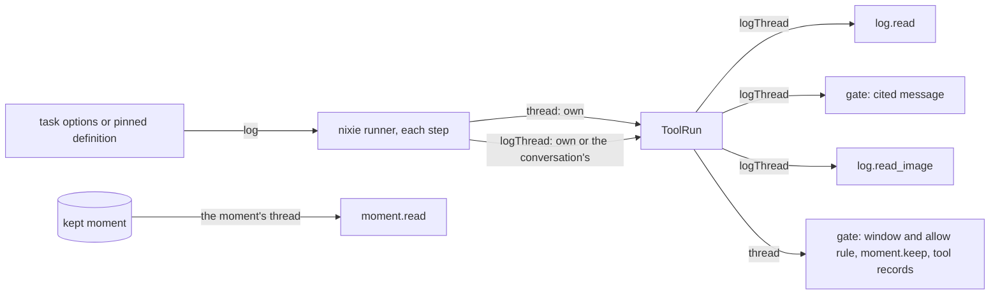

# Thread reads

- **Status:** draft
- **Work items:** [the log grant](https://linear.app/zgeoff/issue/GEO-2525),
  [the gate reads a granted task's cited event](https://linear.app/zgeoff/issue/GEO-2552),
  [the photos in a kept moment](https://linear.app/zgeoff/issue/GEO-1913)

nixie's [event log](../../architecture/core/event-log.md) keeps each task's records on a thread of
its own, named by the task ID. The conversation's records sit on the thread `'conversation'`, which
the code names `conversationTaskID`. Each tool that returns records of the log reads one thread, and
code picks that thread for the model.

The conversation and every task read their own thread. One grant, `log: conversation`, lets a task
read the conversation's thread through 3 readers: `log.read`, `log.read_image`, and the memory write
gate's read of a message that a save cites. A moment that you or a model kept is memory, so
`moment.read` reads the moment's own thread for any caller that has the tool. The tools and grants
you give a task set what it reaches, and no fixed limit narrows them, so you can set up an unusual
task.

Two kinds of task carry the grant, as [the task definition format](task-definition-format.md)
describes. A started task gets its options from a `task.start` call, and they never change. A
definition's task runs from a file in your definitions, and each task run pins one version of that
file. The runner runs a task run as a series of steps, and each step runs one model turn
([steps](../../architecture/core/tasks.md#steps)).

## Shape



## Contracts

### The grant

```ts
task.start({
  name: 'Note taker',
  brief: 'Read the messages since the previous task run and save what is worth keeping.',
  memory: 'read',
  log: 'conversation',
  tools: ['log.read', 'memory.remember', 'memory.edit'],
});
// → planned, with options.log 'conversation'
//   or, from a starter without the grant, refused with logGrantRefusal
const logGrantRefusal =
  "You can give a task the conversation's log only when you hold it yourself, and you do not.";
```

```ts
// tasks module
type TaskLog = 'own' | 'conversation';

interface TaskStartChoice {
  // …existing fields
  readonly log?: TaskLog | undefined; // absent: 'own'
}

interface TaskRunOptions {
  // …existing fields
  readonly log: TaskLog; // a stored record with no `log` key decodes as 'own'
}

interface TaskStarter {
  // …existing fields
  readonly log: TaskLog; // the conversation passes 'conversation'; a task passes its own options.log
}

// TaskStartChoiceRefusal, current, gains this member
type WiderLogRefusal = { readonly reason: 'wider_log' }; // rendered as logGrantRefusal
```

A definition file takes the same `log` key. The release that ships
[the task definition format](task-definition-format.md#the-hash-the-version-store-and-the-snapshot)
adds the field `DefinitionVersion.log` to each stored definition version, with both values, so every
release that has definitions reads a stored `log`.

### The thread on a tool run

```ts
// tools module. The runner sets both fields at the start of each step, from the started task's
// options or the definition version that the task run pins. No record, row or tool input holds
// logThread.
interface ToolRun {
  // …existing fields
  readonly thread: string; // current: the caller's own thread
  readonly logThread: string; // the thread of log.read, log.read_image and a cited message
}

// memory module
interface WriteCaller {
  // …existing fields
  readonly thread: string; // current: ToolRun.thread
  readonly logThread: string; // ToolRun.logThread
}
```

### Which thread each reader reads

The [content gate](../../architecture/memory/writes.md#the-content-gate) checks each memory save. A
save applies, or becomes a proposal that waits for your review with a review reason, such as
`no_quote`. A save backs its quote of your words in one of 2 ways: it cites the event ID of your
message, or the gate searches the window, the recent messages of a thread. An allow rule of yours
lets a tool's saves skip the quote, and the gate looks the rule up by thread.

| Reader                             | Field of `ToolRun` | A task with `log: own` | A task with `log: conversation` | The conversation |
| ---------------------------------- | ------------------ | ---------------------- | ------------------------------- | ---------------- |
| `log.read`                         | `logThread`        | its own                | the conversation's              | its own          |
| the gate's read of a cited message | `logThread`        | its own                | the conversation's              | its own          |
| the gate's window search           | `thread`           | its own                | its own                         | its own          |
| the gate's lookup of an allow rule | `thread`           | its own                | its own                         | its own          |
| `log.read_image`                   | `logThread`        | its own                | the conversation's              | its own          |
| `moment.keep`                      | `thread`           | its own                | its own                         | its own          |
| `moment.read`                      | none               | the moment's           | the moment's                    | the moment's     |

For the conversation, `logThread` equals `thread`.

## Constraints

### The grant

- `log` sits beside `memory` and `persona` in the start input. With no `log` key, the task gets
  `own`.
- The start check accepts `log: conversation` only from a starter whose own `log` is `conversation`.
  A chain of starts passes the grant on, and a task without the grant never gives it.
- A definition file may set `log: conversation`, because you wrote the file. When nixie loads your
  definitions ([seeding](../../architecture/core/definitions.md#seeding)), it checks each one as a
  start from the starter `'file'` of
  [`CheckTaskStart`](task-definition-format.md#the-hash-the-version-store-and-the-snapshot), and
  that starter has `log: conversation`.
- The start check accepts the grant in the same start as a tool that sends data outside nixie. Each
  outward call passes the [decision point](../../architecture/policy/decision-point.md), which
  decides by the tool's declared effects and your rules, the same with the grant or without it. The
  grant widens what a task reads, never where nixie sends.
- A stored `log` value other than `own` or `conversation` fails the decode of the task's options, as
  any invalid option does.
- `readTaskSetup`, in the tasks module, returns the stored value, and so does the `TaskSetup` of
  [the runner port](https://linear.app/zgeoff/issue/GEO-2588), as `log`.
- [The worker tool](https://linear.app/zgeoff/issue/GEO-1793) gives a worker's tool run its caller's
  `logThread`.

### `log.read`

- `log.read` takes the same input with or without the grant, and reads only `logThread`.
- The `tool_called` and `tool_result` records of a granted task's `log.read` sit on the task's own
  thread. The conversation's thread never holds a record of a task's read.
- Each entry that a granted task reads keeps its role: `owner` for your message, and `task` for a
  [task report](task-runs/reports.md#contracts) on the conversation's thread. The task's model then
  tells your words apart from a report.
- `log.read` shows each image you attached as a `<dropped-image>` marker line
  ([reading the log](../../architecture/memory/context.md#reading-the-log)). `log.read_image`
  follows the `log` grant as `log.read` does: it opens the image of a marker on `logThread`, so a
  granted task opens the images of the conversation's thread. The description of `log.read_image`
  tells the model that the tool opens images of the thread that `log.read` reads.

### The write gate

- A save that cites an `eventID` reads that record on `logThread`. For a granted task, the gate then
  checks the cited message as it checks a message that the conversation cites.
- When `logThread` holds no record at the cited ID, the save waits with `no_quote`. That covers an
  event on any other thread. A cited record that is not your message gives `quote_not_typed`. A
  cited message that you forgot, or that backed an item you forgot, gives `forgotten_evidence`.
- A quote with no `eventID` searches the window of the caller's own thread, so a granted task's
  uncited quote waits with `no_quote`. Such a task must cite the event.
- The grant adds no review reason and no error sentence, and never sends a save to review on its
  own.
- A grant that the task's setup loses in the middle of a step counts until the step ends. The gate
  reads `logThread` as the runner set it at the start of the step, and a save in a later step reads
  the new setup. A started task's options never change, and a definition's task run pins its
  version, so no designed path loses the grant mid-step. The rule covers any later path.

### Moments and images

- A [moment](../../architecture/memory/moments.md) keeps one span of records on one thread.
  `moment.keep` keeps a span of the caller's own thread only.
- `moment.read` reads the span on the moment's own thread, on any thread, for any caller that has
  the tool. A task gets the tool only under `memory: read`, so `memory: read` decides which task
  reads a moment's records, and the log grant does not. To stop a task reading kept moments, leave
  `moment.read` out of its tools.
- `log.read_image` reads only `logThread`. For a moment on another thread, `moment.read` lists the
  images, and `log.read_image` returns `image unavailable` for each.

### Other paths to your messages

- Until [the similarity push cleanup](https://linear.app/zgeoff/issue/GEO-2550) lands, nixie adds
  past messages of yours from every thread to each turn of a task with `memory: read`
  ([what a turn brings](memory-turn-push.md#between-the-2-items)). The grant ships after that
  cleanup. From then on, the grant is the only path from the conversation's log to a task.
- A memory item and a kept moment reach a task through `memory: read`, never through the grant.

### A forget

- A forget of a record on the conversation's thread cleans the session of each open task with
  `log: conversation`, as it cleans each open task that reads memory. That task's session can hold
  the record's text from a `log.read`.
- The cleanup reads a started task's `log` from the options of its `task.created` record, through
  `readTaskSetup`.
- The cleanup reads a definition's task's `log` from 2 versions: the one its newest task run pinned,
  and the one in force. When either holds `log: conversation`, the cleanup cleans the task, because
  its session can outlive a task run.

### Rollback

- The release a rollback returns to drops the options key because the options schema is not strict.
  It has no `logThread`, so every task run reads its own thread, a granted one included.
- That release refuses a load of your definitions while a file sets `log`, because the definition
  schema is strict, and keeps the last accepted definitions in force.
- The design adds no record kind and no migration. Its one new key is `log`, in the start input and
  in a definition file, and it adds no key to `nixie.yaml`.
- That release cleans no session for the grant on a forget, so a granted task's sandbox can keep the
  text of a record that you forget after the rollback.
- The newer-log test, in the sessions module, runs the code of the last release on a log written by
  this release. The log grant adds its keys to that test. When the grant lands before the other work
  that the test covers, it creates the test
  ([the brief and the envelope](https://linear.app/zgeoff/issue/GEO-2357)).
- The `images` list of a span record belongs to
  [the photos in a kept moment](https://linear.app/zgeoff/issue/GEO-1913), and
  [the export version](redaction.md#the-export-version-shared-with-the-photos-work) gives its
  rollback.

## Decisions

- **The tools and grants you give a task set what it reaches, never a fixed limit.** The owner's
  call on 14 Nov 2026: you can then set up an unusual task. So a task with `moment.read` reads a
  moment kept on any thread, and you leave the tool out to stop it.
- **`log.read`, `log.read_image` and the gate's read of a cited message follow the grant.** The
  owner's call on 14 Nov 2026 for `log.read_image`, which follows the grant as `log.read` does. A
  note-taking task needs the other 2 readers.
- **A grant lost in the middle of a step counts until the step ends.** The owner's call on 14 Nov
  2026: a save in a later step reads the new setup.
- **The runner sets `logThread` per step, and nothing stores it.** An agent's call on 13 Nov 2026:
  the model never picks a thread, and the release a rollback returns to never meets the field.
- **A granted read writes its records on the task's own thread.** An agent's call on 13 Nov 2026: a
  forget of the task's thread then removes what the task read, and the conversation's thread holds
  only the conversation's work.
- **The grant sits beside outward tools.** An agent's call on 13 Nov 2026: the decision point
  decides every send the same way with or without the grant.
- **A forget on the conversation's thread cleans each granted task's session.** An agent's call on
  13 Nov 2026: the forget fix cleans only tasks that read memory, and a granted task with
  `memory: none` would keep the forgotten text.

## Builder decides

- Where the runner computes `logThread`.
- The wording of the description of `log.read_image`, within the rule in [`log.read`](#logread).
- The layout of the tests.

## Out of scope

- A read of another task's thread.
- A window search on the conversation's thread for a granted task.
- Which thread `log.forget` removes a record from. [Redaction](redaction.md#part-4-the-forget-tool)
  owns that tool, and the grant widens reads only.
- A moment over several threads.
