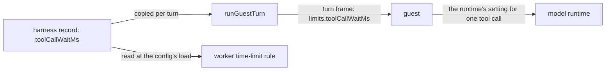

# The tool-call wait

- **Status:** draft
- **Work items:** [the tool-call wait field](https://linear.app/zgeoff/issue/GEO-2543),
  [the Agent SDK tool-call wait](https://linear.app/zgeoff/issue/GEO-2539),
  [the Codex tool-call wait](https://linear.app/zgeoff/issue/GEO-2541)

A model runtime drops a tool call whose result arrives after its own timeout, and `worker.run`
blocks for minutes. Each harness record declares how long its runtime waits for one tool call, the
host copies that figure into each turn frame, and the guest sets it in the runtime. The worker tool
(GEO-1793) reads the same figure at the config's load.

## Shape



## Contracts

```ts
// sessions module, as the host builds each turn frame
limits: { modelCalls: step.modelCalls, toolCallWaitMs: harness.toolCallWaitMs },
// → { modelCalls: 40, toolCallWaitMs: 900000 }, or { modelCalls: 40, toolCallWaitMs: null }
```

```ts
// models module, built; the harness boundary carries the field onto Harness unchanged
interface HarnessDescriptor {
  // …existing fields

  // milliseconds. 900,000 on a harness whose probe passed; null on any other harness
  readonly toolCallWaitMs: number | null;
}

// wire library, built: the turn frame's limits
const turnLimitsSchema = z
  .object({
    modelCalls: z.int().positive().nullable(), // built
    toolCallWaitMs: z.int().positive().nullable(), // a required key
  })
  .readonly();
```

## Constraints

- The figure is 900,000, which is 15 minutes, on each harness whose runtime obeys a setting for the
  wait. It is a constant of the harness definition, and never a function of the config.
- A harness declares 900,000 only after its probe passes: with the timeout set to 2 seconds, a tool
  that returns after 1 second gives the model its result, and a tool that returns after 3 seconds
  gives none. Until then, the harness declares null.
- The guest holds no wait of its own. It sets the frame's value in its runtime when it starts the
  turn, so the figure that the config's load checks is the figure the runtime gets.
- When the frame's value is null, the guest sets nothing, and the runtime keeps its own timeout.
- The Agent SDK guest sets the value in the CLI's setting for the timeout of one MCP tool call. The
  Codex guest sets it in the config that it writes for nixie's MCP server. Each probe's pull request
  states the setting it found.
- The wait covers every tool call of the turn. Each nixie tool keeps its own time limit on the host,
  so a long wait gives no tool more time.
- The wait is a value of the turn frame and has no state. When a step runs again, its turn frame
  carries the wait again.
- When a runtime drops a call, the host's tool call runs on to its own limit, nixie writes the
  call's result record when the call ends, and nothing reads that result.
- When nixie stops while a call waits, the step's lease lapses, and the step runs again.
- The turn frame's key is required, and the host and the guest images ship together: the server
  image holds the digest of each guest image. The field is stored nowhere, so a rollback needs no
  step.

## Decisions

- **The wait is a constant per harness.** A wait worked out from the worker's time limit would make
  the worker's time-limit rule pass for every limit.
- **The host sends the wait in the turn frame.** One figure, on the record, is what the config's
  load checks and what the runtime gets.

## Builder decides

- How each guest turns milliseconds into the unit of its runtime's setting.
- The names and layout of the probe tests.

## Out of scope

- A wait per tool, and a wait worked out from `models.limits.workerRun.minutes`.
- The worker tool's rules: the refusal of a worker time limit that the wait cannot cover, the
  refusal of the `worker` role when the caller's harness has a null wait, and what a rerun does with
  an open worker run. The worker tool's design owns them.

## Open questions

- **Does the Agent SDK's CLI obey a setting for the timeout of one MCP tool call?** A probe in the
  Agent SDK lane settles it, in
  [the Agent SDK tool-call wait](https://linear.app/zgeoff/issue/GEO-2539). Until it passes,
  `agent-sdk` declares null.
- **Does the Codex CLI obey a config key for the timeout of one MCP tool call?** A probe in the test
  imp lane settles it, in [the Codex tool-call wait](https://linear.app/zgeoff/issue/GEO-2541).
  Until it passes, `codex` declares null.
