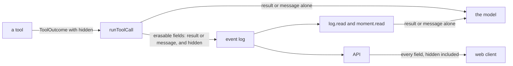

# The `hidden` field of a tool outcome

- **Status:** draft
- **Work items:**
  [`hidden` on an ok outcome, and the search's cost](https://linear.app/zgeoff/issue/GEO-2494),
  [`hidden` on an error, and the cost of a refused search](https://linear.app/zgeoff/issue/GEO-2496),
  [short IDs in the moment and recall records](https://linear.app/zgeoff/issue/GEO-2528),
  [the short ID of a proposal](https://linear.app/zgeoff/issue/GEO-2589)

A tool returns values that the server records and the model never reads under `hidden`, beside its
result or its error message. `log.read` prints only what the call showed the model, so a search's
cost and a memory tool's UUIDs stay out of the model's view. The search tool is the first user, and
the short IDs work is the second: [short IDs in tool records](short-ids-in-tool-records.md).

Terms used here: the result record is the `tool_result` record that the tool runner writes; the
tool's `record` is the optional object a tool returns beside its result, which the result record
stores in place of the result; a tool entry is what `log.read` prints for one result record.

## Shape



## Contracts

```ts
// the search tool, on hits
return { status: 'ok', result: { hits }, hidden: { costUSD: 0.012 } };
// the tool runner stores the erasable fields { result: { hits }, hidden: { costUSD: 0.012 } }
// the model gets { hits }, and log.read prints {"result":{"hits":[…]}}
```

```ts
// tools module
export type ToolOutcome =
  | ({ readonly status: 'ok' } & DirectResult)
  | {
      readonly status: 'error';
      readonly message: string;
      readonly hidden?: JSONObject; // added by the refused-search item
    };

export interface DirectResult extends TypedResult {
  // …existing fields

  // What the server records and the model never reads. Only the tool puts a value here. A tool
  // never puts text here that a forget of another record must erase.
  readonly hidden?: JSONObject;
}

// ActionOutcome, the outcome of a queued tool, is unchanged and holds no `hidden`.
```

```text
The erasable fields of a tool_result record:
  ok outcome                   { result: record ?? result, hidden? }
  an error the tool returns    { message, hidden? }
  every other outcome          { message }
hidden is stored only when the tool set it to an object with 1 key or more.
```

```text
What log.read prints for a tool_result entry, as JSON text:
  {"message": <the message>}        when the fields hold a string message; it wins over result
  {"result": <the stored result>}   otherwise, when the fields hold result
  the fields whole, as on main      when they hold neither
Every other key of the erasable fields, hidden included, is left out. Other record kinds print
as on main.
```

## Constraints

- The model never reads `hidden`: not in the tool's reply, not through `log.read`, and not through
  `moment.read`.
- `moment.read` with `records: 'all'` prints a `tool_result` record of a span by the `log.read` rule
  above, and every other kind as built. As built it prints every erasable field, so the first item
  that adds `hidden` changes `moment.read` too.
- The tool runner sends the model the result alone, or the message alone.
- The result record's payload is unchanged. The design adds no record kind, no migration and no
  config key.
- `hidden` is an erasable field, so a forget that erases the result record's fields erases `hidden`
  too.
- `log.read` drops the top-level `costUSD` key of the stored `result` when the payload's `sources`,
  which name the result's top-level keys, do not name `costUSD`. No built tool names it. A payload
  that does not decode names no source. This covers the search records of the releases before, which
  hold the cost inside `result`, and reads no tool name.
- When the fields hold no `hidden` and the stored `result` holds no `costUSD`, `log.read` prints the
  same bytes as on main.
- A word search in `log.read` matches the printed text, so it never matches a value in `hidden`.
- The API passes `hidden` to the web client as it passes every erasable field, and the web client
  shows it under the result or the message. For an error with `hidden`, the web client prints one
  JSON object with `message` before `hidden`.
- The release before reads a record with `hidden` and prints it whole in its `log.read`. After a
  rollback, the model reads the cost of the searches that the later release recorded.
- A search's cost sits in 2 places across one log: `hidden.costUSD`, and `result.costUSD` in records
  of the releases before. Code that totals cost reads both. No code totals it today.

## Decisions

- **Only the tool marks a value as hidden.** nixie cannot derive the mark from the tool's `record`,
  its result or its declared sources: a filter by `sources` would hide `eventIDs` of `log.read`'s
  own record, and a per-tool key list misses a tool that the server did not register.
- **The field has the name `hidden` on both members.** The tool's `record` keeps one meaning: the
  stored form of the result, which `log.read` prints.

## Builder decides

- How `readLogPage` and `readMomentSpanPage` share the printing rule.
- Test layout and internal names.

## Out of scope

- The daily call cap of the search, the paid-tool budget, a separate store for cost, and a refund of
  the cap for a refused search.
- The cost in the result record's plain payload. A forget never erases a payload.
- Storing the model's result beside the tool's `record`. A memory tool's result would sit readable
  after a forget.
- A search that fails at the provider, whose reply carries no cost.
