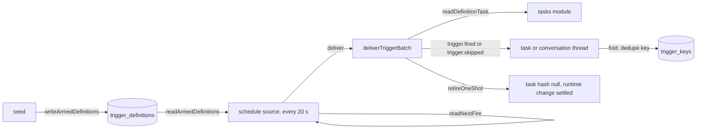

# The trigger core and schedules

- **Status:** draft
- **Work items:** [the trigger core](https://linear.app/zgeoff/issue/GEO-2542),
  [the schedule source and the one-shot](https://linear.app/zgeoff/issue/GEO-1835),
  [the preview definition](https://linear.app/zgeoff/issue/GEO-2537),
  [the trigger source baseline](https://linear.app/zgeoff/issue/GEO-2538),
  [the chat tools, the notice and the undo](https://linear.app/zgeoff/issue/GEO-1836),
  [the view procedures](https://linear.app/zgeoff/issue/GEO-2545)

A definition with a `schedule` trigger fires at repeating times in a time zone, and one with an `at`
trigger fires once. Every trigger source hands its fires to one piece of code, the trigger core,
which takes each fire at most once, writes its record, wakes its task and stores the source's
cursor, all in one write transaction. The triggers module holds the core, the `TriggerSource` port
and [the schedule source](https://linear.app/zgeoff/issue/GEO-1835), and learns which definitions
can fire from a seed hook.

## Shape



| Term       | Meaning                                                                                  |
| ---------- | ---------------------------------------------------------------------------------------- |
| armed      | a definition in force that has a trigger; only an armed definition fires                 |
| withdrawn  | a definition that was armed and is out of force                                          |
| slot       | one scheduled time of a schedule                                                         |
| dedupe key | the text that identifies one fire                                                        |
| watermark  | the instant per armed definition after which nixie looks for its next fire               |
| one-shot   | a definition whose trigger is `at`; it is spent once `trigger_keys` holds its dedupe key |

## Contracts

### The port

This design builds the port that
[the trigger source design](../platform/channels/trigger-source.md#the-interface) sketches, with the
changes that [Changes to the trigger source design](#changes-to-the-trigger-source-design) lists.

```ts
// triggers module
interface TriggerSource {
  id: string; // stable across restarts, such as 'schedule'
  kind: 'schedule'; // 'poll', 'webhook' and 'stream' arrive with their sources
  start(context: TriggerContext): Promise<void>; // resolves once the source runs
  stop(): Promise<void>; // resolves once no tick is in flight
}

// Built per source by startTriggerSources, which binds deliver to deliverTriggerBatch with the
// source's ID and reads the stored cursor from trigger_sources.
interface TriggerContext {
  cursor: JSONValue; // the last cursor nixie committed for this source; null for the schedule source
  deliver(batch: { cursor: JSONValue; events: TriggerEvent[] }): Promise<{ delivered: number }>;
  reportHealth(health: SourceHealth): void; // held in memory by startTriggerSources
  signal: AbortSignal; // aborted at stop
}

type SourceHealth = 'running' | 'unhealthy' | 'stopped';

interface TriggerEvent {
  definitionID: string;
  definitionHash: string; // the version the source computed the event from
  kind: 'schedule' | 'at';
  dedupeKey: string; // the key of `scheduledFor`
  scheduledFor: string; // ISO instant: the newest slot the event covers
  occurredAt: string; // ISO instant the source built the event
  missed: string[]; // earlier slots never delivered, ISO, oldest first: the 20 newest
  missedCount: number; // the full number of earlier missed slots
  skip?: 'too_late' | 'catch_up_off' | 'window_closed'; // set when the source decides a skip
  payload: null; // a poll source sets outside content here
}
```

```ts
// triggers module. The server app calls it at start, after createConversationTask, and calls
// `stop` at shutdown.
declare function startTriggerSources(
  sources: readonly TriggerSource[],
  core: TriggerCoreContext,
): Promise<{ stop: () => Promise<void>; readHealth: () => ReadonlyMap<string, SourceHealth> }>;

interface TriggerCoreContext {
  readonly log: Log;
  readonly clock: Clock; // the writer's clock: firedAt and recordedAt
  readonly readDefinitionTask: typeof readDefinitionTaskInTransaction; // ./definition-tasks.md#the-fire-answer
  readonly retireOneShot: RetireOneShot;
}

// What the server app passes. Before the runtime layer lands, it is the tasks module's
// withdrawDefinitionTaskInTransaction alone; the runtime layer wraps it with the
// definition.settled write for a runtime one-shot.
type RetireOneShot = (
  tx: Transaction,
  definitionID: string,
  cause: 'one_shot_fired' | 'one_shot_skipped',
) => Promise<void>;
```

### Schedule

```ts
// contract lib, beside Trigger and isTimeZone
interface Schedule {
  every: 'day' | 'week' | 'hour' | { minutes: number }; // minutes: a whole number, 5 to 1440
  at?: string; // 'HH:MM', 24-hour. day and week: `at` or `window`, never both. Refused for hour and minutes.
  on?: 'mon' | 'tue' | 'wed' | 'thu' | 'fri' | 'sat' | 'sun'; // required for week, refused otherwise
  window?: { from: string; until: string }; // 'HH:MM' each. day and week only. until before from ends the next day.
  idleMinutes?: number; // a whole number, 1 to 720. Only beside `window`.
  zone?: 'owner' | string; // an IANA zone that isTimeZone accepts. Default 'owner'.
  catchUp?: 'once' | 'skip'; // default 'once'
}
```

### The arming hook

```ts
const armed = await writeArmedDefinitions(tx, log, [
  {
    definitionID: 'dentist',
    definitionHash: '8a21…',
    source: 'schedule',
    target: 'conversation',
    trigger: { at: '2027-03-09T14:00:00+11:00' },
  },
]);
// → { armed: 1, withdrawn: 0 }

// triggers module. The definitions module imports it and calls it in the seed's transaction.
declare function writeArmedDefinitions(
  tx: Transaction,
  log: Log,
  inForce: readonly ArmedDefinition[], // each definition in force with a trigger, less each spent one-shot
): Promise<{ armed: number; withdrawn: number }>; // at most one trigger.armed record

interface ArmedDefinition {
  definitionID: string;
  definitionHash: string;
  source: 'schedule'; // the source of `schedule` and `at`
  target: 'task' | 'conversation';
  trigger: Trigger; // parsed, defaults filled
}
```

### The records and the tables

```ts
// triggers module. Neither record sits on a thread, and neither has an erasable field.
interface TriggerArmed {
  armed: ArmedDefinition[]; // added, changed, or back in force
  withdrawn: string[]; // definition IDs out of force, a spent one-shot included
}

interface TriggerDelivered {
  source: string;
  cursor: JSONValue; // written only when the cursor changes; the schedule source never writes one
}
```

The tasks module owns and exports the codecs of `trigger.fired` and `trigger.skipped`:
[the 2 fire records](definition-tasks.md#the-2-fire-records).

```text
3 projections, one appended migration:
trigger_sources      key source_id. cursor, updated_sequence. From trigger.delivered.
trigger_keys         primary key source_key = '<source>\n<dedupeKey>'. sequence.
                     From trigger.fired and trigger.skipped, one row per record. Never deleted.
trigger_definitions  key definition_id. source_id, definition_hash (null when withdrawn), target,
                     trigger, after (the watermark, epoch milliseconds), updated_sequence.
                     From trigger.armed, trigger.fired and trigger.skipped.
```

### Fire times and the rendered trigger

```ts
readNextFire(
  'water-the-tomatoes',
  { schedule: { every: 'week', on: 'fri', at: '08:00' } },
  1_804_194_000_000, // the slot of Fri 5 Mar
  'Australia/Sydney',
);
// → { scheduledFor: 1_804_798_800_000, until: null, dedupeKey: 'water-the-tomatoes|2027-03-12T08:00' }

// triggers module. Pure. The first slot after `after`, or null when none is left.
declare function readNextFire(
  definitionID: string,
  trigger: Trigger,
  after: number, // the watermark, epoch milliseconds
  zone: string, // an IANA zone: the caller has already resolved 'owner'
): { scheduledFor: number; until: number | null; dedupeKey: string } | null;
// until: the end of the window for a `window` schedule, else null

// triggers module. Pure, beside readNextFire. Callers: the task.define result, the change notice,
// tasks.definitions, and definitions.listTasks.
declare function renderTrigger(
  trigger: Trigger,
  after: number,
  zone: string,
): { rendered: string; next: string | null };
// → { rendered: 'every Friday at 08:00', next: 'Fri 12 Mar' }
//   other renderings: 'every day at 06:30', 'every 45 minutes', 'once on Tue 9 Mar at 14:00'

// What the server app passes to the schedule source and to every caller of the 2 functions above:
// it resolves 'owner' to the zone of your newest message through readMessageTimeZone of the
// connectors module, or to the config key time.default_zone when you have sent none, and returns
// any other zone as it is. The triggers module therefore imports no connectors code.
type ReadZone = (zone: Schedule['zone']) => Promise<string>;
```

## Constraints

### Fire times

- `every: day` or `week` with `at` fires at that local time.
- With `window`, `readNextFire` returns `window.from` as `scheduledFor` and `window.until` as
  `until`, with or without `idleMinutes`. The schedule source decides the instant inside the window,
  as the schedule source says.
- `every: hour` fires at each instant at which the zone's clock shows minute 0. A minutes schedule
  fires at each whole multiple of its interval since the Unix epoch, so nixie stores no start time.
- An `at` fires once, at its instant. Its value must hold an offset or `Z`. `readNextFire` returns
  that instant for any `after`, so a one-shot first seeded after its instant still has a slot, until
  its key is taken.
- When the clock skips a local slot of a `day` or `week` schedule, it fires at the first instant
  after the gap. When the clock shows the slot twice, it fires at the first.
- `hour` and minutes schedules fire on instants, so an `hour` schedule fires 25 times on the day the
  clock goes back and 23 times on the day it goes forward.
- The dedupe key of a `day` or `week` fire is `<definitionID>|<local date>T<HH:MM>`, with the local
  date and time of `at` or of `window.from`, also when `until` falls on the next day. One local slot
  therefore fires at most once when your zone changes that day. The key of an `hour`, minutes or
  `at` fire is `<definitionID>|<UTC instant>`.

### The watermark

- nixie stores no time of a pending fire, so a zone change moves the next fire at once.
- The fold of `trigger.armed` sets the watermark to the record's time when the definition has no
  row, was withdrawn, or has a different `trigger`. Two triggers are the same when their canonical
  JSON, with defaults filled, is equal. Another hash with the same `trigger` leaves the watermark,
  so a fire due just before an edit of `instructions.md` fires with the edited version.
- The fold of `trigger.fired` moves the watermark to its `scheduledFor`, and the fold of
  `trigger.skipped` to the last entry of its `scheduledFor`, the newest. The slots a skip covers
  therefore never fire.
- No fold moves the watermark back, and no fold moves it for an `at` event. Only the dedupe key
  decides whether a one-shot fires.
- `readArmedDefinitions` returns the armed definitions of one source.

### The arming hook

- The seed calls `writeArmedDefinitions` after every refusal and after the hook that binds each
  task, and before it can return `unchanged`, so the hook runs at every accepted seed.
- The hook writes one `trigger.armed` when its list differs from the `trigger_definitions` rows, and
  none when they agree.

### One `deliver` call

`deliverTriggerBatch` is one write transaction. For each event in order, the first row that fits
decides:

| #   | When                                                                                                                                                          | Records written                                       | Key taken |
| --- | ------------------------------------------------------------------------------------------------------------------------------------------------------------- | ----------------------------------------------------- | --------- |
| 1   | `trigger_keys` holds the event's key, or an earlier event of the batch took it                                                                                | none                                                  | no        |
| 2   | the definition has no row, is withdrawn, is on another source or holds another hash; or, for a `schedule` event, `scheduledFor` is at or before the watermark | none                                                  | no        |
| 3   | the event holds `skip`                                                                                                                                        | `trigger.skipped` with the source's reason            | yes       |
| 4   | the definition has `target: conversation`                                                                                                                     | `trigger.fired` on the conversation's thread          | yes       |
| 5   | `readDefinitionTask` answers `take`                                                                                                                           | `trigger.fired` on the task's thread                  | yes       |
| 6   | `readDefinitionTask` answers `still_running` or `held`                                                                                                        | `trigger.skipped` with `still_running` or `task_held` | yes       |

- When `readDefinitionTask` answers null, the core throws and the batch commits nothing: the seed
  binds each task before it arms the definition, so null is a fault.
- The core writes `trigger.fired` through the tasks module's `writeInboxRecordsInTransaction`, which
  wakes the task with the cause `event`, and `trigger.skipped` through the log module's
  `writeRecordsInTransaction`. A wake with the cause `event` sets the hop count of messages between
  tasks to 0.
- The conversation task exists before any source starts, because the server app runs
  `createConversationTask` first. When it is missing, the inbox writer throws and the batch commits
  nothing.
- The core writes each record before it reads for the next event, so a second fire of one definition
  in one batch skips with `still_running`.
- Each record carries the event's `dedupeKey` and source, and its fold adds the row to
  `trigger_keys` at once, so the next event of the batch sees the key.
- `trigger.fired` takes `scheduledFor`, `skipped` (from `missed`) and `skippedCount` (from
  `missedCount`) from the event. `firedAt` is the core's clock at the write, and `isCatchUp` is true
  when `firedAt` is more than 60 seconds after `scheduledFor`.
- `trigger.skipped` takes `scheduledFor` as the event's `missed` followed by its `scheduledFor`, the
  20 newest kept, and `count` as `missedCount` plus 1. `recordedAt` is the core's clock at the
  write. The skip takes the key of the event's `scheduledFor`.
- After the record of an `at` event, the core writes a `trigger.armed` that withdraws the definition
  and calls `retireOneShot`, both in the same transaction. A one-shot is then out of force with no
  seed, and a failed retirement fails only the batch it sits in.
- The core writes `trigger.delivered` only when the batch's cursor differs from the stored one. It
  takes no lease.
- A skip takes the dedupe key of its slot, so a definition disabled and enabled again inside a
  skipped slot does not fire in it.

### Crashes, clocks and restores

- When `deliver` throws or nixie dies before the commit, nothing is written, and the source builds
  the same events with the same keys at its next tick.
- When 2 writes of one dedupe key reach `trigger_keys`, the primary key fails the second, and its
  transaction fails.
- When the clock moves back, nixie delivers no fire twice.
- A restored backup holds its `trigger_keys` rows and watermarks, so nixie repeats no fire it holds.
  A fire due after the backup is a missed fire.
- After a rollback and an upgrade, the first seed corrects `trigger_definitions`, and until then row
  2 drops each event whose hash differs from its row.
- `trigger_keys` grows by one row per fire or skip: about 105,000 rows a year for one 5-minute
  schedule, and 365 for a daily one.

### The spent one-shot

- A one-shot is spent when `trigger_keys` holds its dedupe key. nixie stores the fact nowhere else,
  and every seed leaves a spent one-shot out of both hook lists.
- `withdrawDefinitionTaskInTransaction` of the tasks module writes `task.definition_set` with a null
  hash when the definition's task holds a hash, and nothing otherwise.
- The file of a spent one-shot stays as you wrote it, and nixie writes no seed record for the fact.
- When you edit the `at` to another instant, the one-shot has another key and fires at it. When you
  edit it to an instant whose key is taken, the one-shot is spent at the next seed. Disabled and
  enabled again, a spent one-shot does not fire.

### Boundaries

- The triggers module imports the tasks module, the log module and the clock lib. The definitions
  module imports the triggers module. No cycle forms, because the tasks module imports neither.
- A trigger source that calls an outside system is an adapter named `trigger-<system>`, or calls
  that system through a connector.
- `startTriggerSources` logs each change of a source's health. No API reads it.
- The time-zone arithmetic is pure code over the runtime's zone data, with no port and no date
  library.
- The triggers module adds no config key.

## Changes to the trigger source design

This design replaces these parts of
[the trigger source design](../platform/channels/trigger-source.md). The owner approved all 5 on 13
Nov, and [the trigger source baseline](https://linear.app/zgeoff/issue/GEO-2538) rewrites that doc
to match once the schedule source is built:

- A durable timer per next fire: nixie computes the next fire from the watermark and stores no
  timer.
- The key "job ID plus the scheduled time": a `day` or `week` key holds the local slot.
- Job filters and task waits in `deliver`: each event names its definition, and `deliver` writes
  `trigger.fired` or `trigger.skipped`.
- Catch-up "after a restart": the half-interval rule of
  [the trigger source](../platform/channels/trigger-source.md#schedules) holds after any late tick,
  beside `catchUp: skip` and the window skip.
- The generic `Cursor`: a cursor is a `JSONValue`. `SourceHealth` is defined above.

## Decisions

- **The trigger core lives in its own module.** The
  [trigger source](../platform/channels/trigger-source.md) is one of nixie's own interfaces, and a
  source of poll triggers depends on connectors, which the tasks module must not.
- **A late schedule catches up once within half its interval, and skips beyond it.**
  [The trigger source](../platform/channels/trigger-source.md#schedules)
- **The definitions module calls the arming hook directly.** A hook passed in as a function is one a
  second seed path can leave out.
- **A minutes schedule anchors on the Unix epoch.** A stored start time would differ after a restore
  or a first seed on another host.
- **The schedule source sets no timer on a task.** A schedule fires when no task run is open, and
  only a step's commit sets a task's timer.

## Builder decides

- The names of the constants and their module.
- The wording of each rendered trigger, within the forms in the sketch.
- How `deliverTriggerBatch` loads the rows it compares.
- The layout of the tests.

## Out of scope

- Trigger sources for polls, and the match of a polled event to a definition or a wait:
  [mail and calendar polls](mail-and-calendar-polls.md#changes-to-the-trigger-core-and-the-baseline)
  extends the port, the arming hook and `deliverTriggerBatch`.
- Webhooks and streams.
- Pruning `trigger_keys`.
- Moving the backup schedule, the lapse sweeps or the definitions poll onto the schedule source.
- A view of source health.

## Open questions

None.
