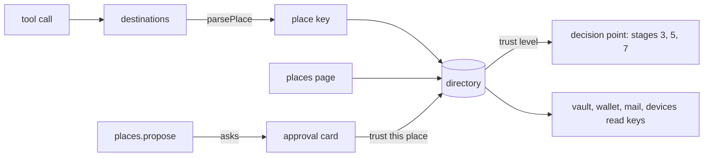

# Trusted places

- **Status:** draft
- **Work items:** [the vault](https://linear.app/zgeoff/issue/GEO-2731),
  [locked entries](https://linear.app/zgeoff/issue/GEO-2814),
  [the wallet](https://linear.app/zgeoff/issue/GEO-2757),
  [devices](https://linear.app/zgeoff/issue/GEO-2758). Each builds on the directory here.

nixie keeps one directory of the places it deals with: websites, email addresses, mail domains,
phone numbers and chat handles. Each entry carries one trust level, and the decision point reads the
level for every tool that reaches the place. Today the same website is free for `web_fetch`, asks
for `computer.browser_open`, and asks again for each click, because each tool and each Always allow
answer keeps its own list. With the directory, you trust a site once, on one page, and every tool
sees the same answer.

The owner approves this design. Build each work item above from it and the
[decision point](../../architecture/policy/decision-point.md) it extends. The directory's own work
items, filed when the owner approves, are:

1. the matcher, the directory, its records and the decision point's changes, with the contacts
   folded in and `web_fetch` declaring its host;
2. the card's answers, `places.propose` and `places.narrow`;
3. the places page and `nixie places`, which retire the contacts code;
4. the one evidence window and the skill guard's move to first use.

## Shape



## Terms

- A **place** is one entry in the directory: a site, an address, a mail domain, a phone number or a
  handle.
- A **place key** is the normal form of a place, the only form the directory stores and compares.
- A **reading effect** is `read` or `fetch`. An **acting effect** is any other effect except
  `spend`, which no place covers.

## Contracts

### The matcher

Compare a destination with a place only through `parsePlace` and `isPlaceCovered`, never as raw
strings.

```ts
parsePlace('https://Docs.Example.org:8443/a?b=1');
// → { kind: 'site', domain: 'docs.example.org' }
parsePlace('Sam@Example.org');
// → { kind: 'address', address: 'sam@example.org' }
parsePlace('+61 420 000 000');
// → { kind: 'phone', e164: '+61420000000' }
parsePlace('telegram:51234');
// → { kind: 'handle', channel: 'telegram', id: '51234' }
parsePlace('0420 000 000'); // a phone number with no country code
// → null
parsePlace('not a place');
// → null

isPlaceCovered(entry.key, parsePlace(destination));
// → true when the entry covers the destination; false for a null destination
```

```ts
// places module (new). parsePlace and isPlaceCovered do no I/O.
// A destination is one concrete place: what a call reaches.
type Destination =
  | { kind: 'site'; domain: string } // lower case, IDNA ASCII, no port, no trailing dot
  | { kind: 'address'; address: string } // the whole address in lower case
  | { kind: 'phone'; e164: string }
  | { kind: 'handle'; channel: string; id: string };

// A place key is what an entry stores. It may cover many destinations.
type PlaceKey =
  | { kind: 'site'; domain: string; subdomains: boolean } // false covers the domain alone
  | { kind: 'address'; address: string }
  | { kind: 'mail_domain'; domain: string; subdomains: boolean } // every address at the domain
  | { kind: 'phone'; e164: string }
  | { kind: 'handle'; channel: string; id: string }
  | { kind: 'raw'; value: string }; // a migrated contact that parsePlace can't read; exact match
```

- A phone number parses only from `+` and its digits, with spaces and dashes dropped. nixie guesses
  no country code.
- A handle parses only as `<channel>:<id>`.
- An IP address or a host with one label, such as `localhost`, parses as a `site`.
- A `site` or `mail_domain` key with `subdomains: true` needs at least two labels, so no entry
  covers a whole top-level domain.

`parsePlacePattern('@shop.example')` reads a place key from what you or a rule write: a domain gives
a `site` key with `subdomains: true`, `@domain` gives a `mail_domain` key, and `=example.org` gives
a `site` key with `subdomains: false`.

### The directory

```ts
const place = await places.add({
  key: { kind: 'site', domain: 'library.example.org', subdomains: true },
  trust: 'read',
  name: 'The library',
});
// → { placeID: '6b0e…', shortID: 'P4', trust: 'read' }

const verdict = places.find(snapshot, parsePlace('https://catalog.library.example.org/x'));
// → { placeID: '6b0e…', shortID: 'P4', trust: 'read' }, or null for a place with no entry
```

```ts
// places module.
type Trust =
  | 'blocked' // every call that reaches the place is denied
  | 'known' // the place passes stage 5; the rules decide the call, as for a known contact today
  | 'read' // a call with only reading effects is allowed; an acting call is decided as at 'known'
  | 'act' // a call with reading or acting effects is allowed, and each act leaves a notice
  | 'self'; // one of your own addresses, numbers or handles; as 'act', with no notice

interface Place {
  placeID: string; // crypto.randomUUID()
  shortID: string; // createShortID; the model reads and passes this, never placeID
  key: PlaceKey;
  trust: Trust;
  name: string | null; // erasable
  addedBy: 'you' | 'proposal' | 'card' | 'seed';
}
```

The directory writes these records. The first three carry no thread, as contact records don't today,
and each makes a new definitions snapshot. `places.acted` goes on the call's thread and makes none.

```text
places.added    { placeID, shortID, key, trust, name, addedBy }
places.changed  { placeID, trust?, name? }
places.removed  { placeID }
places.acted    { placeID, shortID, callID }  // a call that an 'act' place allowed
```

- The `places` projection holds each entry's IDs, kind, level and sequences. For an `address`,
  `phone` or `handle` place, the key and the name are erasable fields of `places.added`, read back
  from the record as a contact's are today, and `places.added` joins the forgettable kinds.
- The projection keeps a keyed hash of each key, under the deployment's key, for the
  one-entry-per-key check. A forget clears the hash.
- A forget of a place removes it, whatever its level: forgetting a `blocked` address unblocks it.
  You forget a place to remove every trace of it.

### The decision point

The directory changes [stages](../../architecture/policy/decision-point.md#the-stages) 3, 5 and 7. A
call's destinations come from its tool as today, and each goes through `parsePlace` first.

| Level     | Stage 3, deny   | Stage 5, destinations                                                   | Stage 7, before the allow rules          |
| --------- | --------------- | ----------------------------------------------------------------------- | ---------------------------------------- |
| `blocked` | denies the call | –                                                                       | –                                        |
| `known`   | –               | gives a permission                                                      | –                                        |
| `read`    | –               | gives a permission                                                      | allows a call with only reading effects  |
| `act`     | –               | gives a permission                                                      | allows any call but `spend`, with notice |
| `self`    | –               | gives a permission                                                      | allows any call but `spend`              |
| no entry  | –               | a permission for a call with only reading effects; else the other tiers | –                                        |

```ts
// log module, where the decision record's types live. Replaces the owner and known_contact tiers.
type DestinationPermission =
  | { by: 'place'; placeID: string; trust: 'known' | 'read' | 'act' | 'self' }
  | { by: 'reading' } // a destination with no entry, on a call with only reading effects
  | { by: 'reply_target' }
  | { by: 'task' }
  | { by: 'rule'; ruleID: string };

// …existing DecisionDetail fields
type DecisionDetail = { place: { placeID: string; shortID: string } | null }; // set for a deny at a
// blocked place, or an allow at stage 7 through places; rule is null then
```

- Stage 3 checks places before the deny rules. The model reads the place's short ID only: "you
  blocked P4".
- Stage 7 checks places first: the call is allowed when every destination's place allows it. A call
  with no destination never passes this check. An ask rule at stage 6 still asks at a trusted place.
- The stage numbers stay 1 to 9. A place allow records stage 7 with `place` set and `rule` null.
- `ownerDestinations` leaves the decision point's inputs, and `self` places take the owner tier's
  place. A decision recorded before this design keeps its old strings, and the decision schema reads
  both forms. No published contract type carries decision permissions.
- The tool runner writes `places.acted` on the call's thread, beside `tool_called`, when the
  decision allowed the call through an `act` place. The decision point stays a pure function, so a
  replay writes nothing.
- When several entries cover a destination, a `blocked` entry wins. Otherwise the most specific
  entry wins: an exact key, then the longer domain.
- A rule's `destinations` keep their patterns and the `*` match. Both the pattern and the
  destination are put in lower case before the match.
- `web_fetch` declares the host of its `url`, or of the link a `link` call names, through
  `resolveDestinations`. A call that reads a stored page fetches nothing and declares none.
- `search` with `sites`, `computer.browser_download` and a device page's fetches declare their URL's
  host too, in their own work items.
- The server's hop gate refuses a redirect hop to a `blocked` site. The browser tools read the tab's
  host at each call, so the next call on a tab that a redirect or a click took to a `blocked` site
  is denied. Navigation inside the browser between calls isn't checked.

### The card and the proposal

```ts
// An approval card's answer, beside Allow once and Always allow.
type TrustAnswer = { trust: 'read' | 'act'; key: PlaceKey }; // the card offers the call's place
```

```ts
const proposal = await tools.call('places.propose', {
  place: 'https://tickets.example.com',
  trust: 'act',
  why: 'You asked me to book here every week.',
});
// → { proposal: 'Q7' }, a card for you
```

- When every destination of a held call is one place, the card offers "Trust this place to read" and
  "Trust this place to act". The answer adds or raises the entry. It writes no rule.
- A card or a proposal offers the exact host, with `subdomains: false`. You widen an entry to its
  subdomains on the places page.
- `places.propose` declares `policy_widen`, so it always asks.
- nixie narrows a place with `places.narrow`. It declares `policy_narrow` and applies at once with a
  notice.

```ts
await tools.call('places.narrow', { place: 'P4', trust: 'known' }); // or { place: 'P4', remove: true }
// → { place: 'P4', trust: 'known' }; refuses a level that isn't lower than the current one
```

### Evidence from what you typed

nixie checks whether you named a place in three spots today, each with its own window: the consent
check (the turn's message, plus your linked messages within `policy.consent.link_max_age` hours),
the memory gate (your last 20 messages) and the skill guard (the same 20). The design gives them one
window, the consent check's, and one comparison, `isPlaceCovered` over `parsePlacePattern` of each
place you typed. The secret scan's exemption for a URL you typed keeps its own rule, the whole URL,
because it guards a secret, not a place.

### The skill guard moves to first use

The owner decided that nixie writes its own skills freely. `skill_write` applies under its rules,
and no longer checks the places a skill names. A skill that names a place you never trusted takes
effect, and its first call to that place meets the decision point like any other call: an acting
call there asks.

### The places page

The web client gets a page at `/places`: each entry with its kind, key, level, name, who added it
and when a call last used it. You add, change and remove entries there. The host CLI
`nixie contacts` becomes `nixie places`, with the same verbs.

## Constraints

- The directory holds at most one entry per place key.
- `parsePlace` returns `null` for a string it can't read as a place. A `null` destination has no
  place tier and falls through.
- An entry covers a place by key alone. A site entry never covers an address at that domain.
- A `blocked` entry beats every rule, mandate and lift.
- `spend` asks at every level. A lift covers it as it does today; a place never does.
- Each call reads the directory of its own definitions snapshot. Each place record makes a new
  snapshot, as a contact record does today. The snapshot's form holds `policy.places`, the place IDs
  and levels, in place of `policy.contacts`, and never an address.
- The vault keeps each entry's exact origins as a fill constraint. A password fills only on an exact
  origin of its entry, even on a site at `act`. The vault entry links its site's place ID.
- A wallet lift names places, never origins. Its merchants are site places.
- A mail trigger's or wake rule's `from` names `address` or `mail_domain` keys, matched by
  `isPlaceCovered`. A place's level never wakes a task by itself.
- Typing a domain covers its subdomains: typing `example.org` names `api.example.org`. A domain is
  how you name a site, and the matcher already covers subdomains for an entry.
- The skill guard checks a place when a skill's call reaches it, never when the skill is written. A
  write can't reach anyone; a call can, and every call meets the decision point.
- Known contacts become places at `known` with no new records: the `places` projection also folds
  `policy.contact_marked_known` and `policy.contact_unmarked`. A migrated place's ID is its contact
  ID, and its short ID comes from `buildShortIDFromUUID`, so a rebuild gives the same short ID. Old
  snapshots' contact IDs read as places at `known`.
- A contact's destination goes through `parsePlace`, and one it can't read becomes a `raw` key.
  `isPlaceCovered` also takes the destination's original string, and a `raw` key covers the exact
  NFC string. No call a contact covers gains an allow or loses one, except that an address now
  matches in any case.
- A forget of the old contact record erases the place.
- The consent check's typed-name match, `nixie contacts`, `contacts.mark_known` and the contract's
  known-contact schema keep working over the `places` projection until the page's work item moves
  them. The `known_contacts` table goes when they do.
- The definitions repo may hold `places.yaml` with `site` and `mail_domain` entries, seeded like
  rules. An `address`, `phone` or `handle` place never leaves the database.

## Builder decides

- The module's name and where the matcher lives, if not in `modules/places`.
- The page's layout and its sort order.
- The notice's wording.
- Whether `places.narrow` is one tool or two.
- How the Always allow rules that pin only a host are left: they keep working, and the builder may
  offer a one-time conversion to places on the page.

## Out of scope

- Groups of places, such as "every bank". A later design can add them over the same keys.
- A place's history beyond its records.
- Trust for MCP servers, which the MCP proxy design keeps in its own config.

## Open questions

- **The levels.** The design has five: `blocked`, `known`, `read`, `act` and `self`. The owner may
  want fewer names, or a level that allows acts without a notice. Until the owner decides, the five
  stand.
- **Reads from an unlisted site.** The design keeps them free, as `allow-reads` does today. The
  owner may prefer that a fetch from an unlisted site asks once. Until then, reads stay free.
- **Whole-domain entries for shared suffixes.** A two-label minimum still allows an entry for
  `co.uk` with subdomains. A public-suffix list would refuse it, at the cost of a library. Until the
  owner decides, only you can make a subdomain entry, on the page.
- **Who sees the notice of an act.** The design shows it in the conversation. The owner may want a
  digest instead.
