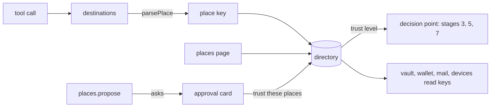

# Trusted places

- **Status:** draft
- **Work items:** [the vault](https://linear.app/zgeoff/issue/GEO-2731),
  [locked entries](https://linear.app/zgeoff/issue/GEO-2814),
  [the wallet](https://linear.app/zgeoff/issue/GEO-2757),
  [devices](https://linear.app/zgeoff/issue/GEO-2758). Each uses the directory.

nixie keeps one directory of the places it deals with: websites, email addresses, mail domains,
phone numbers and chat handles. Each entry carries one trust level, and the decision point reads the
level for every call that declares the place as a destination. Today `web_fetch` reads a website
without asking, `computer.browser_open` asks before it opens the same site, and each click asks
again, because each tool and each Always allow answer has its own list. With the directory, you
trust a site once, on one page, and every tool sees the same answer.

Once the owner approves this design, build each work item above from it and the
[decision point](../../architecture/policy/decision-point.md) it extends. The directory's own work
items, filed at approval, are:

1. the matcher with the public-suffix list, the directory, its records and the decision point's
   changes, with the contacts folded in, nixie's own places seeded, `places.yaml`, the hop gate's
   refusal of a `blocked` site, `web_fetch` declaring its host and the computer tools' destinations
   and effects;
2. the card's answers, `places.propose`, `places.narrow`, `places.list` and the notice of an act;
3. the places page and `nixie places`, which retire the contacts code;
4. the one evidence window, and the skill guard's move to first use.

## Shape



## Terms

- A **place** is one entry in the directory: a site, an address, a mail domain, a phone number or a
  handle.
- A **place key** is the normal form of a place, the only form the directory stores and compares.
- A **reading effect** is `read` or `fetch`. An **acting effect** is any other effect except
  `spend`, which no place covers.
- A **public suffix** is a name on the public-suffix list, in its ICANN or its private section, such
  as `org`, `co.uk` or `github.io`.

## Contracts

### The matcher

Compare a destination with a place only through `parsePlace` and `isPlaceCovered`, never as raw
strings.

```ts
parsePlace('https://Docs.Example.org:8443/a?b=1');
// → { kind: 'site', domain: 'docs.example.org' }
parsePlace('https://www.example.org/');
// → { kind: 'site', domain: 'example.org' }
parsePlace('Sam@Example.org');
// → { kind: 'address', address: 'sam@example.org' }
parsePlace('+61 420 000 000');
// → { kind: 'phone', e164: '+61420000000' }
parsePlace('telegram:51234');
// → { kind: 'handle', channel: 'telegram', id: '51234' }
parsePlace('0420 000 000'); // a phone number with no country code
// → null
parsePlace('not a place');
// → null

isPlaceCovered(entry.key, { parsed: parsePlace(destination), raw: destination });
// → true when the entry covers the destination. A null parsed destination matches only a raw key
// whose value is the NFC form of raw.
```

```ts
// places module (new). parsePlace and isPlaceCovered do no I/O.
// A destination is one concrete place: what a call reaches.
type Destination =
  | { kind: 'site'; domain: string } // lower case, IDNA ASCII, no port, no trailing dot, no www.
  | { kind: 'address'; address: string } // the whole address in lower case
  | { kind: 'phone'; e164: string }
  | { kind: 'handle'; channel: string; id: string };

// A place key is what an entry stores. It may cover many destinations.
type PlaceKey =
  | { kind: 'site'; domain: string; subdomains: boolean } // false covers the domain alone
  | { kind: 'address'; address: string }
  | { kind: 'mail_domain'; domain: string; subdomains: boolean } // every address at the domain
  | { kind: 'phone'; e164: string }
  | { kind: 'handle'; channel: string; id: string }
  | { kind: 'raw'; value: string }; // a migrated contact that parsePlace can't read; exact match
```

- `parsePlace` tries each form in this order: a URL with `://`, an address, a phone number, a
  handle, then a host with an optional port.
- A phone number parses only from `+` and its digits, with spaces and dashes dropped. nixie guesses
  no country code.
- A handle parses only as `<channel>:<id>`, where the channel is on the matcher's fixed list of chat
  connector names. Each chat connector's work item adds its name; the examples assume `telegram`.
  Any other `<name>:<digits>`, such as `example.org:8443`, is a host and a port.
- An IP address or a host with one label, such as `localhost`, parses as a `site`.
- Tools keep declaring the destination strings they declare today. The decision point runs
  `parsePlace` for places only, and a rule's `destinations` match the declared string.
- A site's normal form drops one leading `www.` label, unless what remains is a public suffix. So an
  entry for `example.org` covers `www.example.org`, and an entry typed as `www.example.org` is the
  entry for `example.org`. Every other subdomain needs its own entry or `subdomains: true`. A mail
  domain keeps its `www.`.
- A `site` or `mail_domain` key with `subdomains: true` never names a public suffix. The matcher
  reads the list through `tldts` with `allowPrivateDomains: true`, and every writer of an entry
  refuses such a key. An exact key on a public suffix, such as `github.io` alone, stays allowed. Add
  `tldts` to the root catalog at an exact version. It takes `tldts-core` through a `^` range, which
  the lockfile pins and Bun's minimum release age holds back like any other package.

`parsePlacePattern` reads a place key from text that you or nixie write. `places.propose`,
`places.narrow`, `places.list`, `places.yaml`, the page and a mail trigger's `from` all use this one
syntax, and `places.list` shows each key in it:

```ts
parsePlacePattern('library.example.org');
// → { kind: 'site', domain: 'library.example.org', subdomains: false }
parsePlacePattern('*.library.example.org');
// → { kind: 'site', domain: 'library.example.org', subdomains: true }
parsePlacePattern('@example.org'); // '@*.example.org' adds subdomains: true
// → { kind: 'mail_domain', domain: 'example.org', subdomains: false }
parsePlacePattern('*.github.io');
// → null: the key would cover a whole public suffix
parsePlacePattern('sam@example.org');
// → { kind: 'address', address: 'sam@example.org' }, as parsePlace reads it
```

### The directory

```ts
const place = await places.add({
  key: { kind: 'site', domain: 'library.example.org', subdomains: true },
  trust: 'read',
  name: 'The library',
});
// → { placeID: '6b0e…', shortID: 'k3p9m2x7qa', trust: 'read' }

const destination = 'https://catalog.library.example.org/x';
const verdict = places.find(snapshot, { parsed: parsePlace(destination), raw: destination });
// → { placeID: '6b0e…', shortID: 'k3p9m2x7qa', trust: 'read' }, or null for a place with no entry
```

```ts
// places module.
type Trust =
  | 'blocked' // every call that declares the place as a destination is denied
  | 'known' // the place passes stage 5; the rules decide the call, as for a known contact today
  | 'read' // a call with only reading effects is allowed; an acting call is decided as at 'known'
  | 'act' // a call with reading or acting effects is allowed, and each act leaves a notice
  // one of your own addresses, numbers or handles, never a site or mail domain; as 'act', no notice
  | 'self';

interface Place {
  placeID: string; // crypto.randomUUID()
  shortID: string; // createShortID; the model reads and passes this, never placeID
  key: PlaceKey;
  trust: Trust;
  name: string | null; // erasable for an address, phone or handle place
  addedBy: 'you' | 'proposal' | 'card' | 'seed' | 'nixie_own';
}
```

nixie's own places, such as its phone number and its website, are entries at `act` with
`addedBy: 'nixie_own'`. At start the server adds one for each address, number or site that a
connector's config names as nixie's own, unless it added that value before, so a value you removed
stays removed. No built connector names one yet. The page and `places.list` show each as nixie's
own, and you can change or remove it like any other entry. `self` holds only your places.

The directory writes these records. The first three carry no thread, as contact records don't today,
and each makes a new definitions snapshot. `places.acted` goes on the call's thread and makes none.

```text
places.added    { placeID, shortID, key, trust, name, addedBy }
places.changed  { placeID, trust?, name? }
places.removed  { placeID }
places.acted    { placeID, shortID, callID, tool }  // a call that an 'act' place allowed
```

- The `places` projection holds each entry's IDs, kind, level and sequences, and the key and name of
  a `site` or `mail_domain` place. It keeps a removed entry's row, so a replay of an older call
  finds its key. It sets the time a call last used a place from each `tool_called` whose decision
  carries that place's permission.
- For an `address`, `phone` or `handle` place, the key and the name are erasable fields of
  `places.added` and `places.changed`, and nixie reads them back from the record at each call, as it
  reads a contact's today. Both kinds join the forgettable kinds in the contract.
- `places.add` and `places.changed` check the one entry per key inside their write transaction,
  against the keys read back. The projection stores no copy or hash of a personal key.
- You can forget an `address`, `phone` or `handle` place. The forget takes its `places.added` and
  every `places.changed` of it. Its key then reads back empty, so it covers nothing whatever its
  level, and the page and `places.list` leave it out. Forgetting a `blocked` address unblocks it. A
  forget is yours alone; nixie's `places.narrow` never removes a `blocked` entry. A `site` or
  `mail_domain` place holds nothing personal: you remove it, and its records stay.

### The decision point

The directory changes [stages](../../architecture/policy/decision-point.md#the-stages) 3, 5 and 7. A
call's destinations come from its tool as today, and each goes through `parsePlace` first.

| Level     | Stage 3, deny   | Stage 5, destinations                                                   | Stage 7, before the allow rules          |
| --------- | --------------- | ----------------------------------------------------------------------- | ---------------------------------------- |
| `blocked` | denies the call | –                                                                       | –                                        |
| `known`   | –               | gives a permission                                                      | –                                        |
| `read`    | –               | gives a permission                                                      | allows a call with only reading effects  |
| `act`     | –               | gives a permission                                                      | allows any call but `spend`, with notice |
| `self`    | –               | gives a permission                                                      | allows any call but `spend`              |
| no entry  | –               | a permission for a call with only reading effects; else the other tiers | –                                        |

```ts
// log module, where the decision record's types live. Replaces the owner and known_contact tiers.
// Stage 5 gives each destination the first permission that holds, in this order.
type DestinationPermission =
  | { by: 'place'; placeID: string; trust: 'known' | 'read' | 'act' | 'self' }
  | { by: 'reading' } // a destination with no entry, on a call with only reading effects
  | { by: 'reply_target' }
  | { by: 'task' }
  | { by: 'rule'; ruleID: string };

// …existing DecisionDetail fields; rule is null when places is set
type DecisionDetail = { places: { placeID: string; shortID: string }[] | null }; // a deny: the first
// blocked place in destination order; an allow at stage 7: every place that allowed it
```

- Stage 3 checks places before the deny rules. The model reads the place's short ID only: "you
  blocked k3p9m2x7qa".
- Stage 7 checks places first: the call is allowed when every destination's place allows it. A call
  with no destination never passes this check. An ask rule at stage 6 still asks at a trusted place.
- The stage numbers stay 1 to 9. A place allow records stage 7 with `places` set and `rule` null.
- `ownerDestinations` leaves the decision point's inputs, and `self` places replace the owner tier.
  A decision recorded before this design keeps its old strings, and the decision schema reads both
  forms. No published contract type carries decision permissions.
- The tool runner writes one `places.acted` for each `act` place, on the call's thread, when a call
  with an acting effect that places allowed runs. A queued call writes it when its attempt runs. A
  call with only reading effects writes none. The decision point stays a pure function, so a replay
  writes nothing.
- When several entries cover a destination, a `blocked` entry wins. Otherwise the most specific
  entry wins: an exact or `raw` key, then the longer domain.
- A rule's `destinations` keep their patterns and the `*` match. Both the pattern and the
  destination are put in lower case before the match.

### What the tools declare

- `web_fetch` declares the host of its `url`, or of the link a `link` call names, through
  `resolveDestinations`, before any known-site rewrite. A call that reads a stored page fetches
  nothing and declares none.
- `search` with `sites`, `computer.browser_download` and a device page's fetches declare their URL's
  host too, in their own work items.
- `computer.screen_click` and `computer.screen_type` declare the host of the browser tab in front
  when the browser window has focus. With any other window in front they declare no destination, and
  the call asks: their declarations carry a flag that stops stages 7 and 8 allowing them with no
  destination. The flag is part of the declaration that the snapshot hash covers, and an `effects/`
  override can't change it.
- `computer.screenshot`, `computer.screen_scroll` and the browser read tools, such as
  `computer.browser_read`, declare no destination, as the [open question](#open-questions) says.
- `computer.browser_fill` declares `send`, with the tab's host.
- `computer.browser_click` declares `send` with the tab's host, unless its element is a plain link.
  On a plain link it declares `fetch`, with the tab's host and the link's host.

`prepare` of `computer.browser_click` reads the clicked element from the guest and returns the
effects and destinations in place of the declared ones:

```ts
// computer module, the guest's reply to an element read at prepare.
interface ClickedElement {
  role: string; // the snapshot's role; 'link' is an <a> with an http(s) href and no download
  href: string | null; // the absolute target of an <a>
  isInForm: boolean; // the element sits inside a <form>
  hasClickHandler: boolean; // an onclick attribute, or role="button"
}
// A plain link: role 'link', isInForm and hasClickHandler false. Any other element is a button.
```

- A click on a plain link runs without asking at a `read` place, and at an unlisted one through the
  starter rule `allow-reads`. Only a place at `act` or `self` allows a click on a button; at any
  other level the rules decide it, and with no allow rule it asks.
- The queued attempt of a click reads the element again, and refuses when its effects or
  destinations differ from the ones decided.
- A click handler that a script adds is invisible to `prepare`, so a plain-link click can start a
  script's action without asking. A plain link can act on its own too, such as a one-click
  unsubscribe. The design accepts both risks; a click inside a form still asks.
- The server's hop gate refuses each hop to a `blocked` site, both the rewritten URL and each
  redirect, under the call's own snapshot. The browser act tools read the tab's host at each call,
  so the next act on a tab that a redirect or a click took to a `blocked` site is denied. Navigation
  inside the browser between calls isn't checked.

### The notice of an act

Each turn that ends with calls allowed through an `act` place shows at most one line per place,
styled like a tool call. The line names the place and the tools that ran there, from the turn's
`places.acted` records, with a count for each tool:

```text
tickets.example.com: computer.browser_click ×2, mail.send
```

### The card and the proposal

```ts
// An approval card's answer, beside Allow once and Always allow.
type TrustAnswer = { trust: 'read' | 'act'; key: PlaceKey }; // the call's place, subdomains: false
```

```ts
const proposal = await tools.call('places.propose', {
  places: [
    { place: 'tickets.example.com', trust: 'act', why: 'You asked me to book here every week.' },
    { place: '*.library.example.org', trust: 'read', why: 'Your library splits its catalog.' },
  ],
});
// → { proposal: 'r8t2w5n1ze' }, one card for you that lists every place
```

- When every destination of a held call is one place, the card offers "Trust this place to read" and
  "Trust this place to act". Either answer adds the entry or raises its level, and writes no rule.
- `places.propose` reads each `place` through `parsePlacePattern`. The card shows each in words,
  such as "library.example.org and every subdomain", with its level and its reason. The card has no
  subdomain checkbox.
- `places.propose` declares `policy_widen`, so it always asks. It refuses a list with a key on a
  whole public suffix, such as `*.github.io`.
- You approve the whole card, or untick some places first. Approval adds or raises each ticked place
  at its level, and leaves the unticked ones as they are.
- nixie narrows a place with `places.narrow`. It declares `policy_narrow` and applies at once with a
  notice.

```ts
await tools.call('places.narrow', { place: 'k3p9m2x7qa', trust: 'known' }); // or { place: 'k3p9m2x7qa', remove: true }
// → { place: 'k3p9m2x7qa', trust: 'known' }; refuses a level that isn't lower than the current one, and
// refuses remove on a blocked entry, which would make the place free to read
```

### The list

```ts
await tools.call('places.list', { trust: 'read', kind: 'site', query: 'library', limit: 20 });
// → { total: 3, places: [{ place: 'k3p9m2x7qa', key: '*.library.example.org', trust: 'read', name: 'The library' }, …] }

await tools.call('places.list', { place: 'catalog.library.example.org' });
// → { total: 1, places: [{ place: 'k3p9m2x7qa', … }] }, the entry the decision point picks; total 0 for none
```

```ts
// places module. Every filter is optional.
interface PlacesListInput {
  trust?: Trust;
  kind?: PlaceKey['kind'];
  query?: string; // matches the key or the name, in any case
  place?: string; // a host, address, number or handle; returns only the entry that covers it
  detail?: boolean; // adds addedBy and lastUsedAt to each row
  limit?: number; // 50 when unset
  after?: string; // a short ID, for the next page
}
```

- `places.list` declares `read` with no destination, as `tasks.list` does. `total` counts every
  match, whatever the limit. `place` goes through `parsePlace` and `places.find`.

### Evidence from what you typed

Today the consent check, the memory gate and the skill guard each check whether you named a place,
over a window of its own. The consent check reads the turn's message, plus your linked messages
within `policy.consent.link_max_age` hours. The memory gate and the skill guard each read your last
20 messages. This design drops the skill guard's check, as
[the next section](#the-skill-guard-moves-to-first-use) says. The consent check and the memory gate
share one window, the consent check's, and one comparison: `isPlaceCovered` over `parsePlacePattern`
of each place you typed, with `subdomains: true` on each typed domain that isn't a public suffix.
The secret scan's exemption for a URL you typed keeps its own rule, the whole URL, because it guards
a secret, not a place.

### The skill guard moves to first use

nixie writes its own skills freely. `skill_write` stops checking the places a skill names, and
applies under its own rules. A skill that names a place you never trusted takes effect. Its first
call to that place meets the decision point like any other call, and an acting call there asks.

### The places page

The web client gets a page at `/places`: each entry with its kind, key, level, name, who added it
and when a call last used it. You add, change and remove entries there. The host CLI
`nixie contacts` becomes `nixie places`, with the same verbs.

## Constraints

- The directory holds at most one entry per place key.
- `parsePlace` returns `null` for a string it can't read as a place, such as a skill repository's
  name. A `null` destination matches only a `raw` key, never gets the `reading` permission, and
  otherwise falls through to the other tiers as today.
- An entry covers a place by key alone. A site entry never covers an address at that domain.
- A `blocked` entry beats every rule, mandate and lift.
- No level allows a `spend` call. `blocked` denies it; at every other level stage 4 asks, unless a
  lift covers it, as today.
- Each call reads the directory of its own definitions snapshot. `places.added`, `places.changed`
  and `places.removed` each make a new snapshot, as a contact record does today. `policy.places`
  replaces `policy.contacts` in the snapshot. It is a list of `{ placeID, trust }` sorted by place
  ID, and never holds an address. The first snapshot after the upgrade has a new hash.
- The vault keeps each entry's exact origins as a fill constraint. A password fills only on an exact
  origin of its entry, even on a site at `act`, and the `www.` rule never widens it. The vault entry
  links its site's place ID.
- A wallet lift names places, never origins. Its merchants are site places.
- A mail trigger's or wake rule's `from` names `address` or `mail_domain` keys, matched by
  `isPlaceCovered`. A place's level never wakes a task by itself.
- Typing a domain counts as naming its subdomains: typing `example.org` names `api.example.org`. You
  name a site by its domain, and rarely type the host a tool reaches. Typing a public suffix, such
  as `github.io`, names that exact name only. This rule covers typed evidence only; an entry covers
  subdomains only when its key has `subdomains: true`.
- Nothing checks the places a skill names when the skill is written. Writing a skill reaches no one,
  and the decision point checks each place the skill's calls reach.
- Known contacts become places at `known` with no new records: the `places` projection also folds
  `policy.contact_marked_known` and `policy.contact_unmarked`. A migrated place's ID is its contact
  ID, and its short ID comes from `buildShortIDFromUUID`, so a rebuild gives the same short ID. Old
  snapshots' contact IDs read as places at `known`.
- A contact's destination becomes an `address`, `phone` or `handle` key through `parsePlace`. Any
  other contact, such as a site, becomes a `raw` key, and so does a contact whose key another place
  already holds, including one marked after the upgrade. A `raw` key covers the exact NFC string. No
  call a contact covers gains an allow or loses one, except that an address now matches in any case.
- A migrated place's kind comes from its erasable destination, so the projection sets it in
  `afterRebuild`.
- A forget of the old contact record erases the place.
- The consent check's typed-name match, `nixie contacts`, `contacts.mark_known` and the contract's
  known-contact schema keep working over the `places` projection until the page's work item moves
  them. Until then they write contact records and read only places at `known`. The `known_contacts`
  table goes when they move.
- The definitions repo may hold `places.yaml`, a list of `{ place, trust, name? }` with `site` and
  `mail_domain` entries, seeded like rules with `addedBy: 'seed'` under a new definitions format
  number. Each `place` goes through `parsePlacePattern`, and one bad line refuses the whole seed, as
  a bad `effects/` file does. The seed sets and removes only the entries it added and nobody has
  changed since; an entry you added or changed keeps its level. An `address`, `phone` or `handle`
  place never leaves the database.

## Builder decides

- Where the matcher and the directory live: in `modules/policy`, a lib or a new module that forms no
  cycle with `policy`.
- The page's layout and its sort order.
- Whether `places.narrow` is one tool or two.
- How the guest reads the clicked element: a new read mode, or a field on the snapshot read.
- What happens to the Always allow rules that pin only a host: they keep working, and the builder
  may offer a one-time conversion to places on the page.

## Open questions

- **Do the screen and browser read tools respect a blocked site?** The owner settles it in
  [GEO-2828](https://linear.app/zgeoff/issue/GEO-2828). Until then, `computer.screenshot`,
  `computer.screen_scroll` and the browser read tools declare `note` and no destination, and a
  `blocked` site that a tab reached between calls stays readable through them.

## Out of scope

- Groups of places, such as "every bank". A later design can add them over the same keys.
- A place's history beyond its records.
- Trust for MCP servers, which the [MCP proxy design](mcp-proxy-build.md) keeps in its own config.
