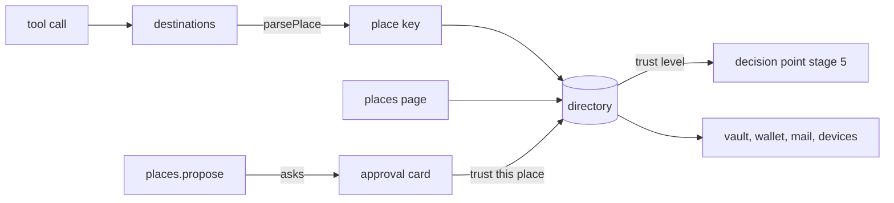

# Trusted places

- **Status:** draft
- **Work items:** [the vault](https://linear.app/zgeoff/issue/GEO-2731),
  [locked entries](https://linear.app/zgeoff/issue/GEO-2814),
  [the wallet](https://linear.app/zgeoff/issue/GEO-2757),
  [devices](https://linear.app/zgeoff/issue/GEO-2758). Each builds on the directory here.

nixie keeps one directory of the places it deals with: websites, email addresses, mail domains,
phone numbers and chat handles. Each entry carries one trust level, and the decision point reads the
level for every tool that reaches the place. Today the same website is free for `web_fetch`, asks
for `computer.browser_open`, and asks again for each click, because each tool and each Always allow
answer keeps its own list. With the directory, you trust a site once, on one page, and every tool
sees the same answer.

The owner approves this design. The builder of each work item above starts from it, together with
the [decision point](../../architecture/policy/decision-point.md) it extends.

## Shape



## Terms

- A **place** is one entry in the directory: a site, an address, a mail domain, a phone number or a
  handle.
- A **place key** is the normal form of a place, the only form the directory stores and compares.
- A **reading effect** is `read` or `fetch`. An **acting effect** is any other effect except
  `spend`, which always asks as it does today.

## Contracts

### The matcher

Every module that compares a destination with a place calls one function. No module compares raw
destination strings.

```ts
parsePlace('https://Docs.Example.org:8443/a?b=1');
// → { kind: 'site', domain: 'docs.example.org' }
parsePlace('Sam@Example.org');
// → { kind: 'address', address: 'sam@example.org' }
parsePlace('+61 420 000 000');
// → { kind: 'phone', e164: '+61420000000' }
parsePlace('telegram:51234');
// → { kind: 'handle', channel: 'telegram', id: '51234' }
parsePlace('0420 000 000'); // a phone number with no country code
// → null
parsePlace('not a place');
// → null

isPlaceCovered(entry.key, parsePlace(destination));
// → true when the entry covers the destination; false for a null destination
```

```ts
// places module (new). parsePlace and isPlaceCovered do no I/O.
// A destination is one concrete place: what a call reaches.
type Destination =
  | { kind: 'site'; domain: string } // lower case, IDNA ASCII, no port, no trailing dot
  | { kind: 'address'; address: string } // the whole address in lower case
  | { kind: 'phone'; e164: string }
  | { kind: 'handle'; channel: string; id: string };

// A place key is what an entry stores. It may cover many destinations.
type PlaceKey =
  | { kind: 'site'; domain: string; subdomains: boolean } // false covers the domain alone
  | { kind: 'address'; address: string }
  | { kind: 'mail_domain'; domain: string; subdomains: boolean } // every address at the domain
  | { kind: 'phone'; e164: string }
  | { kind: 'handle'; channel: string; id: string }
  | { kind: 'raw'; value: string }; // a migrated contact that parsePlace can't read; exact match
```

- A phone number parses only from `+` and its digits, with spaces and dashes dropped. nixie guesses
  no country code.
- A handle parses only as `<channel>:<id>`.
- An IP address or a host with one label, such as `localhost`, parses as a `site`.
- A `site` or `mail_domain` key with `subdomains: true` needs at least two labels, so no entry
  covers a whole top-level domain.

`parsePlacePattern('@shop.example')` reads a place key from what you or a rule write: a domain gives
a `site` key with `subdomains: true`, `@domain` gives a `mail_domain` key, and `=example.org` gives
a `site` key with `subdomains: false`.

### The directory

```ts
const place = await places.add({
  key: { kind: 'site', domain: 'library.example.org', subdomains: true },
  trust: 'read',
  name: 'The library',
});
// → { placeID: '6b0e…', shortID: 'P4', trust: 'read' }

const verdict = places.find(snapshot, parsePlace('https://catalog.library.example.org/x'));
// → { placeID: '6b0e…', shortID: 'P4', trust: 'read' }, or null for a place with no entry
```

```ts
// places module.
type Trust =
  | 'blocked' // every call that reaches the place is denied
  | 'known' // the place passes stage 5; the rules decide the call, as for a known contact today
  | 'read' // a call with only reading effects is allowed; an acting call is decided as at 'known'
  | 'act' // a call with reading or acting effects is allowed, and each act leaves a notice
  | 'self'; // one of your own addresses, numbers or handles; as 'act', with no notice

interface Place {
  placeID: string; // crypto.randomUUID()
  shortID: string; // createShortID; the model reads and passes this, never placeID
  key: PlaceKey;
  trust: Trust;
  name: string | null; // erasable
  addedBy: 'you' | 'proposal' | 'card' | 'seed';
}
```

Records, on the thread of the place's owner (you), each with the place's short ID:

```text
places.added    { placeID, shortID, key, trust, name, addedBy }
places.changed  { placeID, trust?, name? }
places.removed  { placeID }
places.acted    { placeID, shortID, callID }  // a call that an 'act' place allowed
```

The projection `places` holds the live entries. For an `address`, `phone` or `handle` place, the key
and the name are erasable fields, as a known contact's are today: a forget erases them, and the
erased place covers nothing. A `site` or `mail_domain` key is plain.

### The decision point

Stage 5 reads the directory. A call's destinations come from its tool as today, and each goes
through `parsePlace` first.

```ts
// policy module. Replaces the owner and known_contact tiers of stage 5.
type DestinationPermission =
  | { by: 'place'; placeID: string; trust: 'read' | 'act' | 'self' }
  | { by: 'reply_target' }
  | { by: 'task' }
  | { by: 'rule'; ruleID: string };
```

- Stage 3: a destination whose place is `blocked` denies the call, before any rule. The decision
  records the place in place of a rule, and the model reads "you blocked <place>".
- Stage 5: every level but `blocked` gives the destination a permission. The place tier comes first.
  A destination with no entry also gets a permission when every effect of the call is a reading
  effect, so a read from an unlisted site stays free as it is today.
- `owner` and `known_contact` leave `DestinationPermission`, and `ownerDestinations` leaves the
  decision point's inputs. A decision recorded before this design keeps its old strings, and the
  decision schema reads both forms.
- A new stage 6b, after the ask rules and before the allow rules: the call is allowed when every
  destination's place allows it. `read` allows a call whose effects are all reading effects. `act`
  and `self` allow a call with any effect but `spend`. A call with no destination never passes 6b.
- So an ask rule still asks at a trusted place, and an untrusted call goes on to stage 7 as today.
- When the decision at 6b allows a call through an `act` place, the decision point writes
  `places.acted` on the call's thread. The conversation shows it as a notice. A call that a rule or
  consent allowed writes none.
- A destination with no entry falls through to the reply target, task and rule tiers, then to the
  consent check, as today.
- When several entries cover a destination, a `blocked` entry wins. Otherwise the most specific
  entry wins: an exact key before a domain, and a longer domain before a shorter one.
- The decision reads the keys of the snapshot's place IDs from the `places` projection at call time.
  An erased key covers nothing.
- A rule's `destinations` keep their patterns and the `*` match. Both the pattern and the
  destination are put in lower case before the match, so case no longer splits a match.
- `web_fetch`, `search` with `sites`, `computer.browser_download` and a device page's fetches
  declare the URL's host as a destination. The fetcher refuses a redirect hop to a `blocked` site.

### The card and the proposal

```ts
// An approval card's answer, beside Allow once and Always allow.
type TrustAnswer = { trust: 'read' | 'act'; key: PlaceKey }; // the card offers the call's place
```

```ts
const proposal = await tools.call('places.propose', {
  place: 'https://tickets.example.com',
  trust: 'act',
  why: 'You asked me to book here every week.',
});
// → { proposal: 'Q7' }, a card for you
```

- When every destination of a held call is one place, the card offers "Trust this place to read" and
  "Trust this place to act". The answer adds or raises the entry. It writes no rule.
- `places.propose` declares `policy_widen`, so it always asks.
- Nix narrows a place with `places.narrow`. It declares `policy_narrow` and applies at once with a
  notice.

```ts
await tools.call('places.narrow', { place: 'P4', trust: 'known' }); // or { place: 'P4', remove: true }
// → { place: 'P4', trust: 'known' }; refuses a level that isn't lower than the current one
```

### Evidence from what you typed

nixie checks whether you named a place in three spots today, each with its own window: the consent
check (the turn's message, plus your linked messages within `policy.consent.link_max_age` hours),
the memory gate (your last 20 messages) and the skill guard (the same 20). The design gives them one
window, the consent check's, and one comparison, `isPlaceCovered` over `parsePlacePattern` of each
place you typed. The secret scan's exemption for a URL you typed keeps its own rule, the whole URL,
because it guards a secret, not a place.

### The skill guard

`skill_write` applies under its rules, with no check of the places a skill names. A skill that names
a place you never trusted takes effect, and its first call to that place meets the decision point
like any other call.

### The places page

The web client gets a page at `/places`: each entry with its kind, key, level, name, who added it
and when a call last used it. You add, change and remove entries there. The host CLI
`nixie contacts` becomes `nixie places`, with the same verbs.

## Constraints

- The directory holds at most one entry per place key.
- `parsePlace` returns `null` for a string it can't read as a place. A `null` destination has no
  place tier and falls through.
- An entry covers a place by key alone. A site entry never covers an address at that domain.
- A `blocked` entry beats every rule, mandate and lift.
- `spend` always asks, whatever the level, unless a lift covers it.
- Each call reads the directory of its own definitions snapshot. Each place record makes a new
  snapshot, as a contact record does today. The snapshot's form holds `policy.places`, the place IDs
  and levels, in place of `policy.contacts`, and never an address.
- The vault keeps each entry's exact origins as a fill constraint. A password fills only on an exact
  origin of its entry, even on a site at `act`. The vault entry links its site's place ID.
- A wallet lift names places, never origins. Its merchants are site places.
- A mail trigger's or wake rule's `from` names `address` or `mail_domain` keys, matched by
  `isPlaceCovered`. A place's level never wakes a task by itself.
- Typing a domain covers its subdomains: typing `example.org` names `api.example.org`. A domain is
  how you name a site, and the matcher already covers subdomains for an entry.
- The skill guard checks a place when a skill's call reaches it, never when the skill is written. A
  write can't reach anyone; a call can, and every call meets the decision point.
- Known contacts become places at `known` with no new records: the `places` projection also folds
  `policy.contact_marked_known` and `policy.contact_unmarked`. A contact's destination goes through
  `parsePlace`, and one it can't read becomes a `raw` key. No call a contact covers gains an allow,
  and a forget of the old record erases the place.
- The consent check's typed-name match, `nixie contacts` and the contract's known-contact schema
  move to places in the directory's work item. The contract keeps the old schema beside the new one
  until the places page ships, so the published contract never drops a type in a minor release.
- The `self` places replace the owner tier of stage 5, which the server fills with an empty list
  today.
- The definitions repo may hold `places.yaml` with `site` and `mail_domain` entries, seeded like
  rules. An `address`, `phone` or `handle` place never leaves the database.

## Builder decides

- The module's name and where the matcher lives, if not in `modules/places`.
- The page's layout and its sort order.
- The notice's wording.
- Whether `places.narrow` is one tool or two.
- How the Always allow rules that pin only a host are left: they keep working, and the builder may
  offer a one-time conversion to places on the page.

## Out of scope

- Groups of places, such as "every bank". A later design can add them over the same keys.
- A place's history beyond its records.
- Trust for MCP servers, which the MCP proxy design keeps in its own config.

## Open questions

- **The levels.** The design has five: `blocked`, `known`, `read`, `act` and `self`. The owner may
  want fewer names, or a level that allows acts without a notice. Until the owner decides, the five
  stand.
- **Reads from an unlisted site.** The design keeps them free, as `allow-reads` does today. The
  owner may prefer that a fetch from an unlisted site asks once. Until then, reads stay free.
- **Who sees the notice of an act.** The design shows it in the conversation. The owner may want a
  digest instead.
