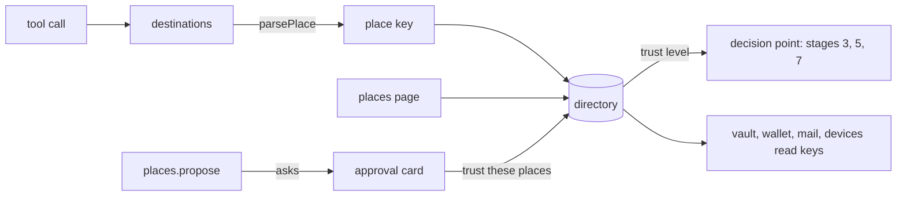

# Trusted places

- **Status:** partly built; the directory and the decision point's reads are built
- **Work items:** [the vault](https://linear.app/zgeoff/issue/GEO-2731),
  [locked entries](https://linear.app/zgeoff/issue/GEO-2814),
  [the wallet](https://linear.app/zgeoff/issue/GEO-2757),
  [devices](https://linear.app/zgeoff/issue/GEO-2758). Each uses the directory.

nixie keeps one directory of the places it deals with: websites, email addresses, mail domains,
phone numbers and chat handles. Each entry carries one trust level, and the decision point reads the
level for every call that declares the place as a destination. Today `web_fetch` and
`computer.browser_open` read a website without asking, and each click asks, because each tool and
each Always allow answer has its own list. With the directory, you trust a site once, on one page,
and every tool sees the same answer.

Build each work item above from this design and the [places](../../architecture/policy/places.md)
and [decision point](../../architecture/policy/decision-point.md) docs, which describe what is
built. The directory's own work items still to build are:

1. the card's answers, `places.propose`, `places.narrow`, `places.list` and the notice of an act;
2. the places page and `nixie places`, which retire the contacts code;
3. the one evidence window, and the skill guard's move to first use.

## Shape



## Terms

- A **place** is one entry in the directory: a site, an address, a mail domain, a phone number or a
  handle.
- A **place key** is the normal form of a place, the only form the directory stores and compares.
- A **reading effect** is `read` or `fetch`. An **acting effect** is any other effect except
  `spend`, which no place covers.
- A **public suffix** is a name on the public-suffix list, in its ICANN or its private section, such
  as `org`, `co.uk` or `github.io`.

## Contracts

### What the tools declare

Built: `web_fetch` declares its host, `computer.screen_click` and `computer.screen_type` carry the
flag that stops an allow with no destination, the hop gate refuses a `blocked` site, and the
computer's read tools, its click, its desktop picture and its act tools declare their hosts and
effects, and the act tools read the tab's host at each call, as the
[computer doc](../../architecture/connectors/computer.md#reads-and-acts) says. The rest is still to
build:

- `search` with `sites`, `computer.browser_download` and a device page's fetches declare their URL's
  host too, in their own work items.
- A `blocked` host denies a read of a tab or of the desktop whoever opened the page, and the refusal
  tells the model that a blocked site is on screen. Today the refusal names the blocked place, and
  does not say the page is on screen.
- A phone feature lists its number as a `nixie_own` place and declares a `phone.send` destination
  that `parsePlace` reads as a phone place.

### The notice of an act

Each turn that ends with calls allowed through an `act` place shows at most one line per place,
styled like a tool call. The line names the place and the tools that ran there, from the turn's
`places.acted` records, with a count for each tool:

```text
tickets.example.com: computer.browser_click ×2, mail.send
```

### The card and the proposal

```ts
// An approval card's answer, beside Allow once and Always allow.
type TrustAnswer = { trust: 'read' | 'act'; key: PlaceKey }; // the call's place, subdomains: false
```

```ts
const proposal = await tools.call('places.propose', {
  places: [
    { place: 'tickets.example.com', trust: 'act', why: 'You asked me to book here every week.' },
    { place: '*.library.example.org', trust: 'read', why: 'Your library splits its catalog.' },
  ],
});
// → { proposal: 'r8t2w5n1ze' }, one card for you that lists every place
```

- When every destination of a held call is one place, the card offers "Trust this place to read" and
  "Trust this place to act". Either answer adds the entry or raises its level, and writes no rule.
  The card carries a place hash beside the action hash, over the key and the level it shows, and the
  answer echoes both. The host checks the echo again, and refuses an answer that holds the action
  hash alone, as it does for an Always allow rule's hash.
- `places.propose` reads each `place` through `parsePlacePattern`. The card shows each in words,
  such as "library.example.org and every subdomain", with its level and its reason. The card has no
  subdomain checkbox.
- `places.propose` declares `policy_widen`, so it always asks. It refuses a list with a key on a
  whole public suffix, such as `*.github.io`.
- You approve the whole card, or untick some places first. Approval adds or raises each ticked place
  at its level, and leaves the unticked ones as they are.
- nixie narrows a place with `places.narrow`. It declares `policy_narrow` and applies at once with a
  notice.

```ts
await tools.call('places.narrow', { place: 'k3p9m2x7qa', trust: 'known' }); // or { place: 'k3p9m2x7qa', remove: true }
// → { place: 'k3p9m2x7qa', trust: 'known' }; refuses a level that isn't lower than the current one, and
// refuses remove on a blocked entry, which would make the place free to read
```

`places.narrow` also refuses a change that leaves a destination the entry covers at a higher level
than before. Another entry can cause that: removing `forms.example.org` at `known` beside
`*.example.org` at `act` leaves `forms.example.org` at `act`. Levels rise in the order `blocked`,
`known`, `read`, `act`, and no entry counts as `known`.

### The list

```ts
await tools.call('places.list', { trust: 'read', kind: 'site', query: 'library', limit: 20 });
// → { total: 3, places: [{ place: 'k3p9m2x7qa', key: '*.library.example.org', trust: 'read', name: 'The library' }, …] }

await tools.call('places.list', { place: 'catalog.library.example.org' });
// → { total: 1, places: [{ place: 'k3p9m2x7qa', … }] }, the entry the decision point picks; total 0 for none
```

```ts
// places module. Every filter is optional.
interface PlacesListInput {
  trust?: Trust;
  kind?: PlaceKey['kind'];
  query?: string; // matches the key or the name, in any case
  place?: string; // a host, address, number or handle; returns only the entry that covers it
  detail?: boolean; // adds addedBy and lastUsedAt to each row
  limit?: number; // 50 when unset
  after?: string; // a short ID, for the next page
}
```

- `places.list` declares `read` with no destination, as `tasks.list` does. `total` counts every
  match, whatever the limit. `place` goes through `parsePlace` and `places.find`.

### Evidence from what you typed

Today the consent check, the memory gate and the skill guard each check whether you named a place,
over a window of its own. The consent check reads the turn's message, plus your linked messages
within `policy.consent.link_max_age` hours. The memory gate and the skill guard each read your last
20 messages. This design drops the skill guard's check, as
[the next section](#the-skill-guard-moves-to-first-use) says. The consent check and the memory gate
share one window, the consent check's, and one comparison: `isPlaceCovered` over `parsePlacePattern`
of each place you typed, with `subdomains: true` on each typed domain that isn't a public suffix.
The secret scan's exemption for a URL you typed keeps its own rule, the whole URL, because it guards
a secret, not a place.

### The skill guard moves to first use

nixie writes its own skills freely. `skill_write` stops checking the places a skill names, and
applies under its own rules. A skill that names a place you never trusted takes effect. Its first
call to that place meets the decision point like any other call, and an acting call there asks.

### The places page

The web client gets a page at `/places`: each entry with its kind, key, level, name, who added it
and when a call last used it. You add, change and remove entries there. The host CLI
`nixie contacts` becomes `nixie places`, with the same verbs.

## Constraints

- The vault keeps each entry's exact origins as a fill constraint. A password fills only on an exact
  origin of its entry, even on a site at `act`, and the `www.` rule never widens it. The vault entry
  links its site's place ID.
- A wallet lift names places, never origins. Its merchants are site places.
- A mail trigger's or wake rule's `from` names `address` or `mail_domain` keys, matched by
  `isPlaceCovered`. A place's level never wakes a task by itself.
- Typing a domain counts as naming its subdomains: typing `example.org` names `api.example.org`. You
  name a site by its domain, and rarely type the host a tool reaches. Typing a public suffix, such
  as `github.io`, names that exact name only. This rule covers typed evidence only; an entry covers
  subdomains only when its key has `subdomains: true`.
- Nothing checks the places a skill names when the skill is written. Writing a skill reaches no one,
  and the decision point checks each place the skill's calls reach.
- The consent check's typed-name match, `nixie contacts`, `contacts.mark_known` and the contract's
  known-contact schema keep working over the `places` projection until the page's work item moves
  them. Until then they write contact records and read only places at `known`. The `known_contacts`
  table goes when they move.
- A raise to `act`, from the page or from a card, takes the passkey check, as a wider rule does. So
  do an unblock and a `subdomains: true` key. A one-off approval, a lower level and a block never
  take it. The page refuses a change that comes from a browser act tool.

## Builder decides

- The page's layout and its sort order.
- Whether `places.narrow` is one tool or two.
- What happens to the Always allow rules that pin only a host: they keep working, and the builder
  may offer a one-time conversion to places on the page.

## Out of scope

- Groups of places, such as "every bank". A later design can add them over the same keys.
- A place's history beyond its records.
- Trust for MCP servers, which the [MCP proxy](../../architecture/connectors/mcp-proxy.md) keeps in
  its own config.
