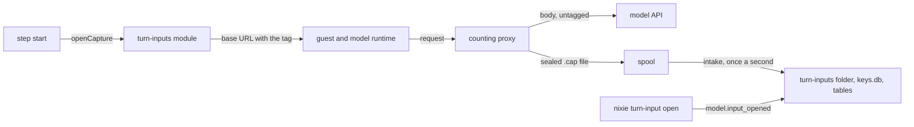

# The turn-input log

- **Status:** draft. The owner chose the capture shape, and an independent security review checked
  it.
- **Work items:** [the capture in the counting proxy](https://linear.app/zgeoff/issue/GEO-2548),
  [the turn-input log in nixie](https://linear.app/zgeoff/issue/GEO-2355)

The counting proxy copies each request, because a copy made by a guest would let the guest vouch for
its own input. The proxy seals each copy to a key of the step's capture, and nixie keeps the bodies
outside the backup set.

The log stores the exact body of each model request, so you can open what a model received: the
system prompt, the reminders the harness added, every message and the tool list. It exists for
tuning recent prompts. The event log never holds that input: the harness builds each request inside
the sandbox.

- **Step.** One attempt of a task or of the conversation to run a model turn, with the ID
  `stepRunID`.
- **Capture.** The window in which nixie collects one step's requests, with a capture ID and a P-256
  key pair.
- **Capture point.** A counting proxy and its own spool folder: one entry of the config key
  `sources`.
- **Capture tag.** One path segment in a turn frame's base URL that holds the capture ID and the
  capture's public key, and no secret.
- **Miss.** A row that holds a reason and the count of requests the log does not hold.
- **Own secret value.** A secret that the deployment itself holds, such as a credential in nixie's
  secrets file.

## Shape



## Contracts

### The tag and `openCapture`

```text
The profile's base URL:     https://<proxy_host>/<route>
The turn frame's base URL:  https://<proxy_host>/<route>/~in.<tag>
The CLI's request:          POST https://<proxy_host>/<route>/~in.<tag>/v1/messages
What the proxy matches:     /<route>/v1/messages
```

The Agent SDK's CLI keeps the extra segment. Against a stub server, the CLI of SDK 0.3.322, the
version the catalog pins, sent each request of `claude -p` with this base URL as
`POST /<route>/~in.<tag>/v1/messages?beta=true`.

```ts
// turn-inputs module. The sessions module opens a capture at a step's start and closes it at the
// step's end, and has no other part in the log.
const capture = await openCapture({ step, profile, role: 'task' });
// → { baseURL: 'https://<proxy_host>/<route>/~in.<tag>', close }, or the profile's own base URL
await capture.close({ callFrames: 3 }); // the step's `call` frames

interface OpenCaptureInput {
  readonly step: { readonly taskID: string; readonly stepRunID: string };
  readonly profile: ModelProfile;
  readonly role: ModelRole;
}
interface Capture {
  readonly baseURL: string;
  readonly close: (step: { readonly callFrames: number }) => Promise<void>; // a no-op with no capture
}
export declare function openCapture(input: OpenCaptureInput): Promise<Capture>;

// The server builds the search from collectOwnValues and passes it to the module.
interface TurnInputsOptions {
  readonly holdsOwnValue: (body: Uint8Array) => boolean;
}
```

```yaml
# nixie's config. With no `turn_input_log` section, the log is off.
turn_input_log:
  default: always # off | always; a configurable default
  max_window: 24h # the longest time one `on --for` lasts
  close_wait: 5s # the longest a step's end waits for the proxy's .part files
  roles: [conversation, task] # a configurable default
  retention: { days: 7, bytes: 2147483648 } # the default; days: 3 | 7 | 30
  sources:
    proxy:
      base_url: https://<proxy_host>
      dir: /var/lib/nixie/turn-input-spool # this proxy's own `capture.spool`
```

### The spool file

```ts
// wire library: the proxy writes these and nixie reads them. Committed fixtures pin each version.
export interface CaptureTag {
  readonly captureID: string; // a random UUID
  readonly sealTo: Uint8Array; // the capture's P-256 public key
}
export declare function encodeCaptureTag(tag: CaptureTag): string; // the segment after `~in.`
export declare function decodeCaptureTag(segment: string): CaptureTag | null;

// <spool>/<captureID>.<writer>.<counter>.part, renamed to <…>.<upstreamStatus>.cap on a response.
// Bytes: a 4-byte header length, the header as JSON, then AES-256-GCM ciphertext.
export interface SpoolHeader {
  readonly version: 1;
  readonly captureID: string;
  readonly writer: string; // random per start of the proxy
  readonly counter: number; // from 1 per (capture, writer), one per tagged request sent upstream
  readonly receivedAt: number;
  readonly route: string;
  readonly api: ModelAPI; // the matched route's `api`
  readonly endpoint: 'messages' | 'responses';
  readonly bytes: number;
  readonly ephemeralKey: string; // base64url, this request's own P-256 public key
  readonly iv: string; // base64url
}
// The wire library owns the seal and the open, and its fixture pins the derivation: ECDH on
// P-256, HKDF-SHA-256 to the AES key, the additional data (captureID, writer, counter).
export declare function sealSpoolBody(
  tag: CaptureTag,
  header: Omit<SpoolHeader, 'ephemeralKey' | 'iv'>,
  body: Uint8Array,
): Uint8Array;
export declare function openSpoolFile(
  file: Uint8Array,
  privateKey: CryptoKey,
): { header: SpoolHeader; body: Uint8Array } | null;

// <spool>/<captureID>.<writer>.<counter>.miss: plain JSON, no body. It takes a counter value.
export interface SpoolMiss {
  readonly version: 1;
  readonly captureID: string;
  readonly writer: string;
  readonly counter: number;
  readonly reason: 'queue_full' | 'spool_full' | 'spool_write_failed' | 'seal_failed';
}
```

```yaml
# the counting proxy's config. With no `capture` key, the proxy removes a tag and writes no file.
capture:
  spool: /var/lib/nixie/turn-input-spool
  max_bytes: 536870912
  max_pending: 16 # bodies waiting for the spool write
```

### The store and its records

```text
<data directory>/turn-inputs/<inputID>.bin   a 12-byte IV, then the body's ciphertext; the additional
                                             data is the key ID and the input ID
keys.db                                      one key per logged request, and one per open capture
nixie.db turn_inputs                         one row per request: its capture, step, call place,
                                             role, profile, model, harness, api, endpoint, route,
                                             isRewritten, upstream status, bytes, key ID, the event
                                             log's sequence at intake, state, removed cause
nixie.db turn_input_captures                 one row per capture: step, role, source, key ID, the
                                             sealed private key, state, close cause, counts
nixie.db turn_input_misses                   one row per miss: capture, step, reason, count
```

The event log holds only what an audit needs:

```ts
// turn-inputs module. Neither payload holds a request's text.
interface InputLogSet {
  state: 'on' | 'off';
  until: number | null;
} // model.input_log_set
interface InputOpened {
  inputID: string;
  by: 'host';
} // model.input_opened
```

### Reading

```ts
// contract library, hostContract, on the control socket. The device API's contract holds none.
turnInputs: {
  // newest first: each request's row and each miss. Not an opening.
  list: oc.input(z.strictObject({ limit: z.int().positive().max(500).default(50) }))
    .output(z.object({ inputs: z.array(loggedInputSchema), misses: z.array(inputMissSchema) })),
  // OPEN_NOT_RECORDED: the model.input_opened commit failed, so no body
  open: oc.errors({ NOT_FOUND: { status: 404 }, REMOVED: { status: 410 }, OPEN_NOT_RECORDED: { status: 503 } })
    .input(z.strictObject({ inputID: z.string().min(1) }))
    .output(z.object({ inputID: z.string(), body: z.string() })),
  set: oc.input(z.discriminatedUnion('state', [
      z.strictObject({ state: z.literal('on'), forMs: z.int().positive().nullable() }),
      z.strictObject({ state: z.literal('off'), drop: z.boolean() }),
    ])).output(z.object({ state: z.enum(['on', 'off']), until: z.number().nullable() })),
}
```

```bash
nixie turn-input on [--for <duration>]   # until `off`, or for at most max_window
nixie turn-input off [--drop]            # --drop also removes every logged request
nixie turn-input list [--limit <count>]
nixie turn-input open <input_id>         # prints the body
```

## Constraints

### The capture

- A logged request equals, byte for byte, the body that the model API received. The proxy never
  changes a body; for a model outside Claude it copies the bytes the guest's request rewriter sent.
- nixie captures a step only when the log is on, the step's role is in `roles`, and the profile's
  `base_url` starts with a `sources` entry's `base_url`. A compaction's `summarize` frame counts
  under `conversation`. With the log off or the role outside `roles`, nixie stores nothing and the
  base URL is the profile's own; with no matching source, it writes one `no_capture_point` miss.
- With `default: always`, the log starts on. The latest `model.input_log_set` record sets the state
  across a restart, so `off` holds until `on`. `--for` holds it on for at most `max_window`.
- The guest has no code for the tag, and the frame schema has no key for it. The proxy removes the
  tag, then matches the endpoint, and its model check and count are as without a tag.
- The proxy copies a tagged request only when it sends it upstream to `messages` or `responses`. A
  request that the proxy refuses writes no file.
- The proxy never awaits the spool write. It holds at most `max_pending` bodies waiting for the
  spool; past that, it writes a `queue_full` miss in place of the body. When the model API returns
  no response, it removes the `.part` file. At its start, it removes every `.part` file in its own
  spool, so 2 proxies never share a folder.
- When the proxy cannot write a body, it writes a `.miss` file: `spool_full` when the spool holds
  `max_bytes`, `spool_write_failed` or `seal_failed`.
- While a capture is open, nixie reads the spool once a second. At the step's end it waits for the
  capture's `.part` files for at most `close_wait`, takes in every file, destroys the capture's key
  and closes the capture.
- Each writer's counters of a capture run from 1 with no gap. At the close, each gap in a writer's
  sequence is one `not_received` miss. A lost last request leaves no gap, so nixie also writes
  `not_received` for the call frames above the files it holds; a refused or retried call can hide
  that last loss.
- The log never holds a request's credential or a header. No server log holds a byte of a body. The
  proxy's 403 and 404 replies echo the path, tag included, which holds no secret.

### The 3 key layers

| Layer                                                     | It stops, beyond file permissions                                                                                       |
| --------------------------------------------------------- | ----------------------------------------------------------------------------------------------------------------------- |
| The proxy seals each body to the capture's public key     | A reader of the spool through a volume snapshot, a mount on another host, or a root on the proxy's host after the write |
| `keys.db` seals the capture's private key, shred at close | A spool file that arrives after the close, such as one written after a forget closed the capture, stays unreadable      |
| Each body has its own key in `keys.db`                    | A removal deletes the key, so the bytes left on disk, in journals and in any copy of the data directory are unreadable  |

- The third layer is what makes a forget complete: the built forget is complete only when no stored
  copy shows the forgotten text.

### Intake and a secret

- nixie opens the body with the capture's private key, checks its length, runs `holdsOwnValue`,
  seals the body under a fresh key of its own, writes the file and its row, then removes the spool
  file. A `.miss` file gives one miss with its reason.
- A file that fails its header, its key or its AES-GCM tag gives `undecodable`; a file of a closed
  capture gives `capture_closed`; 5 failed intakes in a row give `intake_failed`. Each removes the
  file.
- `holdsOwnValue` searches each own secret value in its plain and its JSON-escaped form. The values
  come from `collectOwnValues`, which the web fetch's secret URL refusal shares and whose config
  keys pick the values. The proxy never gets one.
- On a match, nixie stores no body and writes a `holds_own_value` miss, so a logged request is
  exact, or nixie holds none. Each later request of that session gives its own miss until the text
  leaves the context.
- nixie stores any other request that holds a secret as it stores every request. It never masks a
  body, drops a tool call, or searches for a pattern of a kind of secret.

### Removal, retention and a forget

- One function removes a request: it deletes the key and checkpoints the key store, unlinks the
  file, then marks the row removed. Each step is safe to run twice.
- A sweep runs at the start, every 10 minutes and after each intake. It removes requests past
  `retention.days`, then the oldest until the store fits `retention.bytes`.
- A backup set holds `nixie.db` and `keys.db` only, so it never holds a body. After a restore, the
  start marks each row with no file as `missing`.
- `--drop` removes every request with `dropped`. A
  [reset](../../architecture/deployment/host-commands.md#the-reset) empties the key store and the
  tables, and deletes the `turn-inputs` folder.

A forget of a memory item removes logged requests in its session cleanup, after it closes the open
captures of the threads it covers. The item's first record is the first record of that memory item
in the event log; a request "after" it holds a later intake sequence. The forget design owns which
threads the cleanup covers.

- On a thread the cleanup covers, the forget removes every request, because its sessions may have
  held the item's text before the item existed, such as the message it came from.
- On every other thread, it removes each request after the item's first record. Another thread could
  hold the text only once the item existed, as memory brought into its turns.
- The forget offers no mode that keeps a request, because a forget is complete only when no stored
  copy shows the forgotten text.
- nixie never searches a request for the item's text, because a search misses a paraphrase.

### Faults

A fault in the log never fails, delays or changes a model request, and never changes the proxy's
count. A step's end can wait up to `close_wait` for the proxy's `.part` files.

| Fault                                                 | Outcome                                                                          |
| ----------------------------------------------------- | -------------------------------------------------------------------------------- |
| nixie cannot write the capture's key or its row       | The turn runs with no tag; a log line with a reason code                         |
| The proxy cannot decode a `~in.` segment              | It removes the segment and writes no file; the close counts a miss               |
| The proxy has no `capture` key, or another folder     | No file arrives; the close writes `not_received`                                 |
| A `.part` file outlasts `close_wait`                  | nixie closes without it; the close writes `not_received`                         |
| nixie stops mid-step                                  | Its start closes every open capture; the step opens a new one when it runs again |
| nixie stops between the key, the file and the row     | Its start removes a file with no row and a key with no file                      |
| A tagged request reaches a proxy with no capture code | 403 for an unknown path, and the turn fails                                      |

### What the last release does

- The proxy takes its release first. Before a rollback of the proxy, you turn the log off and remove
  its `capture` key, which the last proxy refuses.
- The last nixie release ignores the folder and the 3 tables. A rollback first runs
  `nixie turn-input off --drop`, then removes the `turn_input_log` section, which its strict schema
  refuses.

## Decisions

- **Every removal deletes the key first.** From that point the live key store opens nothing of that
  request. A backup of `keys.db` copied before the removal still holds the key until the next
  published backup set prunes the older key snapshots, as
  [a forget's backup state](../../architecture/deployment/backups.md#a-forgets-backup-state)
  describes. No backup holds a body or a spool file, so that key opens a body only beside a copy of
  the data directory or the spool.
- **The event log holds 2 kinds.** The rest is debugging state in tables, so the last release meets
  only 2 unknown kinds.
- **The shape stands on one independent security review.** An agent's call on 13 Nov, open to the
  owner's veto: the review found 3 faults (forget modes that kept text, a false claim about
  backed-up keys, a plaintext digest in the spool header), each is fixed above, and a re-check of
  the fixes found each closed.
- **nixie keeps the bodies in a store of its own, outside the backup set, and never as record
  attachments.** An agent's call on 13 Nov, open to the owner's veto: an attachment's ciphertext
  rides in every backup until a forget, and this store keeps every body out of every backup.
- **The log starts on, with `default: always`.** An agent's call on 13 Nov, open to the owner's
  veto: the log exists to take apart a turn that went wrong, and a log that was off holds nothing
  then; retention, the seal and the forget rules bound what it keeps.
- **The log covers `conversation` and `task` by default.** An agent's call on 13 Nov, open to the
  owner's veto: those are the prompts that get tuned, and `roles` adds another role in one line.
- **The log seals a request that holds a secret as it seals every request, and stores no body for
  one that holds an own secret value.** An agent's call on 13 Nov, open to the owner's veto: a mask
  or a dropped tool call would make the logged request differ from what the model received, and a
  forget destroys each body's own key.

## Builder decides

- The byte layout inside the tag, as long as it round-trips its fixture.
- The HKDF info string, within the fixture.
- The schemas of a listed request and a miss, from the tables' columns.
- Internal names, the wording of each error, and the layout of the tests.

## Out of scope

- The model's output, which the event log holds, and a speech provider's input.
- A read by nixie itself, a turn that nixie runs from a stored request, a normalised view, a compare
  of 2 requests, and any view on an enrolled device or in the web UI.

## Open questions

- **Does the Codex CLI keep the tag segment?** The Codex case with
  [the Codex gates](https://linear.app/zgeoff/issue/GEO-2546) settles it, on the CLI version that
  the Codex image pins and with the base URL that a Codex profile holds. Until then, a Codex step
  has no capture.
