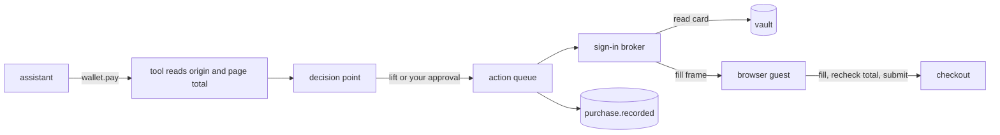

# The wallet

- **Status:** draft
- **Work items:** [the wallet](https://linear.app/zgeoff/issue/GEO-2757). It builds on
  [accounts and sign-in](accounts.md), which lands first.

The assistant pays with a capped card that sits in the same vault as its passwords. It fills the
card into a checkout the way it fills a password, so the card's number never reaches the model. A
purchase is a `spend` action under the [budgets](../../architecture/policy/budgets.md) rules: a lift
lets a small one through without asking, but only when the total on the page matches the amount the
assistant declared. Every other purchase asks with your passkey.

## Shape



## Contracts

### The tools

```ts
wallet.pay({
  tab: 't1',
  amount: { value: '8.00', currency: 'USD' }, // a decimal string, in the page's own currency
  item: 'one font licence',
  card: 'c3w8p1z6mt', // needed when the vault holds more than one card
  submit: 'E12',
  repeats: 'monthly', // optional: 'monthly' | 'yearly', for a subscription
});
// → { status: 'paid', purchase: 'pq3z8w1n5v', merchant: 'https://fonts.example.com',
//     pageTotal: '8.00 USD', charged: '12.71 AUD' }
//   The guest fills the card, reads the total again, and clicks submit only while it still matches.
//   A bank check that shows after the submit waits up to 5 minutes for you to approve it in the
//   bank's app, then returns 'paid'. After that, { status: 'needs_owner', purchase }: an unknown
//   outcome that you settle, as the budgets rules settle one.

wallet.read({});
// → { month: { liftBudget: '100.00 AUD', liftSpent: '37.50 AUD', left: '62.50 AUD', approvedSpent: '40.00 AUD' },
//     lifts: [{ merchants: ['https://fonts.example.com'], perAction: '25.00 AUD' }],
//     purchases: [{ purchase: 'pq3z8w1n5v', at, merchant: 'https://fonts.example.com', amount: '8.00 USD',
//                   charged: '12.71 AUD', item: 'one font licence', approval: 'owner', repeats: 'monthly' }],
//     subscriptions: [{ purchase: 'pq3z8w1n5v', merchant, item, repeats: 'monthly', charged: '12.71 AUD' }],
//     next: null }
//   liftSpent counts lifted purchases, which the budget caps; approvedSpent counts the ones you
//   approved. subscriptions lists each repeating purchase until wallet.cancel marks it.

wallet.cancel({ purchase: 'pq3z8w1n5v' }); // after the assistant cancels it on the merchant's site
// → { purchase: 'pq3z8w1n5v', cancelledAt }
```

`wallet.pay` refuses as [`account.sign_in`](accounts.md#the-tools) does, with these as well:

| Refusal            | When                                                         |
| ------------------ | ------------------------------------------------------------ |
| `WHICH_CARD`       | the vault holds several cards and the call names none        |
| `NO_RATE`          | no exchange rate exists for the page's currency              |
| `NO_CARD_FIELD`    | the guest finds no card field it may fill; carries `report`  |
| `TOTAL_CHANGED`    | the total changed after the fill, so the guest never clicked |
| `UNKNOWN_PURCHASE` | `wallet.cancel`: no purchase has that ID                     |
| `NOT_REPEATING`    | `wallet.cancel`: the purchase doesn't repeat                 |

`WHICH_CARD` and `NO_RATE` return from the prepare hook before the decision, so no card shows.

```ts
// connectors module: the effects each tool declares
// wallet.read, wallet.cancel: ['note'], direct. wallet.cancel marks nixie's record only.
// wallet.pay: ['spend'], queued; destination: the tab's host; amount: charged, below.
// The prepare hook reads the tab's origin, its URL and the checkout's total from the guest.
```

The approval card for a purchase shows the merchant, the declared amount, the total the guest read
from the page or "no total found", `charged`, and whether it repeats.

### The card in the vault

```ts
// connectors module; fields a card entry adds to VaultEntry
interface VaultEntry {
  // …the fields the accounts design defines
  fingerprint: string | null; // an HMAC of the number under a server key; the only form in records
  frameOrigins: string[]; // the payment frames you allow, such as https://js.pay.example; else []
  currency: string | null; // the ISO code the card bills in, which charged converts into
}
vault.add({
  kind: 'card',
  label: 'wallet',
  currency: 'AUD',
  secret: { number, expiry, code },
  frameOrigins: [],
}); // → { account: 'c3w8p1z6mt' }
// vault.reveal of a card → { number, expiry, code }
```

### The fill frame for a card

```ts
// wire lib: the card's additions to the accounts design's frame
type TotalRequest = { op: 'total'; tab: string }; // → { ok: true; pageTotal: string | null } | tab_gone
// FillRole gains 'card_number' | 'card_expiry' | 'card_code'
// FillRequest.submit gains expectTotal?: string: click only while the total matches
// FillReply ok gains pageTotal: string | null and isBankCheck: boolean (a bank's check frame
//   showed after the submit); its reasons gain 'total_changed'
```

### The purchase record

```text
purchase.recorded              -- budgets module, one per wallet.pay that clicks submit
  purchase       text          -- short ID
  amount         integer       -- micros of the page's currency, the amount the assistant declared
  currency       text          -- the page's currency
  page_total     integer null  -- micros of the page's currency, the total the guest read; null when none
  charged        integer       -- micros of the card's currency, the amount the budget counts
  rate           text null     -- the exchange rate and its date; null when the two currencies match
  merchant       text          -- the origin the card was filled on
  item           text          -- erasable
  approval       text          -- 'lift' or the approval's ID
  card           text          -- the card entry's fingerprint
  repeats        text null     -- 'monthly' | 'yearly'
purchase.cancelled             -- budgets module, one per wallet.cancel
  purchase       text
```

## Constraints

The card on the page:

- A card part goes only into a field whose `autocomplete` names that part, in a frame whose own
  origin is the merchant's or one of the card's `frameOrigins`.
- A tab holds a filled card field from the fill until `wallet.pay` clicks submit, the guest clears
  the fields after a refusal, or the tab closes. The guest keeps which tabs hold one.
- A card number shows in full in a picture, so while a tab holds a filled card field,
  `computer.browser_screenshot` on it and `computer.screenshot` while a window shows it return
  `FILLED_TAB`. `computer.browser_click`, `computer.browser_fill`, `computer.browser_download`,
  `computer.screen_click` and `computer.screen_type` return `FILLED_TAB` on that tab too, so only
  `wallet.pay` submits a payment.
- Before each screen act, the screen tool asks the browser guest, in the same computer sandbox,
  which windows show a tab that holds a filled card.
- The message of `FILLED_TAB` says the tab holds a filled card, that screenshots and clicks are off
  until `wallet.pay` submits or the tab closes, and that `computer.browser_read` still reads the
  page. The descriptions of the computer tools say the same.
- A card fill that fails writes the `account.fill_failed` record and the page dump that
  [a password fill](accounts.md#constraints) writes, with no screenshot.

Spending:

- Before the decision, the guest reads the checkout's total from the page. The policy trusts the
  total only when it matches the declared amount to the currency's minor unit. The guest reads the
  currency from an ISO code on the page or a symbol only one currency uses. A total in a symbol
  several currencies share, such as `$` alone, counts as no total found.
- When the page's currency differs from the card's, the server converts the amount at the day's
  reference rate and adds a margin for the bank's conversion fee, a setting whose default is 3%.
  That `charged` amount is what a lift and the budget check.
- A `wallet.pay` passes without asking only under a lifting rule whose destinations include the
  merchant, whose `perAction` covers `charged`, and whose page total matched. Every other
  `wallet.pay` asks with the passkey.
- A `wallet.pay` with `repeats` always asks with the passkey, and its card says it repeats.
- A repeating purchase counts once, when it's made. nixie never sees a later charge.
- A lift charges the budget when the action queues, as
  [budgets](../../architecture/policy/budgets.md#lifts) says. A purchase you approved never counts
  against the budget. A `wallet.pay` that ends before its click credits the charge, and the guest
  clears the card fields it filled.
- Every `wallet.pay` that clicks submit writes a `purchase.recorded` record.
- The wallet starts with a lift of 25 AUD per purchase and a budget of 100 AUD a month. The card's
  own limit in the bank's app is the hard cap.

## Decisions

- **The page's total gates the lift.** The model's declared amount alone can be talked down, so a
  lift passes only when the page agrees with it.
- **A merchant can keep the card.** nixie can't see a later charge from a merchant that saved the
  card. The bank's limit caps it, and the purchase records let you spot it in the bank's app.

## Builder decides

- How the guest finds the card fields and the checkout's total, within the rules above.
- The source of the daily exchange rates, which needs no key.
- The tools' descriptions and the refusal wording.

## Out of scope

- Reading a card statement from the bank. The card has no API.

## Open questions

- **Does the bank ask for a 3-D Secure check on each purchase?** A test purchase settles it. Until
  then, a purchase waits for a bank check as `wallet.pay` describes.
