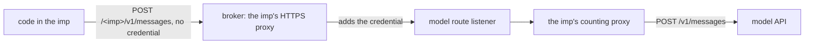

# Spike: the counting proxy behind imp's broker

This spike checks whether a model call from an [imp](../../docs/glossary.md), a sandboxed microVM,
can reach the model API without the host counting its spend. The finding informs the
[hard spending stop](../../docs/design/platform/policy/budgets.md#the-hard-spending-stop).

Code in an imp holds no model credential. A model call from the imp takes this path, all of it on
the host after the imp:

- The broker adds the credential only to a request that the imp's grant covers. A grant gives one
  imp a credential for a host, here the model API's, and covers only some URL paths on that host,
  here those that start with `/<imp>/`, the imp's name.
- The model route listener starts one
  [counting proxy](../../docs/architecture/policy/counting-proxy.md) for each imp. The counting
  proxy strips `/<imp>`, sends the call on, and adds the reply's tokens and dollars to the imp's
  count.

The spike ran this path on the previews of 2 nixie pull requests, #834 and #858. A preview is a
throwaway nixie in an imp of its own, on a host that sets up this path for each preview.

## Question

Does the broker send each model call from an imp through the counting proxy, and does the counting
proxy count it, so that the hard stop can count spend on the host? Can code in the imp get a request
to the model API with the credential on it by any way that skips the counting proxy?

## Answer

The counting proxy counts each model call:

- On both previews, the broker added the credential to every model call from the imp, and sent each
  one through the imp's counting proxy [measured].
- On the preview of #858, the model API answered nixie's calls with 200, and the count reached 64405
  tokens and $0.00345904 [measured]. nixie writes a record of each turn's tokens. The 4 turns'
  records and one call by the memory writer, a nixie task that writes no such record, add up to the
  same 64405 tokens [measured]. The count's rise over the 4 turns equals their tokens at the
  preview's prices [measured].

No credential reaches the model API around the counting proxy:

- The broker refused the 6 paths outside `/<imp>/` that the spike tried, dot segments and encoded
  slashes included [measured].
- Code in the imp that skips the broker reaches the model API with no credential, and the model API
  answers with 401 [measured].
- Code in the imp that skips the broker and calls the model route listener carries no credential
  either. On #834, the listener passed the call on, and the model API answered with 401. On #858,
  the host refused the connection [measured].

None of the ways the spike tried put the credential on a request that skips the counting proxy, and
the counting proxy counts each reply. The hard stop can therefore count spend on the host.

## Run it

Run one spike script at a time on a preview, because the counting proxy keeps one count for the imp.
[The results' run steps](results.md#run-it) give the 8 variables and the command.

## Results

[results.md](results.md) gives the setup, the model calls, the probes, and what the spike left
untested, such as a [worker](../../docs/glossary.md) in an imp of its own.
