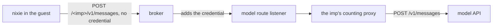

# Spike results: the counting proxy behind imp's broker

This spike sends model calls from an imp on a host that counts model spend, reads the count, and
tries other ways from the imp to the model API. It ran on the preview of nixie pull request #834.

Each fact below ends with how the spike knows it: [measured] when the spike made the request or the
read that shows it, and [read in the code] when the spike's author read it in the source.

## Terms

- **imp**: a sandboxed microVM, as the [glossary](../../docs/glossary.md) defines it. The guest is
  the system that runs inside the imp.
- **Broker**: imp's credential broker, which runs on the host and serves as the guest's HTTPS proxy.
  The broker adds a secret's credential to each request that one of the imp's grants covers.
- **Grant**: a secret given to one imp, with a filter on the URL paths that get the credential. A
  secret can name an upstream, an address that the broker sends the request to in place of the
  secret's host.
- **Preview service**: a service on the host that builds a nixie pull request into a throwaway
  nixie, a preview, and runs it in an imp of its own.
- **Model route listener**: the preview service's listener on the host for model calls. It starts a
  [counting proxy](../../docs/architecture/policy/counting-proxy.md) for each preview's imp, which
  adds each reply's tokens and dollars to that imp's count.
- **Worker**: a unit of work behind one tool call, which runs in an imp of its own, as the
  [glossary](../../docs/glossary.md) defines it.

## Questions

1. **Does the broker send each model call from an imp through the counting proxy, and does the proxy
   count it?** If both hold, the
   [hard spending stop](../../docs/design/platform/policy/budgets.md#the-hard-spending-stop) can
   count spend on the host.
2. **Can code in the guest get a request to the model API with the credential on it, by any way that
   skips the counting proxy?** If it can, code in an imp can get past the hard stop.

## Setup

### The path of a model call

The preview service gives each preview's imp one grant for the model API's host,
`preview-model-counted` [read in the code]:

- The filter covers only paths under `/<imp>/`, where `<imp>` is the imp's name, such as
  `pv-921a15b9-834`.
- The secret's upstream is the model route listener, in place of the model API.

The listener takes the imp's name from the first path segment, starts that imp's counting proxy on
its first call, and passes the call on with its headers. The counting proxy strips the name, sends
the rest to the model API, and adds the reply's usage to the count [read in the code].



A preview runs nixie with its test sandbox adapter. In production, the sandbox adapter starts a
worker in an imp of its own. The test adapter instead runs the conversation and every task as a
local process in the preview's nixie container [read in the code]. Their model calls leave the guest
through the broker, the same way a worker's calls leave its own imp.

nixie writes a `model.turn_ended` record at the end of each turn, with the turn's input, output and
cache tokens [read in the code]. The spike sums them to set beside the count.

### Versions

| Component      | Version or value                                               |
| -------------- | -------------------------------------------------------------- |
| imp            | 6.4.0, impd and CLI                                            |
| Counting proxy | `counting-proxy-linux-x64` from the nixie 0.42.0 release       |
| nixie          | commit `3e2d0d4` of pull request #834, as a preview test build |
| Model          | `claude-haiku-5-5`, the preview's one model profile            |
| Count limit    | $2 for the life of the pull request                            |
| Proxy upstream | `https://api.anthropic.com`                                    |

### Run it

[`run.sh`](run.sh) runs from a machine with SSH access to the host as root. It writes each step's
output to `SPIKE_WORK`, and changes nothing on the host. Its header lists each variable:

```bash
cd research/spend-proxy-imp
PREVIEW_SSH=root@<preview_host> IMP_CLI='<command that runs impz as impd root>' \
  IMP=<imp_name> ORIGIN=https://<preview_origin> COMPOSE_FILE=<compose_file_in_the_imp> \
  SPEND_DIR=<spend_directory_on_the_host> ROUTE_LISTENER=http://<listener_address> \
  SPIKE_WORK=<scratch_dir> bun run spike
```

The script does these steps:

1. It reads the imp's grants, its egress policy, and the model route in the nixie container.
2. It enrols a device with the sign-in code that the preview's `enrol` service prints, or takes
   `SPIKE_TOKEN` from an earlier enrolment on the same preview.
3. It sends a plain message, then a message that asks nixie to start a task, and reads the count
   after each turn.
4. It sums the tokens of nixie's `model.turn_ended` records with
   [`read-turn-usage.ts`](read-turn-usage.ts), which runs in the nixie container.
5. It runs [`guest-probes.sh`](guest-probes.sh) in the guest, then reads the broker's audit for the
   imp.

## Results

### The imp

The imp held 2 grants: `gh`, for its clone of the repository, and `preview-model-counted`
[measured]. It held no other grant for the model API's host [measured]. Its egress policy was
`open`, so the guest reaches the internet without the broker [measured]. The nixie container held
`NIXIE_PREVIEW_MODEL_ROUTE` set to the imp's name, and its model profile's base URL ended with that
name [measured]. The guest's environment held no model credential [measured].

### The model calls

The broker's audit lists each model call from the guest between 12:55 and 13:29 UTC. Each one got
the credential from `preview-model-counted` on the path `/<imp>/v1/messages` [measured]. The model
API answered each one with a 429 and this body [measured]:

```json
{ "type": "error", "error": { "type": "rate_limit_error", "message": "Error" } }
```

| Calls | Request size | Sender                                                                   |
| ----- | ------------ | ------------------------------------------------------------------------ |
| 10    | 33 to 44 KB  | the conversation, one call for each message the spike sent               |
| 6     | 15 KB        | the memory writer, a system task that retried at doubling gaps from 30 s |
| 6     | 93 bytes     | the spike's one-line message request, by hand and as a probe             |

The conversation's 10 `model.turn_ended` records match its 10 calls [measured]. The memory writer's
6 `memory.writer_failed` records match its 6 calls to the second [measured]. The message that asked
nixie to start a task got the same 429, so the conversation started no task [measured].

The preview service logged `proxy.started` for the imp at 12:55:24, a second before the first call
reached the model API [measured]. The count file read `{"dollars":0,"tokens":0}` after every call,
and the `model.turn_ended` records sum to 0 tokens [measured]. A 429 reply carries no usage, and the
counting proxy adds nothing for a reply with no usage [read in the code].

### The probes

Each probe ran in the guest after the model calls, and sent no credential of its own. Every probe
except the last 2 went to the broker, as the guest's HTTPS proxy. The count stayed at
`{"dollars":0,"tokens":0}` [measured].

| Probe                 | URL path, as sent                     | Answered by        | Status |
| --------------------- | ------------------------------------- | ------------------ | ------ |
| `own-route`           | `/<imp>/v1/messages`                  | the model API      | 429    |
| `unrouted`            | `/v1/messages`                        | the broker         | 403    |
| `other-route`         | `/pv-00000000-1/v1/messages`          | the broker         | 403    |
| `dot-segment`         | `/<imp>/../v1/messages`               | the broker         | 403    |
| `encoded-dot-segment` | `/<imp>/%2e%2e/v1/messages`           | the broker         | 403    |
| `encoded-slash`       | `/<imp>%2F..%2Fv1/messages`           | the broker         | 403    |
| `double-slash`        | `//v1/messages`                       | the broker         | 403    |
| `batches`             | `/<imp>/v1/messages/batches`          | the counting proxy | 403    |
| `direct-no-broker`    | `/v1/messages`, to the model API      | the model API      | 401    |
| `route-listener`      | `/<imp>/v1/messages`, to the listener | the model API      | 401    |

The broker refused each path outside `/<imp>/` with
`the grant for api.anthropic.com does not cover POST <path>`, and its audit lists each refusal with
the reason `outside-filter` [measured]. The broker resolved both dot-segment paths to `/v1/messages`
before it checked them [measured]. The counting proxy refused the batch endpoint with
`the counting proxy forwards only requests whose spend it can count` [measured]. A batch spends
after its reply, out of the count's reach [read in the code].

The last 2 probes went straight from the guest, with its HTTPS proxy turned off: one to the model
API, one to the model route listener. The model API answered both with `authentication_error`,
`x-api-key header is required`, so neither request carried a credential [measured].

## Answers

1. **The broker sends each call through the counting proxy; the count is unproven.** The broker
   added the credential to every model call from the preview, from the conversation and from the
   memory writer, and sent each one through the imp's counting proxy [measured]. The model API
   refused every call with a 429, so the spike never saw the counting proxy count a reply with
   usage. The [counting proxy doc](../../docs/architecture/policy/counting-proxy.md#the-count)
   describes how it counts one [read in the code]. The
   [issue](https://linear.app/zgeoff/issue/GEO-248) keeps the count open until the spike runs with a
   credential under its rate limit.
2. **The guest has no way to put the credential on a request that skips the counting proxy.** The
   broker adds the credential only under `/<imp>/`, and refused every other path the probes tried,
   dot segments and encoded slashes included [measured]. Under that path, the counting proxy refused
   the batch endpoint, whose spend it cannot count [measured]. The guest reaches the model API and
   the model route listener without the broker, but with no credential [measured].

## Untested

- A model reply with usage, and what the counting proxy adds for it.
- A started task's model calls. The conversation's turn failed on the 429 before it could start the
  task. The memory writer, a system task, shows that a task's calls take the same path.
- A worker in an imp that the sandbox adapter creates, with a grant of its own. The preview runs
  nixie, its conversation and its tasks in one imp, under one grant.
- Code in the guest that brings a credential of its own. The broker never sees such a key, and the
  guest's open egress reaches the model API.
- The production hard stop's own route and limits, which the
  [budgets design](../../docs/design/platform/policy/budgets.md#the-hard-spending-stop) describes.
- Methods other than `POST`, the token count and model list endpoints, and the endpoints other than
  batches that the counting proxy refuses.
