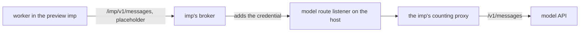

# Spike results: the counting proxy behind imp's broker

This spike ran on the preview of this spike's own pull request, on a preview host whose spend cap is
on. The preview service gives each preview imp a model grant whose upstream is its model route
listener, and that listener starts a counting proxy for the imp on the first call. The spike sent
nixie turns from the preview, read the proxy's count, and probed the guest for a way to the model
API around the proxy.

## Questions

1. **Do a worker's model requests pass from imp's broker through the counting proxy on the host, and
   get counted?** This informs whether budgets can count spend at the host.
2. **Does the broker open the guest any second route to the model provider?** This informs whether a
   worker can get past the hard spending stop.

## Setup

| Component      | Version or value                                                       |
| -------------- | ---------------------------------------------------------------------- |
| imp            | 6.4.0, impd and CLI                                                    |
| Counting proxy | the `counting-proxy-linux-x64` binary of nixie 0.42.0, pinned by hash  |
| nixie          | this pull request's first commit, as a preview test build              |
| Model          | `claude-haiku-5-5`, the preview's one model profile                    |
| Proxy limit    | $2 for the life of the pull request, the preview service's default     |
| Proxy route    | one route, named after the imp, with `https://api.anthropic.com` after |

The path of one model call:



A preview runs nixie on the test sandbox, so the conversation and each started task run as local
processes in the preview's nixie container [read in the code]. Their model calls leave the container
through the imp's broker, the same as those of a worker in an imp of its own.

### Run it

[`run.sh`](run.sh) runs every step below from a machine that reaches the preview host over SSH. It
writes each step's output to `SPIKE_WORK`, and changes nothing on the host:

```bash
cd research/spend-proxy-imp
PREVIEW_SSH=root@<preview_host> IMP_CLI='<command that runs impz as impd root>' \
  IMP=pv-<hash>-<pr> ORIGIN=https://<preview_origin> COMPOSE_FILE=<compose_file_in_imp> \
  SPEND_DIR=<spend_directory> ROUTE_LISTENER=http://<listener_address> \
  SPIKE_WORK=<scratch_dir> bun run spike
```

1. It reads the imp's grants, its egress policy, and the route in the nixie container.
2. It enrols a device with the preview's sign-in code, or takes `SPIKE_TOKEN` from an earlier run.
3. It sends a plain turn, then a turn that asks the conversation to start a task, and reads the
   proxy's count after each.
4. It reads the token counts of nixie's own turn-ended records with
   [`read-turn-usage.ts`](read-turn-usage.ts), which runs in the nixie container.
5. It runs [`guest-probes.sh`](guest-probes.sh) in the guest, then reads the broker's audit.

## Results

### The route

The imp held 2 grants, `gh` and `preview-model-counted`, and no other secret for the model API's
host [measured]. Its egress policy was `open` [measured]. The nixie container held
`NIXIE_PREVIEW_MODEL_ROUTE` set to the imp's name, and its model profile's base URL ended with that
name [measured]. The imp's guest held placeholder values in `GITHUB_TOKEN` and `GH_TOKEN`, and no
model credential [measured].

### The counted turns

Every model call from the preview reached the model API through the counted route, and the API
refused each one with a 429 [measured]:

```json
{ "type": "error", "error": { "type": "rate_limit_error", "message": "Error" } }
```

The model credential that the preview grant holds was at its account's rate limit for the whole
spike, so no call got a reply with usage. The broker's audit lists 12 message calls from the imp
between 12:55 and 13:05 UTC, each on `preview-model-counted` at `/pv-<hash>-834/v1/messages`, and
each answered 429 [measured]:

| Calls | Request size | Sent by                                                         |
| ----- | ------------ | --------------------------------------------------------------- |
| 6     | 33 to 39 KB  | the conversation, one per turn of the 6 the spike sent          |
| 4     | 15 KB        | nixie, 30 s, 1 min and 2 min apart, after the first failed turn |
| 2     | 93 bytes     | the spike's own one-line request from the guest                 |

Nixie's 6 turn-ended records match the 6 turns [measured]. The 4 calls of 15 KB came from nixie
itself, with gaps that double, and the spike sent none of them [measured]. They took the counted
route like every other call.

The preview service logged `proxy.started` for the imp's route at 12:55:24, a second before the
first call reached the API, and the proxy then wrote the imp's count file [measured]. The count read
`{"dollars":0,"tokens":0}` after every call, and nixie's turn-ended records for the same turns sum
to 0 tokens [measured]. A 429 reply carries no usage, and the proxy adds nothing for a reply with no
usage [read in the code].

### The probes

Each probe ran in the guest of the preview imp, after the counted turns. The count stayed at
`{"dollars":0,"tokens":0}` [measured].

| Probe                 | Request                                           | Status | Answered by        |
| --------------------- | ------------------------------------------------- | ------ | ------------------ |
| `unrouted`            | `POST /v1/messages` through the broker            | 403    | the broker         |
| `other-route`         | another imp's route through the broker            | 403    | the broker         |
| `dot-segment`         | `/<imp>/../v1/messages`, sent as is               | 403    | the broker         |
| `encoded-dot-segment` | `/<imp>/%2e%2e/v1/messages`, sent as is           | 403    | the broker         |
| `encoded-slash`       | `/<imp>%2F..%2Fv1/messages`                       | 403    | the broker         |
| `double-slash`        | `//v1/messages`, sent as is                       | 403    | the broker         |
| `batches`             | `/<imp>/v1/messages/batches` on the counted route | 403    | the counting proxy |
| `direct-no-broker`    | `POST /v1/messages` with no proxy                 | 401    | the model API      |
| `route-listener`      | the host's model route listener, with no proxy    | 401    | the model API      |

The broker answered each of its 6 refusals with
`the grant for api.anthropic.com does not cover POST <path>`, and its audit lists each one with the
reason `outside-filter` [measured]. It normalized both dot-segment paths to `/v1/messages` before it
matched them [measured]. The proxy refused the batch with
`the counting proxy forwards only requests whose spend it can count` [measured].

The 2 requests that went around the broker carried no credential, and the model API answered
`authentication_error`, `x-api-key header is required` [measured]. The `route-listener` probe shows
that the guest reaches the host's model route listener with no broker in between. The listener
admits only the route of a live preview and forwards the request unchanged, so such a request
carries no credential [read in the code].

## Answers

1. **Through the proxy: yes, for the route; the count is unproven.** Every model call from the
   preview took the counted grant, reached the imp's proxy, and reached the model API [measured].
   The API refused each one with a 429, so the run never saw the proxy count a reply with usage.
   [`counting-proxy.md`](../../docs/architecture/policy/counting-proxy.md#the-count) describes how
   the proxy counts a reply, and its tests cover it [read in the code]. A run with a credential
   under its rate limit settles the count.
2. **A second route: no.** The broker adds the model credential only to a path under the imp's own
   route, and refused every other path the probes tried, dot segments and encoded slashes included
   [measured]. Inside the route, the proxy refuses the one endpoint whose spend it cannot count
   [measured]. The guest reaches the model API and the host's route listener without the broker, but
   with no credential, so neither request can spend [measured].

## Untested

- A model reply with usage on the counted route, and the count it adds: the credential was at its
  rate limit for the whole spike.
- A started task's own model calls: the conversation's turn failed on the 429 before it could start
  a task.
- A worker in an imp of its own, which the sandbox adapter creates. The preview runs every guest as
  a local process in one imp, so the spike covers one broker grant for all of them.
- A guest that holds a credential of its own. The broker cannot stop a guest that brings its own
  key, and the guest's open egress reaches the model API.
- The production hard stop's own route and limits, which the
  [budgets design](../../docs/design/platform/policy/budgets.md#the-hard-spending-stop) describes.
- Methods other than `POST`, and the token count and model list endpoints.

## Follow-ups

- Run the counted turns again once the preview's model credential is under its rate limit, and
  record the count against nixie's own token counts.
- Close the guest's way to the host's model route listener, which needs no broker. Such a request
  carries no credential, but the listener takes requests from every imp on the host's bridge.
- Give a worker's imp a closed egress policy in production, so a guest that holds a key of its own
  cannot reach the model API around the stop.
