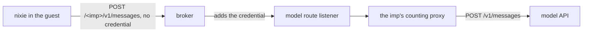

# Spike results: the counting proxy behind imp's broker

This spike sends model calls from an imp on a host that counts model spend, reads the count, and
tries other ways from the imp to the model API. It ran on the previews of nixie pull requests #834
and #858.

Each fact below ends with how the spike knows it: [measured] when the spike made the request or the
read that shows it, and [read in the code] when the spike's author read it in the source.

## Terms

- **imp**: a sandboxed microVM, as the [glossary](../../docs/glossary.md) defines it. The guest is
  the system that runs inside the imp. `impd` is the daemon on the host that runs imps, and `impz`
  is its command line tool.
- **Secret**: a credential that `impd` holds, with the hosts it is for, such as `api.anthropic.com`.
  A secret can name an upstream, an address that the broker sends the request to in place of that
  host.
- **Grant**: a secret given to one imp, with a filter on the URL paths that get the credential.
- **Broker**: imp's credential broker, which runs on the host and serves as the guest's HTTPS proxy.
  The broker adds a secret's credential to each request that one of the imp's grants covers.
- **Preview service**: a service on the host that builds a nixie pull request into a throwaway
  nixie, a preview, and runs it in an imp of its own.
- **Model route listener**: the preview service's listener on the host for model calls. It starts a
  [counting proxy](../../docs/architecture/policy/counting-proxy.md) for each preview's imp, which
  adds each reply's tokens and dollars to that imp's count.
- **Count file**: `<imp>.count.json` in the preview service's spend directory on the host, where the
  counting proxy keeps the imp's count as tokens and dollars.
- **One-line request**: a 93-byte model call with one short user message, which the `own-route`
  probe sends.
- **Worker** and **sandbox adapter**: as the [glossary](../../docs/glossary.md) defines them.

## Questions

1. **Does the broker send each model call from an imp through the counting proxy, and does the
   counting proxy count it?** If both hold, the
   [hard spending stop](../../docs/design/platform/policy/budgets.md#the-hard-spending-stop) can
   count spend on the host.
2. **Can code in the guest get a request to the model API with the credential on it, by any way that
   skips the counting proxy?** If it can, code in an imp can get past the hard stop.

## Setup

### The path of a model call

The preview service grants each preview's imp one secret for the model API's host,
`preview-model-counted` [read in the code]:

- The grant's filter covers only paths under `/<imp>/`, where `<imp>` is the imp's name, such as
  `pv-921a15b9-834`.
- The secret's upstream is the model route listener, in place of the model API.

The listener takes the imp's name from the first path segment, starts that imp's counting proxy on
its first call, and passes the call on with its headers. The counting proxy strips the name, sends
the rest to the model API, and adds the reply's usage to the count [read in the code].



A preview runs nixie with the test sandbox, the sandbox adapter of nixie's test build. In
production, the sandbox adapter starts each worker in an imp of its own. The test sandbox instead
runs the conversation and every task as a local process in the preview's nixie container [read in
the code]. Their model calls leave the guest through the broker, the same way a worker's calls leave
its own imp.

nixie writes a `model.turn_ended` record at the end of each turn, with the turn's input, output and
cache tokens [read in the code]. The spike sums them to set beside the count.

### Versions

| Component      | Pull request #834                                                       | Pull request #858                                        |
| -------------- | ----------------------------------------------------------------------- | -------------------------------------------------------- |
| imp            | 6.4.0, `impd` and `impz`                                                | 6.4.2, `impd` and `impz`                                 |
| Counting proxy | `counting-proxy-linux-x64` from nixie 0.42.0                            | `counting-proxy-linux-x64` from nixie 0.42.0             |
| nixie          | commit `3e2d0d4`, as a preview test build                               | commit `71f58e6`, then `9a4112d`, as preview test builds |
| Model          | `claude-haiku-5-5`, the preview's one model profile                     | `claude-haiku-5-5`, the preview's one model profile      |
| Count limit    | $2 for the life of the pull request                                     | $2 for the life of the pull request                      |
| Proxy upstream | `https://api.anthropic.com`                                             | `https://api.anthropic.com`                              |
| Spike script   | `run.sh` at `523a22e7`, a shell script since replaced by `run-spike.ts` | `run-spike.ts` at `71f58e6`, then at `9a4112d`           |

### Run it

[`run-spike.ts`](run-spike.ts) runs from a machine with SSH access as root to the host. It calls the
preview's API through nixie's typed client, writes each step's output to `SPIKE_WORK`, and changes
nothing on the host. It needs each of these 8 variables. `SPIKE_TOKEN` is optional, as step 2 says.

```bash
cd research/spend-proxy-imp
PREVIEW_SSH=root@<preview_host> IMP_CLI='<command that runs impz with the rights of the user that runs impd>' \
  IMP=<imp_name> ORIGIN=https://<preview_origin> COMPOSE_FILE=<compose_file_in_the_imp> \
  SPEND_DIR=<spend_directory_on_the_host> ROUTE_LISTENER=http://<listener_address> \
  SPIKE_WORK=<scratch_dir> bun run spike
```

The script does these steps:

1. It reads the imp's grants, its egress policy, and the model route in the nixie container.
2. It enrols a device with a sign-in code, or takes `SPIKE_TOKEN` from an earlier enrolment on the
   same preview. The preview's Compose stack has an `enrol` service, which prints to its log a code
   that works once.
3. It sends a plain message, then a message that asks nixie to start a task, and reads the count
   after each turn.
4. It sums the tokens of nixie's `model.turn_ended` records with
   [`read-turn-usage.ts`](read-turn-usage.ts), which runs in the nixie container.
5. It runs [`guest-probes.sh`](guest-probes.sh) in the guest, then reads the broker's audit for the
   imp.

## Results on pull request #834

### The imp

The imp held 2 grants: `gh`, for its clone of the repository, and `preview-model-counted`
[measured]. It held no other grant for the model API's host [measured]. `impz policy` printed its
egress policy as `open`, so the guest reaches the internet without the broker [measured]. The nixie
container held `NIXIE_PREVIEW_MODEL_ROUTE` set to the imp's name, and its model profile's base URL
ended with that name [measured]. The guest's environment held no model credential [measured].

### The model calls

The broker's audit lists each model call from the guest between 12:55 and 13:29 UTC on 4
November 2026. Each one got the credential from `preview-model-counted` on the path
`/<imp>/v1/messages` [measured]. The model API answered each one with a 429 and this body
[measured]:

```json
{ "type": "error", "error": { "type": "rate_limit_error", "message": "Error" } }
```

| Calls | Request size | Sender                                                                         |
| ----- | ------------ | ------------------------------------------------------------------------------ |
| 10    | 33 to 44 KB  | the conversation, one call for each of the 10 messages sent to it in that time |
| 6     | 15 KB        | the memory writer, a system task that retried at doubling gaps from 30 s       |
| 6     | 93 bytes     | the one-line request, from the `own-route` probe and by hand with curl         |

The conversation's 10 `model.turn_ended` records match its 10 calls [measured]. The memory writer's
6 `memory.writer_failed` records match its 6 calls to the second [measured]. The message that asked
nixie to start a task got the same 429, so the conversation started no task [measured].

The preview service logged `proxy.started` for the imp at 12:55:24, a second before the first call
reached the model API [measured]. The count file read `{"dollars":0,"tokens":0}` after every call,
and the `model.turn_ended` records sum to 0 tokens [measured]. A 429 reply carries no usage, and the
counting proxy adds nothing for a reply with no usage [read in the code].

### The probes

Each probe ran in the guest after the model calls, and sent no credential of its own. Each probe
went to the broker, as the guest's HTTPS proxy. The last 2 probes are the exception, and went
straight from the guest. The count stayed at `{"dollars":0,"tokens":0}` [measured].

| Probe                 | URL path, as sent                     | Answered by        | Status |
| --------------------- | ------------------------------------- | ------------------ | ------ |
| `own-route`           | `/<imp>/v1/messages`                  | the model API      | 429    |
| `unrouted`            | `/v1/messages`                        | the broker         | 403    |
| `other-route`         | `/pv-00000000-1/v1/messages`          | the broker         | 403    |
| `dot-segment`         | `/<imp>/../v1/messages`               | the broker         | 403    |
| `encoded-dot-segment` | `/<imp>/%2e%2e/v1/messages`           | the broker         | 403    |
| `encoded-slash`       | `/<imp>%2F..%2Fv1/messages`           | the broker         | 403    |
| `double-slash`        | `//v1/messages`                       | the broker         | 403    |
| `batches`             | `/<imp>/v1/messages/batches`          | the counting proxy | 403    |
| `direct-no-broker`    | `/v1/messages`, to the model API      | the model API      | 401    |
| `route-listener`      | `/<imp>/v1/messages`, to the listener | the model API      | 401    |

The broker refused each path outside `/<imp>/` with
`the grant for api.anthropic.com does not cover POST <path>`, and its audit lists each refusal with
the reason `outside-filter` [measured]. The broker resolved both dot-segment paths to `/v1/messages`
before it checked them [measured]. The counting proxy refused the batch endpoint with
`the counting proxy forwards only requests whose spend it can count` [measured]. A batch spends
after its reply, out of the count's reach [read in the code].

The last 2 probes went straight from the guest, with its HTTPS proxy turned off: one to the model
API, one to the model route listener. The model API answered both with `authentication_error`,
`x-api-key header is required`, so neither request carried a credential [measured].

## Results on pull request #858

### The imp

The imp held the same 2 grants, and its model route and base URL named the imp [measured]. `impz`
6.4.2 printed the egress policy as `public` [measured]. The spike did not check whether `public` is
the policy that 6.4.0 printed as `open`.

### The model calls

When the spike first ran here, at 05:59 UTC on 5 November 2026, on a preview of commit `71f58e6`,
the model API answered each of the conversation's 3 calls with the same 429 [measured]. The 429
carried no `retry-after` or rate limit header, so it gave no time at which the limit would end
[measured]. Each turn ended in `task.step_errored` and wrote no `model.turn_ended` record
[measured]. On pull request #834, each turn that got a 429 wrote such a record. The spike did not
look for the change between commits `3e2d0d4` and `71f58e6` that stops it.

At 06:05:43 UTC, after these 429s, the host's operator put a new credential on the secret
`preview-model-counted`, with the same hosts, upstream and grants [measured]. Why the model API gave
the old credential a 429 lies outside the spike. The preview service then rebuilt the preview at
commit `9a4112d`, with a new database, so nixie's `model.turn_ended` records cover only the turns
after the rebuild [measured]. The spike ran once more at 06:07 UTC.

From then on, the model API answered each of nixie's model calls with a 200 [measured]:

| Time (UTC)      | Calls | Request size | Sender                                                       |
| --------------- | ----- | ------------ | ------------------------------------------------------------ |
| 06:06:27        | 1     | 15 KB        | the memory writer of the `71f58e6` build, before the rebuild |
| 06:07:31 to :43 | 6     | 6 to 38 KB   | 3 conversation turns and 1 turn of the task they started     |

The script's 2 messages started the first 2 conversation turns. The second turn started the task,
and the task sent its answer to the conversation, which started the third [measured]. A turn makes
one model call per step of its agent loop. The 4 turns' records show 1, 2, 2 and 1 steps, which
makes the 6 calls [measured].

The script read the count file 4 times [measured]:

| When the script read the count                       | Tokens | Dollars     |
| ---------------------------------------------------- | ------ | ----------- |
| before its first message                             | 5222   | $0.0006647  |
| after the first conversation turn                    | 18071  | $0.00227265 |
| after the second and third turns and the task's turn | 64405  | $0.00345904 |
| after the probes                                     | 64405  | $0.00345904 |

nixie's 4 `model.turn_ended` records sum to 59183 tokens: 53964 in the conversation's 3 turns, and
5219 in the task's 1 turn [measured]. That sum and the memory writer's 5222 tokens, which the count
held before the turns, make 64405, the count's total [measured]. By kind, the 4 turns held 16 input,
482 output, 41599 cache read and 17086 cache write tokens [measured]. The preview service on the
host sets the prices that the counting proxy uses, per million tokens: $0.10 input, $0.50 output,
$0.01 cache read and $0.125 cache write [measured]. At those prices, the 4 turns cost $0.00279434,
the same as the count's rise over the turns, $0.00345904 less $0.0006647 [measured]. The memory
writer's call wrote no record, so the spike never checked its $0.0006647.

### The probes

The probes got the same answers as on pull request #834, with 2 changes [measured]:

- The `own-route` probe, the one-line request on the imp's own route, got a 429 while nixie's calls
  on the same route got 200.
- The host refused the guest's connection to the model route listener, so the `route-listener` probe
  got no HTTP answer, and curl exited 7.

The count stayed at 64405 tokens after the probes [measured]. The preview's imp was removed after
the spike ran.

## Answers

1. **The broker sends each call through the counting proxy, and the counting proxy counts each
   reply.** The broker added the credential to every model call from the preview, from the
   conversation, its task and the memory writer, and sent each one through the imp's counting proxy
   [measured]. The count's tokens equal those of nixie's turns plus the memory writer's call, and
   its rise over the turns equals the turns' tokens at the preview's prices [measured].
2. **The guest has no way to put the credential on a request that skips the counting proxy.** The
   broker adds the credential only under `/<imp>/`, and refused every other path the probes tried,
   dot segments and encoded slashes included [measured]. Under that path, the counting proxy refused
   the batch endpoint, whose spend it cannot count [measured]. The guest reaches the model API
   without the broker, but with no credential [measured]. On pull request #834, the guest reached
   the model route listener without the broker, with no credential. On pull request #858, the host
   refused that connection [measured].

## Untested

- Why the one-line request got a 429 on the route where nixie's calls got 200.
- A worker in an imp that the sandbox adapter creates, with a grant of its own. The preview runs
  nixie, its conversation and its tasks in one imp, under one grant.
- Code in the guest that brings a credential of its own. The broker never sees such a key, and the
  guest's egress reaches the model API.
- The production hard stop's own route and limits, which the
  [budgets design](../../docs/design/platform/policy/budgets.md#the-hard-spending-stop) describes.
- Methods other than `POST`, the token count and model list endpoints, and the endpoints other than
  batches that the counting proxy refuses.
